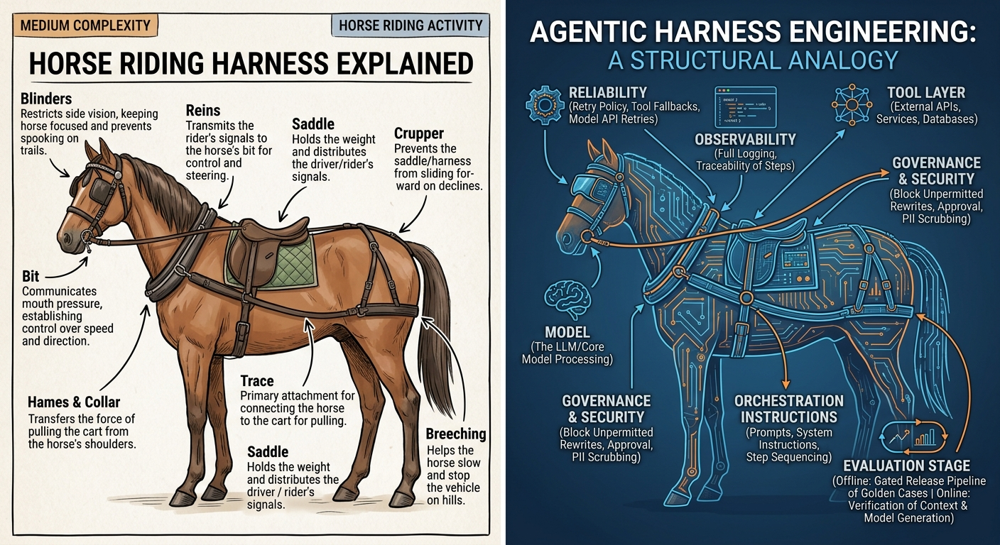

# Harness Engineering: Designing the Systems Around AI Agents



A self-study course on the systems you build around an LLM to turn it into a dependable product. A frontier model is a capability, not a system. The **harness** around it is what makes it reliable, governed and observable: how context is assembled, the tool interfaces, control flow, memory, evaluation, guardrails and telemetry. This course treats that harness as the main thing you engineer.

It is written for a working engineer who has tried LLM and agent APIs but hasn't yet built a production agent system. The reference stack is **Google ADK** at the API level, with models served through **LiteLLM** (Azure OpenAI, DeepSeek, Claude). Model training, fine-tuning and basic prompt engineering are out of scope.

## Start here

| If you want to… | Go to |
|---|---|
| See the full plan, outcomes and conventions | [syllabus.md](syllabus.md) |
| Learn from the beginning, in order | [M1 · What Is a Harness](modules/01-what-is-a-harness/README.md) → M17 |
| See every layer combined into one design | [M17 · End-to-End Harness Design](modules/17-end-to-end-design/README.md) |
| Understand why agents fail and which layer is at fault | [M2 · Model Failure Science](modules/02-model-failure-science/README.md) |
| Compare ADK with LangGraph, CrewAI, AutoGen and others | [frameworks/README.md](frameworks/README.md) |

## The course (`modules/`)

17 modules in 6 parts. Each module opens with a concrete scenario, follows three threads throughout (**failure modes**, the **tradeoff ledger**, and **ADK at a glance**), and ends with a design exercise.

| Part | # | Module | Question it answers |
|---|---|---|---|
| Foundations | M1 | [What Is a Harness](modules/01-what-is-a-harness/README.md) | What exactly is the engineering artifact we're designing? |
| | M2 | [Model Failure Science](modules/02-model-failure-science/README.md) | What does the model actually get wrong, and why? |
| | M3 | [Harness Architecture & ADK](modules/03-harness-architecture/README.md) | What are the parts of a harness, and how do we record architecture decisions? |
| Cognitive layer | M4 | [Context Engineering I: Assembly & Budgets](modules/04-context-engineering-1/README.md) | What goes into the context window, in what form, and what does it cost? |
| | M5 | [Context Engineering II: Retrieval & Grounding](modules/05-context-engineering-2/README.md) | How do the right facts get into context, and how do we know they're right? |
| | M6 | [The Instruction Layer](modules/06-instruction-layer/README.md) | How is the agent's standing policy written, versioned and tested? |
| | M7 | [Memory & State](modules/07-memory-state/README.md) | What does the agent remember, for how long, and how is it kept correct? |
| Action layer | M8 | [Tool Interfaces](modules/08-tool-interfaces/README.md) | How do we give the model a safe, correct, debuggable API to the world? |
| | M9 | [Tool Platforms: MCP](modules/09-tool-platforms-mcp/README.md) | How do tools become a platform that is discovered, versioned and governed? |
| | M10 | [Orchestration I: Control Flow](modules/10-orchestration-1/README.md) | How much autonomy should this agent have, and how is that encoded? |
| | M11 | [Orchestration II: Multi-Agent](modules/11-orchestration-2/README.md) | When is one agent not enough, and when do more agents just add failure modes? |
| Verification layer | M12 | [Evaluation Harnesses](modules/12-evaluation/README.md) | How do we know the harness works, and keep knowing it? |
| | M13 | [Reliability Engineering](modules/13-reliability/README.md) | How does an agent degrade gracefully instead of failing hard? |
| Governance layer | M14 | [Security & Injection Defense](modules/14-security-injection/README.md) | How do we stop the environment from turning the model against us? |
| | M15 | [Guardrails, Safety & Governance](modules/15-guardrails-governance/README.md) | Who decides what the agent may do, and how is that enforced and audited? |
| Operational layer | M16 | [Observability & LLMOps](modules/16-observability-llmops/README.md) | When a run goes wrong, can you reconstruct exactly what happened? |
| Synthesis | M17 | [End-to-End Harness Design](modules/17-end-to-end-design/README.md) | How do all the layers fit into one coherent, defensible design? |

## Beyond the modules

- **[discussions/](discussions/)**: three deep-dives that grew out of questions while writing the course: telling derivable claims from interpretive ones when attributing failures, whether injecting memory into a cached prefix breaks prompt caching, and whether MCP tool definitions sit inside the cached prefix.
- **[frameworks/](frameworks/README.md)**: 17 open-source agent frameworks, each checked for licence and source, and mapped to the modules its components cover (and the ones they don't).
- **[ADK-conventions/](ADK-conventions/README.md)**: practical ADK rules, starting with the right way to update session state.
- **`mindmaps/`**: an interactive revision atlas, currently covering M4. Open `mindmaps/index.html` in a browser after cloning.
- **Code examples**: runnable ADK agents in [M1](modules/01-what-is-a-harness/code/) and an instruction-layer experiment in [M6](modules/06-instruction-layer/code/).

## Honest caveats

- All 17 modules are written, but they are a **first draft** that hasn't had a full review pass yet.
- There is no lab infrastructure. Exercises are design exercises done on paper, and code appears only where it illustrates a concept.
- ADK-specific claims were checked against the official ADK docs when written. ADK changes quickly, so check an API against the current docs before relying on it.
- The PDFs in `downloaded-papers/` folders are third-party research papers, kept for reference. Their copyright belongs to their authors and publishers.

## Layout

```
syllabus.md              course blueprint: outcomes, module map, conventions, decisions
modules/01..17/          the course, one README per module, plus supporting notes,
                         code examples and reference papers where a module has them
discussions/             deep-dives on questions raised while writing
frameworks/              open-source agent frameworks mapped to modules
ADK-conventions/         ADK usage rules
mindmaps/                interactive revision atlas (index.html)
```
