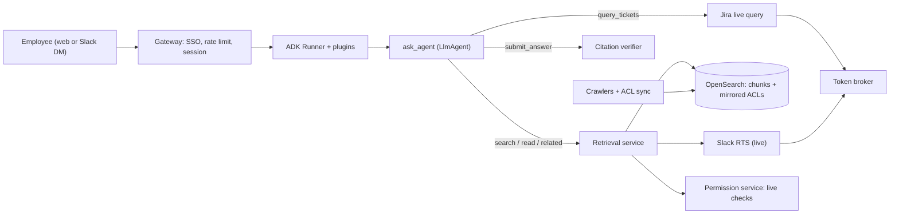
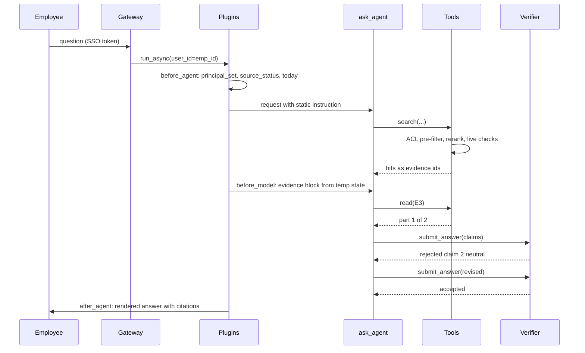

# Ask: a permission-aware enterprise search agent

An internal assistant that answers employees' plain-language questions from the company's Google Drive, Confluence, Jira, GitHub and Slack. It cites every claim, never shows or hints at content the asker may not see, and says "I don't know" when the evidence does not support an answer. One **search agent** does the reasoning; everything that decides *who may see what* and *whether a claim is supported* is deterministic harness code around it.

This document is the agent side: what the agent does, its tools, its state, and how it reaches the sources. The harness around it (index, verification, evals, security, operations) is in [harness-architecture.md](harness-architecture.md).

## Contents

- [Overview](#overview)
- [Assumptions](#assumptions)
- [Architecture at a glance](#architecture-at-a-glance)
- [Where the knowledge lives: indexed versus federated](#where-the-knowledge-lives-indexed-versus-federated)
- [Agents](#agents)
  - [Search agent](#search-agent)
  - [What is deliberately not an agent](#what-is-deliberately-not-an-agent)
- [The turn, end to end](#the-turn-end-to-end)
- [Composition: why one agent](#composition-why-one-agent)
- [Does the VFS flat orchestrator fit?](#does-the-vfs-flat-orchestrator-fit)
- [Existing MCP servers](#existing-mcp-servers)
- [Identity, OAuth and permission checks](#identity-oauth-and-permission-checks)
- [Session state](#session-state)
  - [How state works in ADK](#how-state-works-in-adk)
  - [All state variables at a glance](#all-state-variables-at-a-glance)
  - [State considered and rejected](#state-considered-and-rejected)
  - [Tensions to resolve](#tensions-to-resolve)
- [Other ADK machinery](#other-adk-machinery)
- [A2A](#a2a)
- [Skills](#skills)
- [Closed decisions](#closed-decisions)
- [Open decisions](#open-decisions)
- [Appendix](#appendix)

---

## Overview

- **Goal:** answer "how do I…", "what is…", "where is…", "what did we decide about…" questions across five sources, with a citation on every factual claim, and abstain when the evidence does not carry the answer.
- **The core systems problem, with the AI framing stripped off:** this is an authorization problem on a search engine. An LLM on top makes it worse in two ways: it can paraphrase content the user may not see into an answer, and it can invent content that no document says. The design therefore puts two hard gates in code: **nothing enters the model's context unless the asker may read it now**, and **nothing leaves as a claim unless a cited passage supports it**.
- **One agent, five model-facing tools.** The agent plans queries, reads, and drafts. Permission filtering, evidence assembly and citation verification are code. See [Composition: why one agent](#composition-why-one-agent).
- **Hybrid reach:** four sources are crawled into one ACL-mirrored index; Slack is queried live (its terms forbid bulk indexing), and structured Jira questions ("how many open P1s in PAY") go live to Jira with the user's own token. See [Where the knowledge lives](#where-the-knowledge-lives-indexed-versus-federated).
- **Late-binding authorization:** the index's mirrored ACLs pre-filter candidates; every passage is then re-checked against the source, for this user, before it enters the context. Both must allow.
- **Citations are managed by the harness:** tools return evidence ids (`E7`) that the harness issued. The model can only cite ids that exist, so a phantom citation cannot be produced, and the final answer is a structured object that a verifier checks before anything is shown.
- **Tool conventions** (the ops-desk conventions, adapted):
  - Arguments are flat and typed; there are no free-form filter dicts and no raw query languages (no JQL, no Lucene syntax from the model).
  - Fixed sets are enums, with each value's meaning in the tool description.
  - Every hit the model sees is addressed by an evidence id; ids are found only through `search`, `related` or `query_tickets`, never typed by the model from memory.
  - List results are one page (8 hits) and always report the total and the coverage band, so the model never mistakes a page for the whole.
  - Facts the system cannot know (which of two "Atlas" projects the user means) are never guessed: the agent answers with `needs_clarification` through `submit_answer`.
  - Tool errors are structured: `status` is `ok`, `partial` (some sources failed), `error` with `retryable`, or `needs_consent`. A source that failed is named, never silently dropped.
- **Evidence tags** on ADK claims: **Code** cites a file under `ADK/` (google-adk 2.13.0 source, `src/google/adk`), **Docs** an adk.dev page, **Unverified** a plausible claim not checked.

## Assumptions

Nobody will answer clarifying questions, so these are the numbers the design is sized against.

| Dimension | Assumption |
|---|---|
| Company | One company, single tenant, 12,000 employees, mostly one region (US), some EU staff |
| Identity | Okta (OIDC/SAML) as IdP, SCIM to all five sources; every employee has a stable `emp_id` and one corporate email |
| Sources | Google Drive (≈8M files, ≈2M indexable docs/sheets/slides/PDFs), Confluence Cloud (≈1.5M pages, 900 spaces), Jira Cloud (≈4M issues, 600 projects), GitHub Enterprise Cloud (≈6k repos; READMEs, `docs/`, issues, PRs, not code), Slack Enterprise Grid (≈40k channels) |
| Indexed corpus | ≈7.5M items → ≈40M chunks after chunking; ≈6 GB/day of changes |
| Load | 30% daily active, ~5 questions each → ≈18k questions/day; peak 3 q/s, design for 10 q/s |
| Latency SLO | first progress event < 1 s; verified answer p50 ≤ 6 s, p95 ≤ 12 s; hard timeout 25 s |
| Cost | target ≤ $0.10 per answered question at p50, hard cap $0.40 (≈$50k/month at the target) |
| Permission freshness | an ACL change at the source is respected **at answer time immediately** (live check); the mirrored index converges within p95 10 min for webhook sources, 24 h worst case |
| Models | via LiteLLM to Azure OpenAI (course stack, no Gemini assumption): a GPT-4.1-class pinned deployment for the agent, a mini-class model for verification |
| Out of scope (v1) | code search, people directory, writing anything back to any source, voice |

## Architecture at a glance

| Component | Kind | What it does | Sees user content? |
|---|---|---|---|
| **Search agent** (`ask_agent`) | ADK `LlmAgent`, the only LLM agent | Plans queries, reads passages, drafts a structured cited answer or abstains | Only evidence the user may read |
| Retrieval service | Code (behind the `search` tool) | Hybrid BM25 + dense search in OpenSearch, ACL pre-filter, rerank, fan-out to Slack | Yes |
| Permission service | Code | Expands the user's principals (groups, roles, teams); live per-document checks at the source | Metadata only |
| Token broker | Code, implements ADK `BaseCredentialService` | Holds per-user OAuth refresh tokens (Slack, Atlassian) and mints short-lived access tokens | No |
| Citation verifier | Code, calls a judge model | Checks every claim of the drafted answer against its cited passages | Yes |
| Renderer | Code (`after_agent_callback`) | Turns the accepted structured answer into text with numbered citations and an allowlisted link set | Yes |
| Ingestion and ACL sync | Code, outside ADK | Crawls four sources with service identities, chunks, embeds, mirrors ACLs | Yes |



## Where the knowledge lives: indexed versus federated

The first decision a reviewer will push on. Three options were weighed per source:

1. **Federated only:** every question fans out to each source's own search (or its vendor MCP server) with the user's token. The source enforces permissions, so nothing is mirrored.
2. **Index only:** crawl everything with service identities, mirror ACLs, answer from the index.
3. **Hybrid:** index where allowed and where ranking quality matters; query live where the source forbids indexing or the question is structured.

**Decision: hybrid, per source.**

| Source | Mode | Why |
|---|---|---|
| Google Drive | Indexed, ACL-mirrored | Drive search is filename/keyword oriented and ranks per source; a cross-source reranker needs passages, not file hits. The Drive MCP server is still a Developer Preview. |
| Confluence | Indexed, ACL-mirrored | Same ranking argument; page trees and labels give good structure for chunking |
| Jira (text) | Indexed, ACL-mirrored | Issue descriptions and comments answer "why did we…" questions; JQL text search is weak |
| Jira (structured) | **Federated**, user OAuth | Counts, statuses and assignees are computed facts that change by the minute; the source is the only correct place to compute them (M5: retrieval is for stated facts, tools for computed ones) |
| GitHub | Indexed, ACL-mirrored | READMEs, `docs/`, ADRs in repos, issues and PRs |
| Slack | **Federated**, user OAuth | Slack's 2025 API terms prohibit bulk indexing and long-term storage of API data by non-Slack apps and steer partners to the Real-time Search (RTS) API and Slack's MCP server ([Slack changelog, 2025-05-29](https://docs.slack.dev/changelog/2025/05/29/rate-limit-changes-for-non-marketplace-apps); [Glean's account of the change](https://docs.glean.com/connectors/native/slack/about/slack-connector-changes)). Indexing Slack is not a design option, it is a contract breach. |

Why not federated everywhere, given that it makes permissions trivially correct:

- **Latency:** five live searches in parallel are bounded by the slowest; vendor search APIs run 400 ms to 2 s, and Slack's search methods have special (low) rate limits.
- **Ranking:** each source returns its own top-k by its own lexical score. Merging five differently scored lists without passages is guesswork; a cross-encoder reranker over passages is where answer quality comes from.
- **Recall:** most sources' search is keyword-only. "How do we rotate the payments signing key" fails against a page titled "PSK rotation runbook".
- **Rate limits at 10 q/s × 5 sources** would hit vendor quotas that are shared with every other integration in the company.

Why not index everything: Slack's terms, and computed Jira facts go stale in the index the moment they are written.

The price of indexing is that **mirrored ACLs are stale by construction**. That is why the index is never the final word on permissions: see [Identity, OAuth and permission checks](#identity-oauth-and-permission-checks) and ADR-002/003.

## Agents

### Search agent

- **Purpose**
  - Turn a question into one to four searches, read the passages that matter, and draft a structured answer in which every claim names the evidence ids that support it.
  - Abstain, partially answer, or ask one clarifying question when the evidence does not carry the full answer.
  - Answer follow-ups ("where does it say that?", "what about for contractors?") from the evidence ledger without re-deriving context from prose.
- **Model:** `LiteLlm(model="azure/gpt-4.1-ask-prod")`, a pinned Azure deployment; temperature 0.1. **Code:** `LiteLlm` in `ADK/models/lite_llm.py:3912`.
- **Loop:** ADK's normal tool loop on an `LlmAgent` in the default chat mode at the root. Plan → `search` → (optional `read` / `related` / `query_tickets`) → `submit_answer`. The loop has three stops the model does not vote on:
  1. **Done:** `submit_answer` is accepted by the verifier. The tool sets `skip_summarization`, so that function response is the final event of the turn (**Code:** `ADK/events/event.py:295`, `is_final_response`), and the renderer replaces it with the user-facing text (`after_agent_callback`, **Code:** `ADK/plugins/base_plugin.py:217`).
  2. **Budget:** at most 4 `search`, 6 `read`/`related`, 2 `query_tickets` and 1 rejected `submit_answer` per turn, enforced in a `before_tool_callback` that returns a structured refusal instead of running the tool (**Code:** a returned dict skips the tool, `ADK/plugins/base_plugin.py:297-320`). Plus `RunConfig(max_llm_calls=8)` as the outer tripwire (**Code:** `ADK/agents/run_config.py:271`; the default is 500, `:38`, which is far too loose here).
  3. **Fail-closed end:** if the agent ends the turn without an accepted `submit_answer` (it wrote prose instead, or ran out of budget), the renderer emits the standard abstention, never the model's prose.
- **Instruction** (static, cached; the full layering is in the harness doc, M6):
  - Answer only from text inside `<retrieved_evidence>`. Cite evidence ids on every factual claim.
  - Prefer the newest authoritative source; when two passages disagree, say so and cite both, or ask.
  - Use `query_tickets` for anything that is a count, a status or a list of tickets; never estimate a number from passages.
  - If evidence is missing, call `submit_answer` with `abstained`. Do not speculate about documents you cannot see; there is no such thing as "a document you can't access" in your world.
  - You cannot change anything in any system. If asked to, say so and suggest who or where.
- **Tools**
  - `search(query, sources=None, since=None, until=None, content_type=None, author=None)` — hybrid search over the index plus live Slack, filtered to what this user may read.
    - `query`: the model's rewritten query, ≤ 200 characters. One search per distinct sub-question.
    - `sources`: list of `drive` (Google Docs, Sheets, Slides, PDFs), `confluence` (wiki pages and blog posts), `jira` (issue text and comments, not live status), `slack` (messages and threads, live), `github` (READMEs, `docs/`, issues, PRs). Omitted means all five.
    - `since` / `until`: ISO dates; `since` inclusive, `until` exclusive. The dynamic instruction carries today's date, so "last quarter" is resolved by the model into dates.
    - `content_type`: `doc`, `page`, `ticket`, `message`, `pull_request`, `readme`. Optional.
    - `author`: an email address only; a name comes back as `needs_clarification` with candidates from the directory.
    - Returns one page of up to 8 hits: `{id: "E7", source, title, location, author, updated_at, score_band: high|medium|low}`, plus `total_candidates`, `coverage` (`strong`, `weak` or `none`, computed in code from rerank scores, see the harness doc, M5), and `sources_unavailable` (`[{source: "slack", reason: "not_connected"}]`).
    - **The passage text is not in the tool response.** It goes into turn-scoped state and the harness writes it into the request as an evidence block ([`evidence_text`](#state-evidence_text)). The model reads it there, inside a boundary the harness drew.
    - **State:** reads [`principal_set`](#state-principal_set), [`source_status`](#state-source_status), [`retrieval_budget`](#state-retrieval_budget); writes [`evidence_ledger`](#state-evidence_ledger), [`evidence_text`](#state-evidence_text), [`last_search`](#state-last_search), [`turn_usage`](#state-turn_usage).
      - <a id="state-last_search"></a>**State variable `last_search`** (written by tools while the conversation runs)
        - **What it is for:** the exact arguments and result ids of the last search: `{query, sources, since, until, content_type, author, shown_ids}`, so a refinement is the same call with one field changed.
        - **Written by:** `search`. **Read by:** the agent's instruction (`{last_search?}`).
        - **Chat example:**
          ```text
          User:   What's our policy on expensing home-office equipment?
          Agent:  Up to $500 every two years, with manager approval [1]. ...
          User:   Only look in Confluence, and only things updated this year.
                  (same query; sources=[confluence], since=2026-01-01)
          User:   What did the third one say?
                  (E-id taken from shown_ids[2])
          ```
        - **Why state:** the refinement keeps the exact query the user saw results for, instead of the model re-deriving it from its own earlier prose; "the third one" means the order shown, not a re-ranked order.
        - **Risk:** it describes what was shown, not what is true now; `read` re-checks permission and version on every use.
  - `read(evidence_id, part=None)` — the full section around a hit, about 1,200 tokens per part.
    - `part` pages through a long section (`part=2` of `n`); the response says `part i of n`.
    - Re-checks this user's access live at the source before returning anything; a hit that fails the check comes back as `not_found`, the same shape as a deleted document (no existence leak).
    - **State:** reads [`evidence_ledger`](#state-evidence_ledger); writes [`evidence_text`](#state-evidence_text), [`evidence_ledger`](#state-evidence_ledger), [`turn_usage`](#state-turn_usage).
  - `related(evidence_id, relation)` — walk one step from a hit, returning new evidence ids.
    - `relation`: `parent` (Confluence parent page, Drive folder's index doc), `children` (Confluence child pages), `linked` (Jira issue links, PR ↔ issue), `thread` (a Slack thread's replies), `comments` (Jira or PR comments), `newer_version` (a newer page in the same tree with the same title stem, used when a hit looks stale).
    - This is the VFS-style drill-down; see [Does the VFS flat orchestrator fit?](#does-the-vfs-flat-orchestrator-fit).
    - **State:** same as `read`.
  - `query_tickets(project=None, status=None, assignee=None, priority=None, issue_type=None, updated_since=None, text=None, count_only=False)` — a live, structured Jira query run **with the user's own Atlassian token**, so Jira enforces permissions itself.
    - Enums: `status` is `open` (any not-done category), `in_progress`, `done`; `priority` is `p0`…`p4` mapped per project in code; `issue_type` is `bug`, `task`, `story`, `incident`, `epic`.
    - `assignee` is an email or `me`. `project` is a project key; a name comes back as `needs_clarification` with matching keys.
    - The tool builds JQL in code from these fields. The model never writes JQL, which closes JQL injection and keeps the arguments checkable.
    - Returns `{total, issues: [up to 10 as evidence ids with key, summary, status, assignee, updated]}`. `total` is the computed fact the answer cites.
    - If the user has not connected Atlassian, returns `{status: "needs_consent", source: "atlassian"}` and the UI shows a connect button; the model tells the user that live ticket queries need the connection.
    - **State:** reads [`source_status`](#state-source_status); writes [`evidence_ledger`](#state-evidence_ledger), [`evidence_text`](#state-evidence_text), [`turn_usage`](#state-turn_usage).
  - `submit_answer(status, claims=None, uncovered=None, clarification=None, abstain_reason=None)` — the only way to finish a turn.
    - `status`: `answered` (every part of the question is covered), `partial` (some parts covered, `uncovered` lists the rest in plain words), `abstained` (nothing usable), `needs_clarification` (one question in `clarification`).
    - `claims`: up to 12 `{text, evidence_ids}`; each `text` is one atomic, user-facing sentence.
    - `abstain_reason`: `no_evidence`, `conflicting_evidence`, `out_of_scope` (asks for an action or for something none of the sources hold), `stale_only` (only outdated material found).
    - Runs the verification gate synchronously (harness doc, M5 and M12): unknown ids are rejected outright; each claim is checked against its cited passages; on any `contradict` or `neutral` claim it returns `{status: "rejected", failures: [{claim_index, verdict, hint}]}` once, and the model may revise. A second failure drops the unsupported claims and downgrades the answer to `partial` or `abstained` in code.
    - **State:** reads [`evidence_ledger`](#state-evidence_ledger), [`evidence_text`](#state-evidence_text), [`turn_usage`](#state-turn_usage); writes [`last_answer`](#state-last_answer).
- **Does not**
  - Write to, comment on, or act in any source. There are no write tools, and the vendor MCP servers are filtered to read-only tools (see [Existing MCP servers](#existing-mcp-servers)).
  - See tokens, group lists, ACLs, or any document it was not cleared to see.
  - Fetch arbitrary URLs. There is no web tool; a URL inside a document is just text.
  - Remember anything across sessions.
- **Rules**
  - "Nothing found" and "nothing you're allowed to see" produce **the same words**: "I couldn't find anything you have access to that answers this." The model cannot distinguish them, because filtered documents never reach it, and the template is fixed in the renderer.
  - Counts, statuses, and lists of tickets come from `query_tickets`; a number in a passage is cited as "as of" its date.
  - Answers older than 18 months by their newest cited passage get an "as of" stamp and a staleness note in the renderer.
- **State**
  - <a id="state-retrieval_budget"></a>**State variable `retrieval_budget`** (config-time: set when the session is created; the model never writes it)
    - **What it is for:** the per-turn ceilings `{max_search: 4, max_read: 6, max_tickets: 2, max_revisions: 1, max_evidence_tokens: 10000}`.
    - **Written by:** session setup in the gateway (`create_session(state=...)`). **Read by:** the budget `before_tool_callback` and `submit_answer`.
    - **Chat example:**
      ```text
      User:   Compare every team's on-call policy.
      Agent:  I found on-call policies for 6 of the 41 teams before reaching my search
              limit for one question. Here's what those six say ... Ask about a specific
              team for more.                                    (budget hit → partial)
      ```
    - **Why state:** it differs per session in tests (an eval sets `max_search: 1` to exercise the budget path) and per surface (Slack DMs get a tighter budget than the web app) without code changes.
    - **Risk:** it is a safety limit. Only the gateway writes it; no tool or callback that the model can reach writes this key. A test asserts that.

### What is deliberately not an agent

| Candidate | What it is instead | Why |
|---|---|---|
| A per-source specialist (Confluence agent, Slack agent, …) | A branch inside the `search` tool's code | The sources share one vocabulary (documents and passages) and one policy (permissions, citations). The V6 lesson from the VFS notes applies directly: per-source LLM sub-agents add two serial LLM calls per hop and lose context at each handoff. |
| A query planner / rewriter agent | The search agent itself | Rewriting is the agent's main judgement; splitting it off would serialize a hop and hide the user's words from the planner |
| A verifier agent (M11 "debate") | `verify_claims()`, a function that calls a judge model per claim | Verification here is classification of `(claim, passage)` pairs, not a loop. It needs no tools, no history and no autonomy. |
| A summarizer for long documents | `read` paging plus the evidence token budget | Summaries of documents are claims without citations to the passage |
| A permission agent | The permission service | Authorization is never a judgement call |

## The turn, end to end



Worked trace:

```text
User:   Can contractors get access to the prod Kafka cluster?

search(query="contractor access production Kafka cluster", sources=None)
  → E1 confluence "Kafka access policy" (Platform, 2026-07-02, high)
    E2 jira PLAT-4412 "Contractor prod access exception process" (2026-03-18, medium)
    E3 slack #platform-help thread (2026-09-30, medium)
    coverage=strong, sources_unavailable=[]
read(E1)  → part 1 of 1 (section "Who may request access")
submit_answer(status=answered, claims=[
  {text: "Contractors cannot be granted standing access to production Kafka.", ids: [E1]},
  {text: "They can get time-boxed access of up to 72 hours through a PLAT exception ticket approved by the platform lead.", ids: [E1, E2]},
  {text: "Platform said on 30 Sep that the exception form moved to the Access portal.", ids: [E3]}])
  → rejected: claim 2 "72 hours" neutral against E1 and E2 (E1 says "up to 3 business days")
submit_answer(... claim 2 revised to "up to 3 business days" ...) → accepted

Agent:  Contractors can't get standing access to production Kafka [1]. They can get
        time-boxed access for up to 3 business days through a PLAT exception ticket
        approved by the platform lead [1][2]. As of 30 Sep, the exception form lives in
        the Access portal [3].
        [1] Kafka access policy, Confluence, updated 2 Jul 2026
        [2] PLAT-4412, Jira   [3] #platform-help, Slack, 30 Sep 2026
```

## Composition: why one agent

ADK offers five ways to compose, and each changes who sees history, how state flows, and what it costs. Verified mechanics:

| Option | History the callee sees | State | Control flow | Cost for this system |
|---|---|---|---|---|
| `sub_agents` with transfer (chat mode) | The whole shared session | One shared session state | The callee takes over the conversation until it transfers back | Transfer adds an LLM turn; specialists here would share 90% of instructions |
| `AgentTool` | None: a fresh `InMemorySessionService` session per call (**Code:** `ADK/tools/agent_tool.py:270-317`) | Parent state copied in (minus `_adk*` keys), deltas forwarded back (**Code:** `:309-317`, `:391-393`); the parent's credential service is passed through (`:276`) | The parent gets a result and continues | +2 LLM calls per call, serial |
| `sub_agents` with `mode="task"` / `"single_turn"` | Only its own events under an `isolation_scope` equal to the delegating function-call id, plus that call's arguments rebuilt as its first user turn (**Code:** `ADK/flows/llm_flows/context/_contents.py:294-396`) | Same session, so same state (**Unverified** that every write path is visible to the parent mid-turn) | `task` may ask the user, then returns via `finish_task`; `single_turn` returns without user replies (**Code:** `ADK/utils/_agent_mode.py:24-66`, `ADK/agents/llm/task/`) | +1 to 2 LLM calls per delegation |
| Workflow agents (Sequential / Parallel / Loop) or an ADK 2 workflow graph | Per node | Shared | Code decides the flow | No LLM routing cost, but the flow here is not fixed |
| **One flat `LlmAgent` with tools** | Whole session | Shared | The model loops; code bounds it | **3 LLM calls on a typical turn** |

**Decision: one flat agent.** Running M11's honest test, none of the four payoffs is present:

- **Context isolation:** the sub-tasks (search, read, draft) all need the same question and the same evidence. Isolating them is exactly the context loss that hurts.
- **Independent verification:** wanted, and present, but as a deterministic gate with a judge model, not an agent. It sees only `(claim, passage)` pairs, which is stronger independence than a verifier agent that reads the whole transcript.
- **Specialization:** one model, one instruction, one tool vocabulary.
- **Parallelism:** the fan-out across sources happens inside `search` with `asyncio.gather`, in code, at zero LLM cost.

What would change the decision: if a "research mode" (questions needing 20+ documents, e.g. "summarize every postmortem about Kafka this year") is added, a `single_turn` sub-agent per document batch earns its place through context isolation and parallelism. That is ADR-001's revisit trigger.

## Does the VFS flat orchestrator fit?

The VFS design (one flat orchestrator; `ws_ls`, `ws_cat`, `ws_search`, `ws_grep` over a virtual tree of workspace entities; deterministic tools; compact tables) replaced eight LLM sub-agents with code, and its lessons transfer. Its **filesystem metaphor** transfers only partly.

**What carries over, adopted:**

- **One flat agent, deterministic tools, no LLM inside any tool.** The case against per-source sub-agents is the same as V6 → V11: fewer serial LLM calls and no context lost in handoffs.
- **Canonical addresses that drop straight into the next tool.** `search` returns `E7`, and `read(E7)` / `related(E7, "thread")` work on it, the way `ws_search` returns paths that drop into `ws_cat`.
- **Routing in code, not prose.** "If the SLX search is empty, try task search, then resources" became code paths with unit tests in VFS; here, "if Slack is not connected, search the rest and say so", "keyword → dense → rerank", and "fall back from Drive's index to live fetch" are code paths with tests, not instruction paragraphs.
- **Compact, tabular tool output** with totals ("showing 8 of 143").

**What does not carry over, rejected:**

- **Browsing is not how people find documents here.** A workspace has hundreds of SLXs under a resource tree the agent can reason about. A company has 7.5M items under folder trees that nobody organizes consistently; `ls /drive/` is meaningless and `ls /confluence/ENG/` returns 9,000 pages. The primary access pattern is semantic search, and the tree is secondary.
- **Listing is an enumeration oracle.** In VFS every listed entity is visible to the user. Here, a directory listing must be ACL-filtered per entry and must not reveal counts of hidden children ("12 pages, 3 restricted" is a leak). A `search` tool that only ever returns permitted hits has a smaller attack surface than a tree with holes.
- **`ws_grep` (substring over every entity) does not exist at 40M chunks** without an index; it would just be `search` with worse ranking.
- **Paths are unstable across sources.** Drive files live in several folders at once, Confluence pages move between spaces, Slack threads have no path. An evidence id that resolves to `(source, native_id, version, span)` is stable; a path is not.

**Where the tree does fit:** one step of structure from a known hit (parent page, child pages, linked issues, thread replies). That is `related(evidence_id, relation)`: a `ws_ls` on one node, with no root listing. ADR-006 records this.

## Existing MCP servers

Vendor-maintained remote MCP servers exist for every source here, and they all authenticate as the end user, which matches on-behalf-of access. Verified by web search on 2026-10-26:

| Source | Server | Endpoint / transport | Auth | Status | Use here |
|---|---|---|---|---|---|
| Jira, Confluence | [Atlassian Rovo MCP server](https://support.atlassian.com/atlassian-rovo-mcp-server/docs/getting-started-with-the-atlassian-remote-mcp-server/) | `https://mcp.atlassian.com/v2/mcp`, HTTP | OAuth 2.1 as the user; API-token option configured by admins | GA; v1 tools migrate to v2 on 2027-03-01 | **Yes:** backs `query_tickets` (JQL search tool) and the live-fetch fallback for Confluence pages |
| Slack | [Slack MCP server](https://docs.slack.dev/ai/slack-mcp-server/) + [Real-time Search API](https://docs.slack.dev/changelog/2026/02/17/slack-mcp) | `https://mcp.slack.com/mcp`, Streamable HTTP; no SSE, no dynamic client registration | Confidential OAuth with a registered internal app; user token scopes `search:read.public/.private/.im/.mpim`, `channels:history`, … | GA (announced 2026-02-17) | **Yes:** Slack search and thread reads inside `search` / `related` |
| GitHub | [GitHub MCP server (remote)](https://github.com/github/github-mcp-server/blob/main/docs/remote-server.md) | `https://api.githubcopilot.com/mcp/`, HTTP; `/readonly` path or `X-MCP-Readonly: true`; `X-MCP-Toolsets: repos,issues,pull_requests` | OAuth or PAT | GA | **Fallback only:** live fetch of a file or issue when the index copy fails its version check |
| Google Drive | [Drive MCP server](https://developers.google.com/workspace/drive/api/reference/mcp) (`search_files`, `read_file_content`, `get_file_metadata`, `get_file_permissions`, …) | `https://drivemcp.googleapis.com/mcp/v1` | OAuth as the user, Cloud project required | **Developer Preview** | **Not in v1.** Revisit at GA; the crawler uses the Drive API directly |
| SharePoint / OneDrive | [Work IQ MCP servers](https://learn.microsoft.com/en-us/microsoft-365-copilot/extensibility/work-iq/mcp/overview) | per-workload remote servers; a unified server announced | Entra; **requires a Microsoft 365 Copilot licence** | Preview | Not a source today; noted for the day the company adds M365 |
| Notion | [Notion MCP](https://developers.notion.com/guides/mcp/get-started-with-mcp) | `https://mcp.notion.com/mcp`, Streamable HTTP | OAuth as the user | GA | Not a source today |

**Why use them at all, rather than each REST API:** for Slack the RTS-backed MCP server is the sanctioned path, and it gets the granular search scopes right; for Atlassian it saves building OAuth 2.1 plus a JQL client, and it enforces Jira's own issue-security levels for the user. For indexed sources, crawling with service identities against the REST APIs remains the right tool (MCP servers act as one user; a crawler needs a service view of everything plus the ACLs).

**How they plug into ADK, and why not as toolsets on the agent.** ADK's `McpToolset` takes `connection_params` (`StreamableHTTPConnectionParams(url, headers, timeout, sse_read_timeout)`, `SseConnectionParams`, or `StdioConnectionParams`), plus `tool_filter` (a list of names or a predicate), `tool_name_prefix`, `auth_scheme`/`auth_credential`/`credential_key`, `header_provider` (a callable on `ReadonlyContext` returning headers), `require_confirmation`, and `tool_list_cache_ttl_seconds` (**Code:** `ADK/tools/mcp_tool/mcp_toolset.py:150-237`; connection params in `ADK/tools/mcp_tool/mcp_session_manager.py:299-530`). Attaching three vendor toolsets directly to the agent was rejected:

1. **A missing credential stops the whole turn.** For a toolset with an `auth_scheme`, ADK resolves auth before tools are listed; if any toolset has no credential, it yields an auth request and sets `end_invocation = True` (**Code:** `ADK/flows/llm_flows/tools/_toolset_auth.py:29-111`). An employee who never connected Slack could not ask anything at all.
2. **The model would see vendor tools** (Slack's server alone exposes send, schedule, canvases, lists). `tool_filter` can prune them, but each vendor tool also returns raw content that bypasses the evidence ledger, the live permission check and the evidence boundary.
3. **Results must become evidence ids** with versions and spans, and Slack text must not be persisted (see [`evidence_text`](#state-evidence_text)).

So each vendor server is an `McpToolset` instance **owned by the source gateway code**, not by the agent: `StreamableHTTPConnectionParams(url=..., timeout=8)`, a `tool_filter` allowlist of read tools only (Slack: search messages, read thread; Atlassian: JQL search, get issue, get page; GitHub: the `/readonly` URL plus `X-MCP-Toolsets: repos,issues,pull_requests`), no `auth_scheme`, and a `header_provider` that asks the token broker for this user's short-lived access token. ADK pools MCP sessions per distinct header set, so each user gets their own session (**Code:** `mcp_toolset.py:106`, `:197-201`). The tools call the selected MCP tool from inside `search`, `related` or `query_tickets`. **Unverified:** that invoking an `McpTool.run_async` from inside another function tool with the outer `ToolContext` behaves cleanly; the fallback is the MCP Python SDK's streamable-HTTP `ClientSession`, which ADK's session manager wraps anyway.

What is still wrapped or restricted on top of the vendor servers: the read-only allowlist; argument construction in code (the model never passes raw strings to a vendor tool); result size caps (Slack: 20 messages, 300 characters each, before rerank); a per-user rate limit below the vendor's tier so one user's loop cannot exhaust the company's quota; and every result treated as untrusted data (harness doc, M14).

## Identity, OAuth and permission checks

**Principal:** the employee, always. There is no "agent identity" that can read more than the asker. Two identities are involved, for different jobs:

| Job | Identity | Mechanism |
|---|---|---|
| Crawl and mirror ACLs (offline) | Service identities: Google service account with domain-wide delegation (read-only Drive scopes), Atlassian admin app, GitHub App installation, none for Slack | Ingestion pipeline, outside ADK |
| Live permission check for indexed hits (online) | Service identity **naming the user** | Drive: domain-wide delegation impersonating the user, `files.get(fields=id,version)`; Confluence: `POST /wiki/rest/api/content/{id}/permission/check` with the user's accountId and `read` (needs Confluence admin, [Atlassian docs](https://developer.atlassian.com/cloud/confluence/rest/v1/api-group-content-permissions/)); Jira: bulk permission check for the user on the issue's project and security level (**Unverified** exact endpoint shape); GitHub: repo collaborator permission for the user's login |
| Federated live queries (online) | The **user's own OAuth token** | Slack (RTS/MCP user token), Atlassian MCP (OAuth 2.1) for `query_tickets` |

Why a service identity naming the user for the checks, instead of per-user OAuth everywhere: per-user OAuth would make every employee click through four consent screens before the product works, and a missing consent would silently shrink their results. The permission-check APIs answer exactly the question needed ("may emp 4411 read page 9921?") with an admin credential the company already controls. Per-user OAuth is used only where the source offers no other sanctioned path (Slack) or where the source must compute a live answer as the user (Jira queries).

**The flow for a user-token source (Slack):**

1. **Connect once.** In the web app's settings, "Connect Slack" starts a confidential OAuth flow against the company's internal Slack app (`https://slack.com/oauth/v2_user/authorize`). The redirect lands on the **token broker**, not on the agent. The broker exchanges the code, stores the refresh token in Vault (transit-encrypted, keyed by `emp_id`), and records `slack: connected`.
2. **Each turn.** A `before_agent_callback` asks the broker which sources are connected and healthy and writes [`source_status`](#state-source_status) (`temp:` scope). The instruction tells the model which sources are unavailable, so it can say so.
3. **Each call.** The Slack `McpToolset`'s `header_provider` calls `broker.access_token(user_id, "slack")`. The broker returns a cached token or refreshes it (its own refresher, with a lock per user and source). The token goes into an HTTP header and nowhere else.
4. **Not connected.** `search` skips Slack and reports `sources_unavailable: [{source: "slack", reason: "not_connected"}]`; an `after_tool_callback` turns that into a UI "Connect Slack" chip. The rest of the search proceeds.
5. **Revocation.** Offboarding (SCIM deprovision) or the user disconnecting deletes the refresh token; the next call fails closed with `not_connected`.

**How this maps onto ADK's auth machinery:**

- ADK's pipeline is `AuthConfig(auth_scheme, raw_auth_credential, credential_key)` → `CredentialManager.get_auth_credential()` → load from the `credential_service` → else from the auth response in state → exchange → refresh → save (**Code:** `ADK/auth/credential_manager.py:229-356`). In-tool, `tool_context.load_credential` / `request_credential` / `get_auth_response` expose the same (**Code:** `ADK/agents/context.py:627-700`).
- **The broker implements `BaseCredentialService`** (`load_credential(auth_config, callback_context)` keyed by `app_name`, `user_id` and `credential_key`, the same bucket shape as the in-memory reference, **Code:** `ADK/auth/credential_service/in_memory_credential_service.py:39-66`) and is passed as `Runner(credential_service=...)` (**Code:** `ADK/runners.py:291`). `AgentTool` children inherit it (**Code:** `ADK/tools/agent_tool.py:276`), so a future sub-agent gets the same identity without new wiring.
- **ADK's in-band consent flow (`request_credential` → an `adk_request_credential` event) is not used for search.** A tool that requests a credential ends the invocation (**Code:** `ADK/flows/llm_flows/core/_function_call_postprocessor.py`, the auth event sets `end_invocation = True`). For a fan-out over five sources, one unconnected source must degrade the answer, not stop it. Consent therefore happens out of band in settings, and `query_tickets`, the one tool that cannot work without the token, returns `needs_consent`.
- **`SessionStateCredentialService` is rejected:** it keeps the user's access and refresh tokens in clear text in session state, which the session-read endpoints return verbatim (**Code:** `ADK/auth/credential_service/session_state_credential_service.py:34-45`).

**What never enters the model's context:** access or refresh tokens; OAuth codes; group lists and ACLs; the principal set; the names, titles or counts of documents that failed a permission check; source error bodies (they are mapped to `{source, reason}`); internal service URLs. ADK already drops auth and confirmation events from the model's contents (**Code:** `_contents.py:391-396`, `_is_auth_event`); the rest is held back by tool design.

## Session state

Where `session.state` earns its place, with the tools exactly as specified above.

- **Count:** 10 variables: 1 set at session creation and 9 written while the conversation runs (6 of them `temp:`, living for one invocation only). The schema, write and read code for each is in the harness doc, [M7](harness-architecture.md#m7--memory--state).
- **Kinds:** config-time values the model never writes; conversation-time pointers and parameter sets, never facts of record. Every value is re-validated by whatever acts on it: the source, not state, says whether a document is readable and what it says.

### How state works in ADK

- **Scopes (Code):** no prefix is session scope; `user:`, `app:` and `temp:` are user-wide, app-wide and invocation-only (`ADK/sessions/state.py:96-98`). `temp:` keys are applied to the in-memory session during the invocation and trimmed from the persisted delta (`ADK/sessions/base_session_service.py:203-222`).
- **Used here:** session scope for pointers that follow-ups need; `temp:` for everything derived from identity or holding document text; `user:` is not used either: who the user is comes from the directory every turn (`temp:turn_context`), so no copy of it can go stale (harness doc, M7 semantic). **`app:` is not used at all:** it is shared across all users, which makes it the single most dangerous scope in a permission-aware system.
- **Writing:** `tool_context.state[...]` / `callback_context.state[...]`, captured into the event's `state_delta`; initial values through `create_session(state=...)`; never by mutating a session fetched from the service (the user's ADK conventions).
- **Reading:** instruction templating `{key}`, `{key?}` for optional; prefixed names such as `{temp:source_status}` are valid template names (**Code:** `ADK/flows/llm_flows/prompt/_instructions_utils.py:268-290`).
- **Config-time delivery:** the gateway always creates the session explicitly with `state=` before the first message; the runner's auto-create path is off.
- **Who sees history:** the single agent sees the whole session (compacted, harness doc M4). No component sees another user's session.

<a id="state-principal_set"></a>**State variable `temp:principal_set`** (written by a callback at the start of each invocation)
- **What it is for:** the user's expanded principals for the index filter: `{user_ids: [...], group_ids: [...], hash}` across Okta groups, Google groups, Confluence groups, Jira project roles and GitHub teams (≈150 ids for a median employee).
- **Written by:** a `before_agent_callback` that calls the permission service (5-minute cache keyed by `emp_id`). **Read by:** `search` only. Never templated into an instruction.
- **Chat example:**
  ```text
  (Maya was removed from the "finance-leads" group at 10:02.)
  User (10:05):  What's the Q4 budget for the platform team?
  Agent:         I couldn't find anything you have access to that answers this.
                 (the budget sheet is shared with finance-leads; the new principal set no longer matches)
  ```
- **Why state, and why `temp:`:** every tool in the turn must filter with the same principal set, and it must be recomputed every turn so a revocation takes effect on the next message. `temp:` guarantees it is never persisted into the session, so a resumed session next week cannot reuse last week's groups.
- **Risk:** the 5-minute cache is a revocation window for the **index pre-filter only**; the live check at the source closes it for anything that would reach the model.

<a id="state-source_status"></a>**State variable `temp:source_status`** (written by a callback at the start of each invocation)
- **What it is for:** per-source availability for this user now: `{drive: ok, confluence: ok, jira_text: ok, jira_live: not_connected, slack: ok, github: degraded}`.
- **Written by:** the same `before_agent_callback` (token broker plus a health cache). **Read by:** the instruction (`{temp:source_status}`), `search`, `query_tickets`.
- **Chat example:**
  ```text
  User:   What did the team decide about the Kafka upgrade?
  Agent:  The Confluence decision log says ... [1]. I couldn't search Slack because your
          Slack account isn't connected, so discussion there isn't included.
  ```
- **Why state:** the model must be able to say which sources were not searched, and the tools must agree with what the model was told. One value written once per turn keeps them consistent.
- **Risk:** it can be stale within a turn if a source goes down mid-turn; tools report real failures in `sources_unavailable`, which wins.

<a id="state-evidence_ledger"></a>**State variable `evidence_ledger`** (written by tools while the conversation runs)
- **What it is for:** the map from the evidence ids the model has seen to where they point: `{E7: {source, native_id, version, span: [start, end], title, location, updated_at, url, checked_at}}`. Pointers only, no text. Capped at 60 entries; the oldest not cited in `last_answer` are evicted first.
- **Written by:** `search`, `read`, `related`, `query_tickets`. **Read by:** `read` and `related` (resolve an id), `submit_answer` (reject unknown ids, find passages), the renderer (titles and URLs), follow-up turns.
- **Chat example:**
  ```text
  User:   Where does it say contractors need the platform lead's approval?
  Agent:  In the Kafka access policy, section "Exceptions" [1].   (E1 from the ledger;
                                                                  read(E1) re-checks access)
  ```
- **Why state:** the citation must resolve to exactly the passage the claim was checked against, and follow-ups need ids that survive history compaction. Evidence ids issued by code are what makes phantom citations impossible.
- **Risk:** pointers go stale: the page is edited or the user loses access. Every use re-checks access live and compares `version`; a changed version re-fetches and, if the cited span moved or vanished, the claim is re-verified.

<a id="state-evidence_text"></a>**State variable `temp:evidence_text`** (written by tools while the conversation runs)
- **What it is for:** the passage text fetched this turn: `{E7: "…", E9: "…"}`, bounded by `max_evidence_tokens` (10k), plus the order they arrived in.
- **Written by:** `search` (top passages after rerank and live check), `read`, `related`, `query_tickets`. **Read by:** a `before_model_callback` that writes them into the request as a `<retrieved_evidence>` block (harness doc, M4/M5), and the verifier.
- **Chat example:** none visible to the user; it is the reason the user sees correct citations.
- **Why state, and why `temp:`:** three reasons. Slack text must not be persisted (Slack's terms), and `temp:` is trimmed before persistence. Tool responses in history stay small (pointers), so history does not grow by 8k tokens per search. And the harness, not the tool response, writes the trust boundary around evidence.
- **Risk:** a follow-up turn has no text, only pointers, so it costs a `read`. That is intended: the re-read is also the re-check. **Unverified:** that every LiteLLM provider adapter accepts a user-role evidence block placed after a function response; the integration test for the pinned deployment covers it.

<a id="state-last_answer"></a>**State variable `last_answer`** (written by a tool while the conversation runs)
- **What it is for:** the accepted structured answer: `{status, question, claims: [{text, evidence_ids, verdict}], dropped_claims, uncovered, abstain_reason}`.
- **Written by:** `submit_answer` on acceptance. **Read by:** the instruction (`{last_answer?}`) for follow-ups, the renderer, and the feedback endpoint (thumbs down attaches it to a review item).
- **Chat example:**
  ```text
  User:   Are you sure about the 3 business days?
  Agent:  Yes. The Kafka access policy says "time-boxed access of up to 3 business
          days" in its Exceptions section [1].   (claim 2 and its E-ids from last_answer)
  ```
- **Why state:** "are you sure?" must not trigger sycophantic retreat (M2 class 2). The agent has the verified claim and its evidence in hand and can re-read rather than re-guess.
- **Risk:** small; the model also sees the rendered answer in history. It earns its place through exactness and through feeding feedback and evals.

<a id="state-turn_usage"></a>**State variable `temp:turn_usage`** (written by a callback while the conversation runs)
- **What it is for:** counters for this invocation: `{search: 2, read: 1, related: 0, tickets: 0, revisions: 0, evidence_tokens: 6100}`.
- **Written by:** the budget `before_tool_callback`. **Read by:** the same callback (refuse past [`retrieval_budget`](#state-retrieval_budget)) and `submit_answer` (allow one revision).
- **Why state:** it is the counter for a limit the model must not be able to reset; `temp:` resets it per turn by construction.
- **Risk:** none beyond correctness of the counter; the outer `max_llm_calls` tripwire covers a bug here.

<a id="state-user_profile"></a><a id="state-turn_context"></a>**State variable `temp:turn_context`** (written by a callback at the start of each invocation)
- **What it is for:** `{line, team_id, timezone}`, where `line` is a pre-rendered sentence such as "Today is 2026-10-26. You are helping Maya Rao (Platform), America/Chicago." built from the HR directory and the clock.
- **Written by:** `IdentityContextPlugin.before_agent_callback` (same 5-minute directory cache as the principal set). **Read by:** the instruction (`{temp:turn_context}` renders the line, so "my team's on-call doc", "here" and "last quarter" resolve) and the same-team ranking boost in `search`.
- **Why `temp:` and not `user:`:** an earlier draft kept a `user:profile` copy refreshed daily; that is semantic memory with a 24-hour staleness window and no benefit, since the directory is read every turn anyway for the principal set.
- **Risk:** it is *not* an authorization input; nothing about access is derived from it.

<a id="state-glossary_hits"></a>**State variable `temp:glossary_hits`** (written by a callback at the start of each invocation)
- **What it is for:** up to 5 glossary entries whose terms appear in the question and whose visibility includes this user (`PSK` → "payments signing key").
- **Written by:** `IdentityContextPlugin`. **Read by:** the instruction tail and `expand_query` in `search`. Details and the promotion loop: harness doc, M7 procedural.
- **Risk:** codenames can be secret; entries carry a visibility principal and are filtered by `temp:principal_set`.

### All state variables at a glance

| # | Variable | Scope | Kind | Holds | Written by | Read by |
|---|---|---|---|---|---|---|
| 1 | [`retrieval_budget`](#state-retrieval_budget) | session | config | per-turn tool ceilings | gateway at session creation | budget callback, `submit_answer` |
| 2 | [`temp:turn_context`](#state-turn_context) | temp | conversation | today's date, display name, team, timezone | `before_agent_callback` | instruction, `search` ranking |
| 3 | [`temp:principal_set`](#state-principal_set) | temp | conversation | expanded principals for the ACL filter | `before_agent_callback` | `search` |
| 4 | [`temp:source_status`](#state-source_status) | temp | conversation | per-source availability for this user | `before_agent_callback` | instruction, `search`, `query_tickets` |
| 5 | [`evidence_ledger`](#state-evidence_ledger) | session | conversation | evidence id → pointer, version, span | `search`, `read`, `related`, `query_tickets` | tools, verifier, renderer |
| 6 | [`temp:evidence_text`](#state-evidence_text) | temp | conversation | passage text fetched this turn | same tools | `before_model_callback`, verifier |
| 7 | [`last_search`](#state-last_search) | session | conversation | last search args and shown ids | `search` | instruction |
| 8 | [`last_answer`](#state-last_answer) | session | conversation | accepted structured answer | `submit_answer` | instruction, renderer, feedback |
| 9 | [`temp:turn_usage`](#state-turn_usage) | temp | conversation | per-turn tool counters | budget callback | budget callback, `submit_answer` |
| 10 | [`temp:glossary_hits`](#state-glossary_hits) | temp | conversation | visible glossary entries matching the question | `before_agent_callback` | instruction, `search` |

### State considered and rejected

- **Tokens in state** (ADK's `SessionStateCredentialService`): clear-text tokens readable through session endpoints. The broker holds them.
- **Any `app:` key** (a shared ACL cache, a shared answer cache, a "popular answers" list): app scope is cross-user, and anything derived from one user's permissions in it is a leak waiting for a cache key bug.
- **Answer caching across turns or users:** an answer derived yesterday from a page the user could read yesterday is not an answer for today. Retrieval and permission checks always run.
- **The group list in the instruction:** costs ~1k tokens per call, invites the model to reason about permissions, and gives an injected document something to exfiltrate.
- **`pending_consent`:** ADK's own auth resume would carry a pending tool call across a consent, but consent is out of band here; the UI chip plus a re-ask is simpler and never blocks a turn.
- **`focus_document`:** duplicated by `last_search.shown_ids` and the ledger.
- **Long-term memory (`user:` facts, `MemoryService`):** see [Other ADK machinery](#other-adk-machinery).
- **Persisting evidence text** in session scope: Slack terms, history bloat, and stale text presented as current.

### Tensions to resolve

- **Re-checking costs latency:** every follow-up re-checks access for each cited id (≈60-300 ms in parallel). The alternative, trusting a check from three minutes ago, is a revocation window. Kept, with a 5-minute positive cache per `(user, doc, version)` for the live check only.
- **`last_answer` duplicates history** the agent already sees. It earns its place through feedback and evals more than through the agent.
- **Prompt cost:** `{temp:source_status}`, `{last_search?}`, `{last_answer?}`, `{temp:turn_context}` and `{temp:glossary_hits?}` are templated into the *dynamic* instruction tail, after the cached static prefix, ≈400 tokens per call.
- **Config in state or in code:** `retrieval_budget` is in state only because tests and surfaces vary it. If they stop varying it, it should become a constant.

## Other ADK machinery

| Machinery | Used? | Where and why |
|---|---|---|
| **Plugins** (`BasePlugin`) | Yes | `IdentityContextPlugin` (`before_agent_callback`: principal set, source status, turn context, glossary hits); `EvidenceBlockPlugin` (`before_model_callback`: writes the evidence block); `BudgetPlugin` (`before_tool_callback`); `RenderPlugin` (`after_agent_callback`); `AuditPlugin` (`on_event_callback`, `after_tool_callback`). Plugins rather than agent callbacks because they are runner-wide policy, tested once (**Code:** hook list in `ADK/plugins/base_plugin.py:114-403`). |
| **`output_schema`** | No | `submit_answer` is a tool, not an output schema, because the verifier must be able to **reject and let the model revise** inside the same turn. An output schema enforces shape, not support. (ADK does allow `output_schema` with tools, **Code:** `ADK/agents/llm_agent.py:458-462`.) |
| **`static_instruction` + `ContextCacheConfig`** | Yes | The stable policy prefix; the dynamic tail carries state. **Code:** when `static_instruction` is set, `instruction` moves to user content (`llm_agent.py:325-369`); caching is not automatic from that alone (`:369`). |
| **`App` with `EventsCompactionConfig`** | Yes | `token_threshold=20000`, `event_retention_size=8`; tool responses are pointers, so compaction rarely triggers (**Code:** `ADK/apps/_configs.py:50-80`, `ADK/apps/app.py:83-89`). |
| **Session service** | `DatabaseSessionService` on Postgres | 30-day retention; harness doc M7, M15. |
| **Credential service** | Custom (token broker) | See [Identity](#identity-oauth-and-permission-checks). |
| **MemoryService** | **No** | Remembered facts would be facts without a current permission check and without a source. A user preference ("prefer Confluence") is not worth that risk in v1. |
| **Artifacts** | **No** | Nothing is produced to keep; full documents stay at the source. |
| **Planner** (`BuiltInPlanner`, `PlanReActPlanner`) | **No** | The tool loop is short (≈3 calls); a planner's scratchpad adds tokens without a measured gain. |
| **Code executor** | **No** | No computation over evidence beyond counts, which `query_tickets` computes at the source. |
| **`LongRunningFunctionTool`** | **No** | No operation outlives a turn: the slowest is a 2 s fan-out. It would earn its place for an async "research mode" or an export (**Code:** `ADK/tools/long_running_tool.py`). |
| **Tool confirmation** (`require_confirmation`) | **No** | No writes, so nothing to confirm. |
| **`run_live` / streaming** | **No** | Text chat. Answer text is buffered until verified; only progress events stream (ADR-010). |
| **`include_contents='none'`** | No | The agent needs the conversation for follow-ups. |

## A2A

- **ADK support (Code):** `RemoteA2aAgent` consumes a remote agent (`ADK/a2a/agent/_remote_a2a_agent.py:653`); `to_a2a(...)` exposes an ADK agent (`ADK/a2a/utils/agent_to_a2a.py:80`).
- **Relevance today: none.** Every part of this system is in one process and owned by one team; A2A would add a task lifecycle, serialization and an auth hop for no payoff.
- **When it starts to matter:** when other teams' agents want to ask this one ("the coding agent asks for our deploy policy", "the HR bot asks about travel rules"). The hard part is not the protocol; it is that **the caller must carry the end user's identity**, verifiably, so this agent answers as that employee and not as the calling agent. That needs token exchange (RFC 8693) or a signed user assertion on every A2A call, and a policy that an agent-only caller gets nothing.
- **The likelier first step is MCP, not A2A:** employees will want this search inside Claude, Cursor or ChatGPT Enterprise. ADK has an experimental helper that exposes an agent as an MCP server, but it runs every caller as one fixed user id (`_MCP_USER_ID = "mcp_user"`, **Code:** `ADK/tools/mcp_tool/_agent_to_mcp.py`), which is unusable for a permission-aware agent without a wrapper that maps the MCP client's OAuth identity to `emp_id`. That wrapper is the real work item.

## Skills

- **ADK 2.13 offers** `SkillToolset` (**Code:** `ADK/tools/skill_toolset.py:2112`) over `Skill` models with frontmatter, instructions and resources (`ADK/skills/models.py`), loaded from directories or GCS in Agent-Skills `SKILL.md` format, with lazy discovery (`list_skills` / `load_skill`) or eager injection into the system instruction, and lifecycle rules for how long a skill stays active.
- **Decision: no skills in v1.** The agent has one job and a 2.5k-token instruction. A lazy skill costs one extra tool call (≈1 s) to load, which is a bad trade for procedure this small, and an eager skill is just more instruction.
- **When to add them:** when answer playbooks for distinct question families grow past ~3 and push the instruction past ~6k tokens. Candidates already visible: an **incident lookup** skill (find the postmortem, then the Jira incident, then the Slack incident channel, cite in that order); a **policy question** skill (prefer the HR/Legal Confluence spaces, always state the effective date, add the "check with HR" footer); a **"who owns X"** skill once a people directory is a source. Each would be a `SKILL.md` folder with the procedure and the source-preference list, nothing executable.

## Closed decisions

- **One agent, no sub-agents** (ADR-001).
- **Hybrid reach: four sources indexed, Slack and structured Jira federated** (ADR-002).
- **Late-binding authorization; the mirrored ACL is a pre-filter, the source is the authority, fail closed** (ADR-003).
- **Service identity naming the user for permission checks; per-user OAuth only for Slack and live Jira** (ADR-004).
- **Vendor MCP servers behind tool code, read-only allowlisted, not on the agent** (ADR-005).
- **Address-based tools (`search`/`read`/`related`) rather than a VFS tree** (ADR-006).
- **Harness-issued evidence ids and a `submit_answer` gate** (ADR-007).
- **Evidence text is turn-scoped; tool responses are pointers** (ADR-008).
- **One indistinguishable abstention for "not found" and "not permitted"** (ADR-009).
- **Answer text buffered until verified** (ADR-010).
- **No skills, memory, planner or A2A in v1** (ADR-011, ADR-012).
- **Token broker as the credential service; no tokens in state** (ADR-013).
- **Models: GPT-4.1-class agent, mini-class verifier, via LiteLLM to Azure OpenAI** (ADR-014).

## Open decisions

- **Drive MCP at GA:** whether to switch Drive's live check and fallback fetch from domain-wide delegation to the user's own token. DWD is broad (it can impersonate anyone for its scopes); the MCP route narrows blast radius but reintroduces per-user consent.
- **"Anyone with the link" documents:** proposed as *not discoverable* unless the user is an explicit principal, a domain-wide share, or has opened the file before (Drive activity). Needs the security team's sign-off, because it under-serves some legitimate cases.
- **People questions** ("who owns payments?") are the most common out-of-scope question in similar products. A directory source is a small addition; the open part is whether org-chart data counts as low sensitivity.
- **Jira bulk permission check:** confirm the exact endpoint and its admin requirement before building; the fallback is the issue fetch with the user's token, which needs consent.

---

## Appendix
### ADRs

#### ADR-001: One flat search agent, no sub-agents
##### Status
Accepted (2026-10-26)
##### Context
The work per question is: rewrite the question into queries, search across sources, read a few passages, draft a cited answer. Sources differ in API but not in vocabulary: all of them produce documents and passages under one permission and citation policy. M11's honest test asks which of context isolation, independent verification, specialization or parallelism a split would buy. The VFS rewrite (V6 → V11) showed per-source LLM sub-agents costing ~2 serial LLM calls per delegation and losing context in each handoff.
##### Considered Options
1. One `LlmAgent` with five tools.
2. Coordinator plus one sub-agent per source (`AgentTool` or `single_turn`).
3. Planner agent → `ParallelAgent` of retrievers → writer agent → verifier agent.
##### Decision
One `LlmAgent` with `search`, `read`, `related`, `query_tickets` and `submit_answer`. Parallel fan-out is code inside `search`; verification is code inside `submit_answer`.
###### Rejected Alternatives
- **Per-source sub-agents:** no isolation payoff (each needs the same question), +2 serial LLM calls each, and their paraphrased results would lose the passage-level evidence the verifier needs.
- **Planner / parallel retrievers / writer / verifier pipeline:** a fixed four-stage flow cannot adapt when the first search is empty or a hit needs one more `related` step; four model hops roughly double p50 latency and cost.
##### Consequences
- Positive: ~3 LLM calls per typical turn; no handoff contracts; one instruction to test.
- Negative: one context window carries everything, so evidence must be budgeted (10k tokens). Revisit with `single_turn` sub-agents per document batch if a research mode needing 20+ documents is added.

#### ADR-002: Hybrid reach: index four sources, federate Slack and structured Jira
##### Status
Accepted (2026-10-26)
##### Context
Federated search makes permissions the source's problem but ranks poorly, adds the slowest source's latency, and spends shared vendor quotas. Indexing gives cross-source ranking and recall but mirrors ACLs that go stale. Slack's 2025 API terms forbid bulk indexing and long-term storage by non-Slack apps and point to the RTS API and Slack MCP server. Jira counts and statuses are computed facts that change by the minute.
##### Considered Options
1. Federated only, through each source's search or vendor MCP server.
2. Index everything.
3. Hybrid per source.
##### Decision
Index Drive, Confluence, Jira text and GitHub docs/issues/PRs into one ACL-mirrored hybrid index. Query Slack live through its MCP server/RTS with the user's token. Answer structured Jira questions live through the Atlassian MCP server with the user's token.
###### Rejected Alternatives
- **Federated only:** no passage-level cross-source rerank, p95 bounded by the slowest vendor search (≈2 s), keyword-only recall on most sources, and quota exhaustion at 10 q/s.
- **Index everything:** breaches Slack's terms; Jira statuses in the index are stale by design.
##### Consequences
- Positive: one reranked candidate pool for 80% of content; Slack compliant; computed facts correct.
- Negative: a crawler, an ACL sync and a 40M-chunk index to run; Slack results cannot be reranked against history or cached; two permission models to reason about (mirrored and live).

#### ADR-003: Late-binding authorization: mirrored ACL pre-filter, live check before context, fail closed
##### Status
Accepted (2026-10-26)
##### Context
Mirrored ACLs lag the source by minutes (webhooks) to a day (nightly reconciliation), and group membership changes outside the sources entirely (Okta). A leak is the worst failure this product can have; it is worse than an abstention by orders of magnitude.
##### Considered Options
1. Trust the mirrored ACL.
2. Live check every candidate at the source.
3. Mirrored ACL as a pre-filter in the index query, then a live check for each hit that will enter the model's context.
##### Decision
Option 3. A passage enters the context only if both the mirror and a live check (≤ 5 minutes old, same document version) allow it. A failed or timed-out live check drops the passage. A dropped passage is indistinguishable from no result.
###### Rejected Alternatives
- **Mirror only:** a revoked user keeps reading for up to a day; a mis-synced ACL becomes a silent, systemic leak.
- **Live check every candidate:** 200 candidates × 4 sources per question is ≈1,000 vendor calls per question; rate limits and latency make it infeasible.
##### Consequences
- Positive: revocations take effect on the next question for everything the model reads; mirror bugs fail toward fewer results, not leaks.
- Negative: ≈8-12 live checks per question (≈150-300 ms p50 in parallel); a source outage removes that source from answers (degraded, stated to the user). The mirror can still over-filter, which hurts recall; the ACL-sync lag metric watches it.

#### ADR-004: Permission checks with a service identity naming the user; per-user OAuth only where required
##### Status
Accepted (2026-10-26)
##### Context
Live checks need to answer "may this employee read this document now?". Per-user OAuth to four sources means four consent screens before the product works, and silent result loss for users who skip one. Confluence, Jira and GitHub expose permission-check endpoints for a named user to an admin credential; Drive supports domain-wide delegation. Slack offers only user-token search.
##### Considered Options
1. Per-user OAuth for every source.
2. Service identity naming the user for checks; per-user OAuth only for Slack and live Jira queries.
3. Service identity for everything, including Slack via an admin export.
##### Decision
Option 2.
###### Rejected Alternatives
- **Per-user OAuth everywhere:** consent friction and invisible partial coverage; four times the token-refresh surface.
- **Service identity for Slack:** no sanctioned API; an admin export to index Slack breaches the terms in ADR-002.
##### Consequences
- Positive: the product works on day one for every employee for four of five sources.
- Negative: the service identities are powerful (Confluence admin, Drive DWD). They live only in the permission service, with read-only scopes, network-isolated, and audited (harness doc, M14/M15). A bug in the check code is a leak, so the check code gets the zero-tolerance eval suite (harness doc, M12).

#### ADR-005: Vendor MCP servers behind tool code, read-only, not attached to the agent
##### Status
Accepted (2026-10-26)
##### Context
Vendor-maintained remote MCP servers exist for Atlassian, Slack and GitHub and authenticate as the user. ADK's `McpToolset` makes attaching them one line, but a toolset with an `auth_scheme` whose credential is missing ends the whole invocation, the model would see send/write tools, and raw results would bypass the evidence ledger and permission re-check.
##### Considered Options
1. Attach each vendor `McpToolset` to the agent with `tool_filter`.
2. Own each `McpToolset` in the source-gateway code, read-only allowlist, `header_provider` from the token broker, called from inside our tools.
3. Ignore MCP and call each REST API.
##### Decision
Option 2.
###### Rejected Alternatives
- **Attach to the agent:** one unconnected source blocks every question; vendor tool descriptions and results enter the context unmediated.
- **REST only:** rebuilds OAuth 2.1, JQL search and Slack's sanctioned search path for no gain; for Slack, MCP/RTS is the sanctioned route.
##### Consequences
- Positive: vendor-maintained auth and permission semantics; read-only by construction; results become evidence like any other.
- Negative: a dependency on three remote servers' availability and schema stability (pinned tool names, contract tests). Calling `McpTool` from inside a tool is unverified; fallback is the MCP Python SDK client.

#### ADR-006: Address-based tools instead of a VFS tree
##### Status
Accepted (2026-10-26)
##### Context
The VFS flat orchestrator replaced eight LLM sub-agents with `ws_ls`/`ws_cat`/`ws_search`/`ws_grep` over a tree of workspace entities. An enterprise corpus has 7.5M items in inconsistent, multi-parent hierarchies, and a listing must be filtered per entry without leaking counts of hidden children.
##### Considered Options
1. A full virtual tree (`/drive/…`, `/confluence/SPACE/…`, `/slack/#channel/…`) with ls/cat/grep.
2. `search` + `read` + `related(relation)` over harness-issued evidence ids.
##### Decision
Option 2, keeping VFS's principles (one flat agent, deterministic tools, canonical addresses, compact output) and dropping the tree as the primary access path.
###### Rejected Alternatives
- **Full tree:** root and folder listings are meaningless at this scale, every listing is an enumeration oracle, paths are unstable across moves and multi-parent files, and grep over 40M chunks is just a worse search.
##### Consequences
- Positive: smaller leak surface; stable addresses; one-step drill-down where structure helps.
- Negative: no "browse a space" experience; users who know where a page lives still go through search.

#### ADR-007: Harness-issued evidence ids and a `submit_answer` verification gate
##### Status
Accepted (2026-10-26)
##### Context
Free-text answers with model-written citations allow phantom citations, citations to adjacent passages, and unsupported claims. M5's two payload controls are answerability and citation verification.
##### Considered Options
1. Free text with inline links, verified after the fact.
2. `output_schema` structured answer, verified in `after_agent_callback`.
3. A `submit_answer` tool that takes claims with evidence ids, verifies synchronously, and can reject once for revision.
##### Decision
Option 3. Unknown ids are rejected in code; each claim is verified against its cited passages; one revision is allowed; then unsupported claims are dropped and the status downgraded in code. A turn without an accepted `submit_answer` renders as an abstention.
###### Rejected Alternatives
- **Free text:** citation parsing is brittle and phantom citations are possible.
- **`output_schema` + callback:** the callback cannot hand failures back to the model for a revision inside the turn.
##### Consequences
- Positive: phantom citations are impossible; unsupported claims cannot ship; the answer is a structured object evals can score claim by claim.
- Negative: one extra LLM call when a revision happens (~15% of turns expected); the model must learn to call a tool to finish.

#### ADR-008: Evidence text is turn-scoped state; tool responses carry pointers
##### Status
Accepted (2026-10-26)
##### Context
Tool responses are persisted in session events. Slack content must not be stored. Persisted passage text grows history by ~8k tokens per search and presents old text as current in later turns. M5 asks the harness, not the model or the tool, to write the evidence boundary.
##### Considered Options
1. Passages inside tool responses.
2. Passages in `temp:evidence_text`, injected into the request by a `before_model_callback`; tool responses hold ids and metadata.
##### Decision
Option 2.
###### Rejected Alternatives
- **Passages in tool responses:** breaches Slack terms through the session store, bloats history, and lets stale text answer follow-ups without a re-check.
##### Consequences
- Positive: compliant persistence; small history; every follow-up re-reads and re-checks.
- Negative: replay needs re-fetch (harness doc, M16); provider-specific message ordering must be integration-tested.

#### ADR-009: One indistinguishable abstention for "not found" and "not permitted"
##### Status
Accepted (2026-10-26)
##### Context
If the agent says "there is a document about this but you can't see it", it leaks the existence and topic of restricted content (a re-org, an acquisition, a performance case). Even different latency or phrasing between the two cases can leak.
##### Considered Options
1. Tell users when relevant content exists that they cannot access, and suggest requesting access.
2. Filter before the model; the same abstention template either way.
##### Decision
Option 2. Restricted documents never reach the model, and the renderer emits a fixed template for every abstention.
###### Rejected Alternatives
- **"Request access" hints:** a direct existence oracle; an attacker asks "is there a doc about layoffs in Q1?" and reads the answer.
##### Consequences
- Positive: no existence leak through the answer channel.
- Negative: users sometimes don't learn that the answer exists behind an access request. Accepted.

#### ADR-010: Buffer answer text until verified; stream progress only
##### Status
Accepted (2026-10-26)
##### Context
Streaming tokens as they are generated shows unverified claims to the user before the gate runs, and a retracted claim has already been read.
##### Considered Options
1. Stream the draft, then append corrections.
2. Stream progress events ("Searching Confluence, Jira…", "Checking 6 sources…"), buffer the answer, render after acceptance.
##### Decision
Option 2.
###### Rejected Alternatives
- **Stream then correct:** users read and copy the wrong number before the correction arrives.
##### Consequences
- Positive: only verified claims are ever shown.
- Negative: no token streaming; perceived latency relies on progress events within 1 s and a p50 of ≤ 6 s.

#### ADR-011: No skills, MemoryService, planner or code executor in v1
##### Status
Accepted (2026-10-26)
##### Context
Each adds tokens, calls or a new store. The agent's procedure is short, and remembered facts would bypass current permission checks.
##### Considered Options
1. Add skills for question families, Memory Bank for preferences, `PlanReActPlanner`.
2. None in v1, with stated triggers.
##### Decision
Option 2. Skills when playbooks exceed ~3 families or the instruction exceeds ~6k tokens; memory never for facts, possibly for explicit preferences later; no planner.
###### Rejected Alternatives
- **Add them now:** a lazy skill costs a tool call per turn; memory stores facts without provenance or a live permission check.
##### Consequences
- Positive: smaller surface, faster turns.
- Negative: no personalization beyond team and timezone.

#### ADR-012: A2A not now; expose via MCP first, with identity mapping
##### Status
Accepted (2026-10-26)
##### Context
ADK supports A2A (`RemoteA2aAgent`, `to_a2a`) and has an experimental agent-to-MCP helper that runs every caller as one fixed user id.
##### Considered Options
1. Expose over A2A now.
2. Nothing now; when demanded, an MCP server front with OAuth that maps the client's identity to `emp_id`.
##### Decision
Option 2.
###### Rejected Alternatives
- **A2A now:** no caller exists; without verified end-user identity on each call, an agent caller would get an agent-shaped permission set, which must be "nothing".
##### Consequences
- Positive: no premature surface.
- Negative: identity propagation (token exchange) must be designed before any external agent or MCP client is allowed.

#### ADR-013: Token broker as the credential service; tokens never in session state
##### Status
Accepted (2026-10-26)
##### Context
ADK's `SessionStateCredentialService` stores user tokens in clear text in session state; `InMemoryCredentialService` loses them on restart. ADK's in-band `request_credential` ends the invocation.
##### Considered Options
1. `SessionStateCredentialService`.
2. A broker that implements `BaseCredentialService`, stores refresh tokens in Vault, refreshes them itself, and serves short-lived access tokens to `header_provider`s and tools; consent out of band.
##### Decision
Option 2.
###### Rejected Alternatives
- **Session state:** tokens readable through session APIs and copied into every `AgentTool` child session.
##### Consequences
- Positive: tokens never touch the session, the model or the logs; revocation is one delete.
- Negative: a stateful service on the critical path (≈5 ms cached, ≈150 ms on refresh); its outage removes Slack and live Jira, not the whole product.

#### ADR-014: GPT-4.1-class agent and mini-class verifier via LiteLLM to Azure OpenAI
##### Status
Accepted (2026-10-26)
##### Context
The course stack is ADK with LiteLLM to Azure OpenAI. The agent needs reliable tool calling and instruction following over ~15k-token contexts; the verifier needs cheap, independent classification of claim/passage pairs. Company content must stay inside an enterprise data-processing agreement with no training on inputs.
##### Considered Options
1. One frontier model for both roles.
2. A GPT-4.1-class pinned deployment for the agent; a mini-class model from the same provider for verification; a self-hosted MiniCheck-style model as the later verifier.
3. A self-hosted open model for the agent.
##### Decision
Option 2, with versions pinned per deployment and a model change treated as a release (harness doc, M12/M16).
###### Rejected Alternatives
- **One model for both:** a verifier that shares the writer's model shares its blind spots (judges favour their own outputs) and costs 5× more per claim.
- **Self-hosted agent model:** weaker tool calling and an inference platform to run, for a 12k-user internal tool.
##### Consequences
- Positive: ≈$0.09 per question at p50; one DPA; independent verifier.
- Negative: provider outage removes the product unless the fallback deployment in another region is configured (harness doc, M13).
