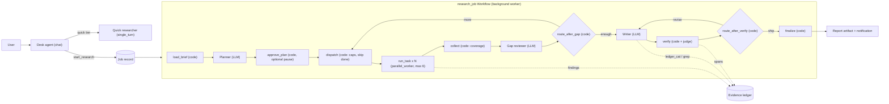

# Research Desk: multi-agent research with a cited report

A research system for a mid-size company's knowledge workers. A user asks an open question in chat ("How are EU banks pricing instant SEPA transfers since the 2025 regulation, and where does our product sit?"). The system reads the web and the company's internal documents, then delivers a report in which every factual sentence carries a citation that has been checked against the passage it points to. A deep run takes 30 to 60 minutes.

The design's central decision, in one sentence: **parallelize the reading, serialize the writing.** Several researcher agents gather evidence in parallel. They never write prose for the reader, and every one of them works from the same written brief. One writer composes the report from the shared evidence ledger, and code, not an agent, checks every citation.

This document covers the agents: what each one does, its tools and state, and how they connect. The harness around them (durability, budgets, evals, security, observability) is in [harness-architecture.md](harness-architecture.md).

## Contents

- [Overview](#overview)
  - [Assumptions, with numbers](#assumptions-with-numbers)
  - [Evidence tags](#evidence-tags)
  - [Tool conventions](#tool-conventions)
- [Architecture at a glance](#architecture-at-a-glance)
- [Two apps, not one invocation](#two-apps-not-one-invocation)
- [Agents](#agents)
  - [Desk agent](#desk-agent)
  - [Quick researcher](#quick-researcher)
  - [Planner](#planner)
  - [Web researcher](#web-researcher)
  - [Internal researcher](#internal-researcher)
  - [Gap reviewer](#gap-reviewer)
  - [Writer](#writer)
  - [Code nodes: dispatch, route, verify, finalize](#code-nodes-dispatch-route-verify-finalize)
- [The evidence ledger](#the-evidence-ledger)
- [Citation verification](#citation-verification)
- [Cross-agent workflows](#cross-agent-workflows)
- [Why this split: the multi-agent debate](#why-this-split-the-multi-agent-debate)
- [Composition in ADK, verified](#composition-in-adk-verified)
- [Does a VFS-style flat orchestrator fit?](#does-a-vfs-style-flat-orchestrator-fit)
- [Search providers and MCP servers](#search-providers-and-mcp-servers)
- [A2A](#a2a)
- [Auth and OAuth](#auth-and-oauth)
- [Skills](#skills)
- [Other ADK machinery](#other-adk-machinery)
- [Session state](#session-state)
  - [How state works in ADK](#how-state-works-in-adk)
  - [Who sees the conversation history](#who-sees-the-conversation-history)
  - [What qualifies as state here](#what-qualifies-as-state-here)
  - [All state variables at a glance](#all-state-variables-at-a-glance)
  - [Deferred](#deferred)
  - [State considered and rejected](#state-considered-and-rejected)
  - [Tensions to resolve](#tensions-to-resolve)
- [Closed decisions](#closed-decisions)
- [Open decisions](#open-decisions)
- [Appendix](#appendix)

---

## Overview

- **Goal:** answer an open research question from the web and internal sources, as a report a reader can audit sentence by sentence.
- **Shape:** a chat front door (the **Desk agent**) and a background **research job**. The job is an ADK `Workflow` graph: a planner, a fan-out of researchers, a gap reviewer, a writer and a verification step. Code decides the flow. Models decide only the content of each step.
- **What runs in parallel:** evidence gathering only. Each research task is one sub-question with explicit scope, and a researcher records findings into the ledger. Writing, revision and verification are single-threaded.
- **The shared key:** the `job_id`. Researchers exchange **finding ids** (`F-0142`), never prose. A finding is one statement plus the verbatim passage it rests on, captured from a stored snapshot of the source.
- **Three effort tiers**, chosen by the Desk agent and confirmed by the user:
  - **quick:** no fan-out. One single-turn researcher runs inline in chat.
  - **standard:** 3 to 6 tasks in one round.
  - **deep:** up to 10 tasks per round and up to 3 rounds.

### Assumptions, with numbers

No one will answer questions, so these are mine. Each is a design input; change one and the affected ADR says what moves.

| Assumption | Value | Drives |
|---|---|---|
| Users | 2,000 knowledge workers, one tenant (the company) | auth model, cache scope |
| Runs per day | ~600: 20% quick, 70% standard, 10% deep | worker pool size, budget totals |
| Peak concurrent jobs | 60 standard/deep jobs | ~360 concurrent researcher loops at peak |
| Duration SLO (p95) | quick 3 min · standard 20 min · deep 45 min; hard wall 75 min | node timeouts, round caps |
| Progress | first progress event < 10 s after start; plan visible < 90 s | progress plugin |
| Budget per run (hard cap) | quick $0.50 · standard $4 · deep $15 | BudgetGuard ([harness M13](harness-architecture.md#m13--reliability-engineering-for-agents)) |
| Sources per deep run | 60 to 150 fetched, 25 to 60 cited | ledger size, writer context |
| Report length | standard 1,500 to 3,000 words · deep 3,000 to 6,000 words | writer output budget |
| Claims checked per report | 60 to 250 atomic claims | verifier cost |
| Internal corpus | Confluence, Jira, Google Drive and Slack, indexed by the company's Glean tenant | internal researcher design |
| Models | any provider through `LiteLlm`; no Gemini assumed (course stack) | rules out Google Search grounding |

**Model tiers** (illustrative LiteLLM strings; pin the exact versions in config):

| Role | Tier | Why |
|---|---|---|
| Planner, writer | frontier (e.g. `anthropic/claude-opus-4-x`) | decomposition and synthesis quality dominate report quality |
| Researchers, gap reviewer | mid (e.g. `anthropic/claude-sonnet-4-x` or `azure/gpt-4.1`) | many calls, mostly search, read and extract |
| Entailment judge | small model from a **different family** (e.g. `azure/gpt-4.1-mini` when the writer is Claude) | high volume; independence from the writer |
| Desk agent | mid | conversational; short turns |

### Evidence tags

Every claim about ADK carries one tag:

- **Code:** read in the google-adk **2.13.0** source, written as `ADK/<path>:<line>`, where `ADK` is the package root `google/adk/`. My working notes are in [scratch/adk-2.13-verified-facts.md](scratch/adk-2.13-verified-facts.md).
- **Docs:** an adk.dev page.
- **Unverified:** plausible, not checked.

### Tool conventions

These are carried over from the course's ops-desk design and adapted:

- Arguments are flat and typed; there are no free-form filter dicts.
- Fixed sets are enums, and the tool description gives each value's meaning.
- Ids are found through list or search tools: `web_search` returns `result_id`s, `fetch_page` takes a `result_id` and never a raw URL from the model, and `ledger_ls` returns finding ids. A model never invents an id; a tool that receives an unknown id returns `not_found` with the list tool to use.
- **`needs_input`** (Desk agent only, the only agent that talks to a user): `{status: "needs_input", missing: [...], collected: {...}, message}`. The message names each missing field in plain words and lists the allowed values for an enum. The call is not performed.
- **`needs_correction`** (researchers): the call was well-formed but its content failed a deterministic check, for example a quote that is not verbatim in the snapshot. The response says exactly what failed and how to fix it. Nothing is written.
- **`needs_auth`**: the user has no valid credential for an internal source. Handled by the Desk agent through ADK's credential request ([Auth](#auth-and-oauth)).
- **Errors** follow M8's shape: `{status: "error", error_type, retryable, message}`. `status` reflects the operation, never just the return value.
- **Page sizes:** search returns at most 8 results per call; `ledger_ls` returns 50 entries and reports the total; `fetch_page` returns at most 6,000 tokens of extracted text plus `next_offset`.
- **Every tool output that carries outside text** wraps that text in a `<untrusted_source id=…>` block written by the tool, never by the model ([harness M14](harness-architecture.md#m14--security--injection-defense)).

## Architecture at a glance

| Component | Kind | Model tier | Sees | Writes |
|---|---|---|---|---|
| Desk agent | `LlmAgent`, chat mode, root of app `research_desk` | mid | the chat history | job requests, `pending_brief`, `active_jobs` |
| Quick researcher | `LlmAgent`, `mode="single_turn"` sub-agent of the Desk agent | mid | only its call arguments | quick-tier findings |
| Planner | `LlmAgent` workflow node, single_turn, `output_schema=ResearchPlan` | frontier | brief, policy, prior rounds' coverage | the plan (tasks + conventions) |
| Web researcher | `LlmAgent`, single_turn, run once per web task | mid | its task + the plan conventions | findings, dead ends |
| Internal researcher | `LlmAgent`, single_turn, run once per internal task | mid | its task + the plan conventions | findings, dead ends |
| Gap reviewer | `LlmAgent` node, single_turn, `output_schema=GapDecision` | mid | coverage table, finding index | a proposed decision (enough / more + new tasks) |
| Writer | `LlmAgent` node, single_turn, `output_schema=ReportDraft` | frontier | brief, plan, findings it reads from the ledger | the structured draft |
| dispatch, route, verify, finalize | `FunctionNode`s (code) | the judge model, called from `verify` | — | caps, routes, verdicts, the final artifact |



## Two apps, not one invocation

The system is two ADK `App`s, sharing one Postgres instance:

- **`research_desk`**: root is the Desk agent (chat). One session per user conversation. Turns are short, measured in seconds.
- **`research_job`**: root is a `Workflow`. Each job gets one session, owned by the requesting user, and one invocation. A worker process drives it, and the invocation lives as long as the run.

Why not one invocation of one agent tree:

- **A 45-minute model loop inside a chat turn is fragile.** A web request, a pod restart or a deploy would kill it. The job needs its own lifecycle (queued, running, cancelling, done), its own lease and its own resume path ([harness ADR-001](harness-architecture.md#adr-001-durable-jobs-postgres-lease-plus-adk-event-replay-ledger-as-source-of-truth)).
- **`Workflow` cannot be a sub-agent of an `LlmAgent`** in 2.13: `ParallelAgent`'s deprecation notice says "Workflow cannot yet be used as an LlmAgent sub-agent" (**Code**, `ADK/agents/parallel_agent.py:172-175`). A graph-shaped job therefore needs its own root.
- **`LongRunningFunctionTool` is the wrong seam for the job.** If `start_research` returned `None` to pause the chat invocation, the chat history would hold an open function call for 45 minutes, follow-up turns would sit beside an unresolved call, and resume is only at-least-once (**Code**, `ADK/apps/_configs.py:29-48`, `ResumabilityConfig` docstring). Instead `start_research` is a plain `FunctionTool` that returns `{status: "queued", job_id}` straight away. Completion is delivered out of band (UI notification, email or Slack), and the Desk agent reads the result when the user comes back. Details in [ADR-003](#adr-003-the-research-run-is-a-background-job-not-part-of-the-chat-invocation).

## Agents

### Desk agent

- **Purpose**
  - Turn a vague question into a **brief**: question, scope (time window, geography, entities), audience and purpose, definitions, exclusions, deliverable shape.
  - Choose the effort tier with the user. Run quick questions inline; start standard and deep runs as jobs.
  - Report status, cancel on request, and answer follow-up questions about a finished report from that report and its ledger.
- **Loop and stop conditions**
  - One turn per user message, with at most 6 tool calls a turn (`RunConfig.max_llm_calls=12` for this app).
  - **Clarification policy:** at most one round of at most 3 questions, asked only when the answer would change the plan (scope, time window, which entity). Otherwise it states its assumptions in the brief and proceeds. The brief is shown to the user before the job starts.
- **Tools**
  - `start_research(question, effort=None, time_window=None, geography=None, audience=None, include_internal=None, exclusions=None)`
    - `effort` is `quick` (single agent, about 2 minutes), `standard` (parallel tasks, about 20 minutes) or `deep` (several rounds, up to about 45 minutes).
    - `include_internal` is `yes` or `no`. It is optional on purpose, so the model asks rather than guesses whether company documents may be read.
    - Any missing required field returns `needs_input`. Missing internal consent or an expired token returns `needs_auth`.
    - On success it creates the job record and the job session (with config-time state, below) and enqueues the job. It returns `{status: "queued", job_id, eta_minutes, budget_usd}`.
    - **State:** writes [`active_jobs`](#state-active_jobs) and clears [`pending_brief`](#state-pending_brief).
      - <a id="state-pending_brief"></a>**State variable `pending_brief`** (written by tools while the conversation runs)
        - **What it is for:** a half-built brief while the user supplies what is missing: `{collected: {question, time_window, ...}, missing: [...], asked_at_turn}`.
        - **Written by:** `start_research` when it answers `needs_input`; cleared on success or when the user abandons it. **Read by:** the Desk agent's instruction (`{pending_brief?}`).
        - **Chat example:**
          ```text
          User:   Research instant-payment pricing for EU banks.
          Agent:  Two things change the plan: which time window (since the Oct 2025
                  deadline, or the last 3 years)? And may I read internal docs
                  (Confluence, Drive) to compare with our product?
          User:   Since the deadline, and yes.
          Agent:  Brief: ... Standard depth, about 20 minutes, up to $4. Start?   (collected merged)
          ```
        - **Why state:** the question and the answers arrive in different turns, and the tool must merge them exactly, not re-read prose.
        - **Risk:** it goes stale if the user changes topic. It expires after 3 turns without a reply, and a new research question overwrites it.
  - `get_research_status(job_id)`: phase, tasks done/total, sources read, spend versus cap, ETA and the last 5 progress lines. It reads the job record, which the progress plugin updates, not the job session.
  - `cancel_research(job_id, keep_partial)`: `keep_partial` is `write_report` (stop researching and have the writer compose from what is in the ledger, at most 5 more minutes) or `discard`.
    - **State:** reads and writes [`active_jobs`](#state-active_jobs).
      - <a id="state-active_jobs"></a>**State variable `active_jobs`** (written by tools while the conversation runs)
        - **What it is for:** jobs started from this conversation: `[{job_id, title, status_at_last_check, started_at}]`, so "how's it going?" or "cancel it" resolves to an id.
        - **Written by:** `start_research`, `get_research_status`, `cancel_research`. **Read by:** the instruction.
        - **Chat example:**
          ```text
          User:   How's it going?
          Agent:  The SEPA pricing run is 60% done: 5 of 8 tasks, 41 sources, $1.70 of $4.   (job_id from active_jobs)
          User:   Stop it and write up what you have.
          Agent:  Stopping. A shorter report will be ready in about 4 minutes.
          ```
        - **Why state:** the user never types a job id, and two jobs in one conversation must stay distinct.
        - **Risk:** the status inside is a snapshot. Tools always re-read the job record; the state copy only resolves "it".
  - `report_ls(job_id, path)`, `report_cat(job_id, path, offset)`, `report_grep(job_id, pattern, path)`: read-only access to a finished report and its ledger, using the [ledger](#the-evidence-ledger) paths. They are how the agent answers "what did it say about Deutsche Bank?" without loading the whole report.
    - **State:** reads and writes [`focus_report`](#state-focus_report).
      - <a id="state-focus_report"></a>**State variable `focus_report`** (written by tools while the conversation runs)
        - **What it is for:** the report the conversation is about: `{job_id, title, artifact_version}`.
        - **Written by:** the `report_*` tools, and `get_research_status` when it sees a job finish. **Read by:** the instruction.
        - **Chat example:**
          ```text
          User:   What did it find about ING?
          Agent:  Section 3: ING charges nothing for instant transfers in NL [F-0031] ...   (report_grep on focus_report)
          User:   Which source says that?
          Agent:  ING's tariff page, fetched 26 Oct 2026 (snapshot S-0012).
          ```
        - **Why state:** follow-ups refer to "the report" across many turns.
        - **Risk:** with two finished reports, "it" is ambiguous. A follow-up that matches neither title asks which one.
  - `set_research_defaults(default_effort=None, blocked_domains=None, citation_style=None)`: changes only on an explicit request.
    - **State:** writes [`user:research_defaults`](#state-user_research_defaults).
      - <a id="state-user_research_defaults"></a>**State variable `user:research_defaults`** (written by one tool, on explicit request only)
        - **What it is for:** a user's standing preferences: `{default_effort, blocked_domains, citation_style, updated_at, set_via}`, where `citation_style` is `footnote` or `inline`. `updated_at` is the freshness field: the brief shows the defaults' age when it is over 180 days.
        - **Written by:** `set_research_defaults` only, never inferred from a conversation (M7's write path: a candidate is not a write). **Read by:** `start_research`, as defaults the user can override.
        - **Chat example:**
          ```text
          User:   Never use content-farm sites like example-seo.com, ever.
          Agent:  Saved: example-seo.com is blocked for all your future research.
          ```
        - **Why state:** it is user-scoped and survives sessions. The `user:` prefix is ADK's own scope for this (**Docs**, adk.dev/sessions/state).
        - **Risk:** a blocked domain list that grows silently can starve research. The tool returns the full list on every change, and the brief shows it.
  - `quick_researcher`: the [Quick researcher](#quick-researcher), attached as a single-turn sub-agent (below).
- **Does not**
  - Research standard or deep questions itself. A long search loop in chat is exactly what the job exists to avoid.
  - Hold or pass tokens. Auth goes through ADK's credential machinery.
  - Change the scope of a running job. Steering is deferred ([Open decisions](#open-decisions)).
- **Rules**
  - The brief is shown before `start_research` runs, so the user can correct scope.
  - Internal sources are used only with an explicit `include_internal=yes` from this user, in this conversation.

### Quick researcher

- **Purpose:** answer quick-tier questions such as "What is the current ECB deposit rate?" in chat, with a verified citation, in under 3 minutes and under $0.50.
- **How it attaches:** `LlmAgent(mode="single_turn")` in the Desk agent's `sub_agents`. ADK wraps it as `_SingleTurnAgentTool` and runs it through `tool_context.run_node` on a sub-branch of the Desk agent's session (**Code**, `ADK/agents/llm_agent.py:1352-1370`; `ADK/tools/agent_tool.py:478-516`). It sees only its call arguments plus ADK's "you will not receive any user replies" nudge (**Code**, `ADK/flows/llm_flows/context/_contents.py:288-345`).
- **Loop and stop conditions:** search, fetch, record, answer. It stops at 10 tool calls, or when every part of the question has a finding, or after 3 searches in a row that bring no new source.
- **Tools:** the web researcher's tools ([below](#web-researcher)) plus `verify_answer(answer)`, which runs the [verification pipeline](#citation-verification) synchronously on its draft and returns the verdicts.
- **Does not:** read internal sources. A quick question that needs company data is promoted to a standard job, because internal access is on behalf of the user and goes through the job's consent and audit path.
- **State:** none of its own. Its findings go to a ledger under a synthetic job id `quick-<uuid>`, so follow-ups use the same `report_*` tools.

### Planner

- **Purpose**
  - Decompose the brief into **research tasks**: each a sub-question with a source scope (`web` or `internal`, never both), entities, time window, and a success criterion ("find the published fee for instant SEPA transfers for retail accounts at each of the 6 largest banks in DE/FR/NL").
  - Write the **conventions** every researcher must share: definitions ("instant transfer = SCT Inst"), units and currency, the time window, inclusion rules, and what counts as a primary source. This is the answer to Cognition's "actions carry implicit decisions": the decisions are made once, written down, and handed to everyone.
  - On later rounds, add tasks only for the gaps the gap reviewer names.
- **Loop and stop conditions:** one model call, plus at most one `load_skill`. It has no search tools; it plans from the brief, the playbook and the coverage table. Code enforces the effort-tier caps on its output (in `dispatch`).
- **Tools**
  - `SkillToolset` with research playbooks in EAGER discovery ([Skills](#skills)).
  - `get_search_lessons(playbook)`: up to 5 tenant-wide lessons for the playbook, such as query shapes that yielded primary sources, or domains that were paywalled or dead ends. Only lessons seen in at least 3 jobs within 90 days are returned, and they are built from web tasks only ([harness M7 episodic](harness-architecture.md#episodic-search-lessons-and-prior-reports)).
  - No search. Letting the planner search turns it into a researcher with a planner's context, which is the expensive window.
- **Output:** `ResearchPlan` (`output_schema`):
  ```python
  class ResearchTask(BaseModel):
      task_id: str                 # "T-03"; stable across rounds
      question: str
      scope: Literal["web", "internal"]
      entities: list[str]
      success_criterion: str
      max_tool_calls: int          # planner proposes; dispatch clamps to the tier cap

  class ResearchPlan(BaseModel):
      conventions: list[str]       # definitions, units, time window, primary-source rule
      tasks: list[ResearchTask]
      out_of_scope: list[str]
  ```
- **Does not:** see web pages or internal documents. It cannot be injected by them in round 1, and in later rounds it sees only coverage counts and finding statements, which are tool-sanitized.
- **State:** reads [`brief`](#state-brief), [`source_policy`](#state-source_policy), [`limits`](#state-limits) and [`coverage`](#state-coverage) (rounds 2 and 3). Its output becomes the `dispatch` node's input, and dispatch writes the [`plan`](#state-plan).
  - <a id="state-plan"></a>**State variable `plan`** (written by the `dispatch` code node while the run proceeds)
    - **What it is for:** the current plan's `conventions` and task list (ids, question, scope, status), so every researcher's instruction can template `{plan_conventions}` and the progress view can show tasks.
    - **Written by:** `dispatch`, from the planner's output after clamping. **Read by:** the researcher instructions (conventions only), the gap reviewer, and the progress plugin.
    - **Chat example (in the progress pane):**
      ```text
      Plan (8 tasks): T-01 SCT Inst fees, DE top-6 banks (web) · T-02 ... FR ...
      Conventions: "instant" = SCT Inst; fees in EUR per transfer, retail accounts;
                   window 2025-10-09 to today; tariff PDFs beat press articles.
      ```
    - **Why state:** the conventions must reach N parallel researchers in byte-identical form, which also keeps the prompt prefix cacheable across them. The task list must survive a worker crash.
    - **Risk:** if researchers treat the conventions as optional, the Flappy Bird failure returns. The verify step checks units and windows on the writer's claims, which is the last line.

### Web researcher

- **Purpose:** for one task, gather findings from the public web: statements, each tied to a verbatim passage from a stored snapshot of the source.
- **How it runs:** `run_task` is a `FunctionNode` with `node(..., parallel_worker=True, max_parallel_workers=6)`. For each task in the list it calls `ctx.run_node(web_researcher, node_input=task)` or the internal researcher, depending on `task.scope` (**Code**, `ADK/workflow/_node.py:47-155`; `ADK/workflow/_parallel_worker.py:67-193`). Each task runs on its own sub-branch, so siblings cannot see each other's events. As a workflow node a single-turn `LlmAgent` defaults to `include_contents='none'` (**Code**, `ADK/workflow/utils/_workflow_graph_utils.py:163-168`), so it sees only its task.
- **Loop and stop conditions**
  - search → choose results → fetch → read → `record_finding` (repeat). The model decides the queries; tools decide what a result returns (M5's hybrid selector).
  - It stops at the first of these:
    - its `max_tool_calls` (standard 15, deep 25; clamped by dispatch);
    - the success criterion is met: the model calls `finish_task` with its summary (single-turn final output with `output_schema=TaskResult`);
    - **no progress:** the tools report `new_sources: 0` on 3 consecutive searches, and the tool tells the model to finish. The check is external and computed by code, because M10's own literature review says a model cannot reliably judge its own progress;
    - the node `timeout=480` s, after which it returns the findings so far;
    - [`budget_phase`](#state-budget_phase) is `wrap_up` (record what you have and finish) or `stop` (tools refuse new searches).
- **Tools**
  - `web_search(query, recency_days=None, include_domains=None, exclude_domains=None, kind="general")`
    - `kind` is `general`, `news` (recent reporting), `company` (official sites and filings) or `academic` (papers and preprints).
    - Returns up to 8 results: `{result_id, title, domain, published_at, snippet, source_tier, seen_before}`. `source_tier` is `primary` (the entity's own site, regulator or filing), `reputable_secondary` (an allowlisted publication) or `other`. `seen_before` marks a result already in this job's ledger.
    - Also returns `new_sources: k of 8`, the progress signal.
    - Provider: Exa, with Brave as fallback ([Search providers](#search-providers-and-mcp-servers)). The provider is invisible to the model.
  - `fetch_page(result_id, offset=0)`: fetches and stores a **snapshot** (raw HTML or PDF plus extracted text, content hash and fetch time) if one is not cached. Returns up to 6,000 tokens of extracted text in an `<untrusted_source id="S-0012">` block, plus `next_offset`. PDFs are text-extracted. A `result_id` that did not come from this task's searches is `not_found`.
  - `record_finding(statement, source_id, quote, finding_type, confidence, subject=None, metric=None, value=None, unit=None, period=None)`
    - `finding_type` is `fact` (a single stated fact), `figure` (a number with unit and date) or `position` (what a named party claims, attributed).
    - `confidence` is `high` (primary source, stated directly), `medium` (secondary source or indirect statement) or `low` (needs corroboration).
    - **Deterministic check at capture:** `quote` must be a verbatim substring of the snapshot's extracted text after whitespace normalization, at least 40 and at most 600 characters. On a match the tool stores the span with character offsets and returns `{finding_id, duplicate, conflicts_with}`. On no match it returns `needs_correction` with the nearest matching passage, offered as a candidate to re-quote. This is the resolver's authenticity check, done when the citation is created rather than after.
    - A `figure` must also give `subject`, `metric`, `value`, `unit` and `period` (missing ones return `needs_correction`), and `value` must appear in the quote as written. These fields drive conflict detection and the time-window check.
    - Idempotent: the same quote from the same source in the same job returns the existing `finding_id` with `duplicate: true`. A figure that disagrees with an existing one for the same subject, metric and period is kept and linked, and the response lists it in `conflicts_with`. The schema and code are in [harness M7](harness-architecture.md#external--retrieval-the-evidence-ledger-and-snapshot-store).
  - `report_dead_end(query, reason)`: records a query that found nothing useful. The gap reviewer reads these, so the next round does not repeat them.
- **Does not**
  - Read internal sources. It has no internal tools at all ([ADR-009](#adr-009-split-researchers-by-source-scope-no-agent-holds-both-internal-and-web-tools)).
  - Write prose for the report, decide the report's structure, or judge other tasks' findings.
  - Follow instructions found inside `<untrusted_source>` blocks. The standing instruction says so, but the real control is that it has nothing dangerous to call: every tool it holds is read-only or appends to its own ledger.
- **Output:** `TaskResult {task_id, status, finding_ids, summary (≤ 120 words), open_questions}`. `status` is `answered`, `partial` or `not_found`. The summary is for the gap reviewer only; the writer reads findings.
- **Rules**
  - One statement per finding. A finding can cite one snapshot only; corroboration is several findings.
  - Prefer `primary` sources for figures. A `figure` from an `other`-tier source is recorded with `confidence=low`.
  - Never record a finding from a search snippet. Snippets are not snapshots.
- **State:** reads [`plan`](#state-plan) (conventions, through instruction templating), [`budget_phase`](#state-budget_phase) and [`source_policy`](#state-source_policy) (tools enforce its blocked domains). It writes no state: findings go to the ledger and results go out as node output. A parallel branch writing state is a race ([ADR-010](#adr-010-parallel-branches-never-write-shared-state-results-travel-as-node-outputs-and-ledger-rows)).

### Internal researcher

- **Purpose:** the same job over internal sources, read on behalf of the requesting user.
- **How it runs:** the same `run_task` fan-out with `scope="internal"`. Its concurrency is capped at 3 of the 6 slots, because the per-user Glean rate limit is the binding constraint (an assumption; Glean's limits depend on the tenant).
- **Loop and stop conditions:** the same as the web researcher. The internal `max_tool_calls` is 12, because internal corpora are narrower.
- **Tools**
  - Glean's remote MCP server through `McpToolset`, with `tool_filter=["glean_search", "read_document"]`. Chat and anything that writes are excluded, because the Glean `chat` tool would return a synthesized answer and we need primary passages. `header_provider` injects the user's bearer token per session ([Auth](#auth-and-oauth)). An `after_tool_callback` stores every `read_document` result as a snapshot and wraps it in `<untrusted_source id=… classification=internal>`.
  - `record_finding` and `report_dead_end`, as for web, with the snapshot's ACL recorded on the finding.
- **Does not:** hold any web tool, so internal text cannot leave through a web query. Nor does it see web findings.
- **Rules:** a finding from an internal source carries `visibility=internal` and the source document's permission fingerprint. Sharing rules are in [harness M15](harness-architecture.md#m15--guardrails-safety--governance).
- **State:** as for the web researcher.

### Gap reviewer

- **Purpose:** after each round, judge whether the evidence is **sufficient** for the brief. This is M5's sufficiency check, done upstream of writing because no output-side check can see a gap. It proposes new tasks for the gaps.
- **Loop and stop conditions:** one model call. It has no search tools.
- **Input:** the [`coverage`](#state-coverage) table, finding statements grouped by task (statements only, no source text), dead ends, and the brief's success criteria.
- **Output:** `GapDecision {decision, gaps: [{description, why_it_matters}], new_tasks: [ResearchTask], contradictions: [{finding_ids, note}]}`. `decision` is `enough` or `more`.
- **Does not decide the route.** `route_after_gap` is code. It goes to the writer when the decision is `enough`, or when `round == limits.max_rounds`, or when `budget_phase != normal`, or when the new tasks are duplicates (title similarity > 0.85 to completed tasks). Otherwise it goes back to `dispatch`. "The model proposes, code disposes."
- **State:** reads [`coverage`](#state-coverage) and [`round`](#state-round).
  - <a id="state-coverage"></a>**State variable `coverage`** (written by the `collect` code node)
    - **What it is for:** per task: `{status, findings, primary_findings, distinct_domains, dead_ends}`, plus totals. It is the compact view of the evidence the reviewer and planner reason over, without source text.
    - **Written by:** `collect`, computed from the ledger. **Read by:** the gap reviewer and planner (`{coverage}`), and the progress plugin.
    - **Chat example (progress pane):**
      ```text
      Round 1 done: 7/8 tasks answered, 52 findings from 31 domains.
      Gap: no primary source for BNP Paribas retail fees (T-02 partial).
      Round 2: 2 new tasks.
      ```
    - **Why state:** the reviewer needs counts it cannot compute reliably from prose, and a crash mid-review must not lose them. The ledger stays the source of truth, so this is a derived view.
    - **Risk:** counts can mislead: 12 findings from one press release copied by 12 sites. `distinct_domains` collapses syndicated copies by content hash.
  - <a id="state-round"></a>**State variable `round`** (written by `dispatch`)
    - **What it is for:** the current round number (1 to 3), so the route can enforce `max_rounds` and the planner knows it is filling gaps rather than starting fresh.
    - **Written by:** `dispatch`. **Read by:** `route_after_gap` and the planner instruction.
    - **Chat example:** "Round 2 of at most 3: filling 2 gaps."
    - **Why state:** a loop counter must survive a resume. An in-memory counter would reset and allow unbounded rounds, the same failure M13 records for `RetryConfig`'s attempt counter.
    - **Risk:** none of substance. Only code writes it.

### Writer

- **Purpose:** compose the report from the ledger as a **structured draft**, where every sentence declares what kind of statement it is and which findings support it. Rendering to Markdown, HTML and PDF is code.
- **Loop and stop conditions**
  - Reads with ledger tools, then emits one `ReportDraft`. It has a budget of 30 tool calls and at most 120k tokens of input in total. The ledger tools page at 50 entries, and `ledger_cat` truncates long files.
  - In **revise mode** (input: the verifier's failing sentences with verdicts), it rewrites only those sentences, using the same evidence ([verification](#citation-verification)). At most 2 revise rounds, then code removes any sentence still failing.
- **Tools:** `ledger_ls(path)`, `ledger_cat(path, offset)` and `ledger_grep(pattern, path)` over the [ledger](#the-evidence-ledger); `calc(expression, inputs)`, a deterministic arithmetic evaluator whose `inputs` must be `figure` finding ids. It returns `{calc_id, result, unit}`, so a derived number is computed by code from cited figures rather than by the model (M5: "stop deriving in the model").
- **Output schema (abridged):**
  ```python
  class Sentence(BaseModel):
      text: str
      kind: Literal["fact", "derived", "attributed", "analysis"]
      finding_ids: list[str]       # required for fact/derived/attributed
      calc_id: str | None = None   # required for derived numbers
      supports: list[str] = []     # for analysis: ids of the sentences it synthesizes

  class ReportDraft(BaseModel):
      title: str
      summary: list[Sentence]      # 5-8 sentences
      sections: list[Section]      # Section = heading + paragraphs (list[list[Sentence]])
      key_findings: list[KeyFinding]   # each needs >= 2 independent sources or is labelled single-source
      disagreements: list[Disagreement]
      limitations: list[str]
  ```
  - `kind` values: `fact` (directly stated by a source), `derived` (computed or combined from several findings, with a `calc_id` for numbers), `attributed` ("X says Y", where the claim is that X said it) and `analysis` (the writer's synthesis, which must point at the sentences it rests on and is shown as analysis).
- **Does not:** search, fetch, or cite anything not in the ledger. A finding id that does not exist is caught by the verifier as "no evidence", not as a citation.
- **Rules:** one claim per sentence; sources that disagree are reported as a disagreement, never silently resolved (M5's *Contradictory* row); every `key_finding` names its sources' independence or is labelled single-source.
- **State:** reads [`brief`](#state-brief) and [`plan`](#state-plan); writes [`draft_ref`](#state-draft_ref) through `output_key`, which saves the artifact pointer, not the text.
  - <a id="state-draft_ref"></a>**State variable `draft_ref`** (written by the writer node's wrapper and `verify`)
    - **What it is for:** `{artifact: "draft.json", version, revision}`. The draft itself is an ADK artifact, because it is 20 to 60 KB and versioned.
    - **Written by:** an `after_agent_callback` on the writer, which saves the draft artifact and records the version; `verify` increments `revision`. **Read by:** `verify`, `finalize` and the progress plugin.
    - **Chat example:** "Draft written (revision 1). Checking 143 claims..."
    - **Why state:** the pointer must survive a resume. Without it a crash after writing would repay the most expensive call.
    - **Risk:** pointer and artifact can drift if one write fails. Both are written in one callback, and `verify` checks that the version exists.

### Code nodes: dispatch, route, verify, finalize

Each is a `FunctionNode`: code, no model, testable as a plain function.

- **`load_brief`:** reads the job record and seeds the ledger. If the ledger already holds completed tasks for this job (a rebuild after a failed ADK resume; [harness ADR-001](harness-architecture.md#adr-001-durable-jobs-postgres-lease-plus-adk-event-replay-ledger-as-source-of-truth)), `dispatch` queries `ledger.research_tasks` and skips answered tasks and near-duplicates of them. The resume and rebuild procedure is in [harness M7](harness-architecture.md#the-resume-procedure-after-a-worker-crash).
- **`approve_plan`:** a pass-through, except for a deep run whose budget cap is above $10 with `review_plan=on`. Then it yields a `RequestInput` with the plan and `response_schema=PlanDecision` (`approve`, `edit`, `cancel`), which pauses the workflow without a model (**Code**, `ADK/events/request_input.py:28-80`). The pause times out after 30 minutes and then auto-approves, so a deep run never stalls overnight on an unanswered prompt.
- **`dispatch`:** clamps the plan to the tier caps (task count, `max_tool_calls`), drops tasks already completed or near-duplicates, writes [`plan`](#state-plan) and [`round`](#state-round), and outputs the task list to `run_task`.
- **`collect`:** computes [`coverage`](#state-coverage) from the ledger.
- **`route_after_gap` / `route_after_verify`:** apply the caps and emit `Event(route=...)`. The cycles pass through routed edges, which ADK requires: unconditional cycles fail graph validation (**Code**, `ADK/workflow/utils/_graph_validation.py:30-55`).
- **`verify`:** the [verification pipeline](#citation-verification).
- **`finalize`:** renders the report, saves the `report.md` and `report.html` artifacts, writes the claim-level citation table, updates the job record and sends the notification.

## The evidence ledger

The ledger is a Postgres schema plus object storage for snapshots, exposed to the writer and the Desk agent as a **read-only virtual filesystem**. This is the one place the course's VFS pattern fits ([below](#does-a-vfs-style-flat-orchestrator-fit)).

```text
/jobs/<job_id>/
  brief.md
  plan.md                       # conventions + tasks, by round
  tasks/<task_id>/
    result.md                   # TaskResult: status, summary, open questions
    findings                    # list: F-id | type | confidence | statement | source | tier
    dead_ends
  findings/<F-id>               # statement, quote (span), source, offsets, published_at, fetched_at, links
  conflicts                     # open 'contradicts' links between findings, both sides shown
  sources/<S-id>                # url, title, domain, tier, fetched_at, content_hash, visibility
  sources/<S-id>/text           # extracted text, paged (offset)
  draft.json                    # current draft (writer revise mode and Desk follow-ups)
  verification.md               # per-claim verdicts (after verify)
  report.md
```

- **Writers of the ledger:** only tools (`record_finding`, `report_dead_end`, `fetch_page`, the Glean snapshot callback) and code nodes. No model writes a ledger row directly.
- **Readers:** `ledger_ls`, `ledger_cat` and `ledger_grep` (writer); `report_ls`, `report_cat` and `report_grep` (Desk agent, after the job); `verify`.
- **Listing format:** compact pipe-delimited rows, as in the VFS reference (`AF/tools/vfs/vfs_router.py`): about 25 tokens per finding row. 150 findings fit in 4k tokens, where the full passages would be about 60k.
- **Why a ledger:** Anthropic reports the same fix for the "game of telephone": subagents write to external storage and pass back lightweight references ([Anthropic, 2025](https://www.anthropic.com/engineering/multi-agent-research-system)). It is also the durable checkpoint ([harness ADR-001](harness-architecture.md#adr-001-durable-jobs-postgres-lease-plus-adk-event-replay-ledger-as-source-of-truth)).

## Citation verification

Verification is a code pipeline with one model judge. It is not an agent, and there is no "citation agent" that places citations after writing. Citations exist from the moment a sentence is written, because the schema requires `finding_ids` ([ADR-008](#adr-008-citations-are-constructed-at-write-time-and-verified-by-a-code-pipeline-not-placed-by-a-citation-agent)). The pipeline follows the course's three components: the pairer, the resolver and the entailment judge.

1. **Pairer (by construction).** The writer's schema yields `(sentence, finding_ids)` pairs directly. Atomicity is the writer's rule (one claim per sentence). A cheap splitter flags sentences with more than one number, or a conjunction joining two entities, and sends them back for splitting in revise mode, because the pairer sets the judge's ceiling.
2. **Resolver (deterministic).** For each finding id:
   - the id does not exist in this job's ledger → class **`no_evidence`**: generation fault, recoverable by revision;
   - it exists, but the snapshot's `content_hash` or span offsets no longer reproduce the stored quote → class **`phantom`**: pipeline integrity fault, not recoverable by looping;
   - otherwise → resolved. This is the second authenticity check; the first was at capture time.
3. **Pre-filter (deterministic).**
   - Every number in the sentence must appear in a cited span or in a cited `calc` result, otherwise `contradict` without spending a judge call.
   - Named entities in the sentence must appear in the cited spans, or the pair is escalated.
   - The sentence's date and unit must match the plan's conventions.
   - **Conflict check:** a sentence citing one side of an open `contradicts` link in the ledger must cite the other side in a `Disagreement`, or carry a `preferred_because` reason (`primary_source`, `more_recent`, `official_correction`) that code checks against the two sources' tiers and dates. Otherwise it goes back to revision.
4. **Entailment judge (model).** `(sentence, span)` → `entail | contradict | neutral`, on the small model from a different family. `derived` sentences, and any `neutral` result, go to the **joint-source tier**: the judge sees all cited spans plus the calc trace together. `key_findings` skip the surface tier and go straight to joint. This is the layered, routed design from M5 and M12.
5. **Routing, by worst class (not by fraction).**

| Verdict class | Fault owner | Action |
|---|---|---|
| `entail` | none | keep |
| `contradict` | generation (or conflicting evidence) | revise with the same evidence. If the cited spans contradict each other, rewrite the sentence as a disagreement |
| `neutral` | ambiguous | revise with a narrower claim. If the claim cannot be narrowed: one patch task (only if `budget_phase=normal` and no patch round has run), else remove it and list it under "claims we could not verify" |
| `no_evidence` | generation | remove the claim or attach evidence on revision |
| `phantom` | pipeline integrity | hard block: the report goes to `needs_review` and a provenance alarm pages the on-call |

   - **Ship rule:** a report ships when every `fact`, `derived` and `attributed` sentence is `entail` and there are no phantoms. `analysis` sentences get a lighter rubric check (does it follow from the sentences it cites?) and are shown labelled as analysis.
   - **Cost:** at about 150 claims, roughly 150 surface judge calls of about 1.5k tokens plus about 30 joint calls of about 6k tokens. That is about 400k cheap-model tokens, about $0.25 to $0.50 (assumed prices). This is why verification is affordable on every report, and why the judge is a small model.
6. **The gap this pipeline cannot close.** It checks `E`-grounding (does the cited passage say this?), never soundness (is the passage true?). The supply-side controls that partly cover it are the source tier, the two-independent-sources rule for key findings, stated disagreements and the as-of date on every source. Lucky parametric recall stays invisible to it (M5); the eval suite measures it ([harness M12](harness-architecture.md#m12--evaluation-harnesses)).

## Cross-agent workflows

- **Standard run** ("How are EU banks pricing SCT Inst since the 2025 deadline, and where do we sit?")
  - Desk: clarifies the window and internal consent → shows the brief → `start_research` → `queued`.
  - Job: `load_brief` → planner (8 tasks: 6 web, 2 internal, plus conventions) → `dispatch` → `run_task` ×8, at most 6 at once → `collect` → gap reviewer: `more` (no primary source for one bank) → `route_after_gap` (round 1 < 2) → `dispatch` (2 tasks) → `run_task` ×2 → gap reviewer: `enough` → writer → `verify` (143 claims: 131 entail, 7 neutral, 4 contradict, 1 no_evidence) → `route_after_verify`: revise → writer (12 sentences) → `verify` (12/12 handled: 10 entail, 2 removed) → `finalize`.
  - Elapsed about 18 minutes, cost about $3.10. The user gets a notification with the report link.
  - State along the way: [`plan`](#state-plan), [`round`](#state-round), [`coverage`](#state-coverage), [`draft_ref`](#state-draft_ref), [`budget_phase`](#state-budget_phase).
- **Follow-up** ("Which banks charge more for instant than for standard transfers?") → Desk: `report_grep` over the finished report → answers from the report with its finding ids. If the report does not cover it, the agent says so and offers a quick or standard run.
- **Cancel with partial report** → `cancel_research(job_id, keep_partial="write_report")` → the job record moves to `cancel_requested` → the worker sets [`budget_phase`](#state-budget_phase)`=stop` → in-flight researchers finish their current step and return → the route skips straight to the writer → verify and finalize as usual, with "stopped early by the user" in the limitations.
- **Worker crash mid-round** → the lease expires (60 s) → another worker calls `runner.run_async(invocation_id=…)`. The workflow replays completed nodes from session events (**Code**, `ADK/workflow/_workflow.py:252-256`). In-flight `run_task` items rerun, and their searches and fetches hit the search cache and snapshot store, so a rerun costs model tokens but no repeated fetches.
- **Budget wrap-up** → at 80% of the cap the BudgetGuard plugin sets `budget_phase=wrap_up`: researchers record and finish, and `route_after_gap` goes to the writer whatever the reviewer says. At 100% the tools refuse new searches and fetches; the writer and verify still run, because their reserve (20% of the cap) is held back from research ([harness M13](harness-architecture.md#m13--reliability-engineering-for-agents)).

## Why this split: the multi-agent debate

The two sources disagree, and both are right about different parts of this problem.

- **Anthropic's case:** a lead agent with parallel subagents "outperformed single-agent Claude Opus 4 by 90.2%" on their internal research eval. Token usage alone explained about 80% of the variance, and multi-agent runs used about 15× the tokens of chat. Breadth-first research is the fit: many independent directions, more information than one window holds ([Anthropic](https://www.anthropic.com/engineering/multi-agent-research-system)).
- **Cognition's case:** "Share context, and share full agent traces, not just individual messages," and "actions carry implicit decisions, and conflicting decisions carry bad results." Their Flappy Bird subagents built pieces in clashing styles because each made decisions the other could not see ([Cognition](https://cognition.com/blog/dont-build-multi-agents)).

**Where they meet:** parallel subagents fail when their outputs *are* decisions that have to fit together (code, visual style, prose voice). They earn their cost when their outputs are **independent observations** that a single later step integrates. Evidence gathering is the second kind: a finding about ING's fees does not constrain a finding about BNP's. Prose is the first kind. So:

| Step | Single or parallel | Why |
|---|---|---|
| Clarify and brief | single (Desk agent) | one conversation, one owner of the user's intent |
| Plan | single (planner) | decomposition is a set of coupled decisions (Cognition) |
| Gather evidence | **parallel** (3 to 10 researchers) | independent observations; breadth; per-task context isolation keeps each window small (Anthropic). The output is facts with provenance, not decisions |
| Judge sufficiency | single (gap reviewer) | needs the whole picture |
| Write | single (writer) | the report's implicit decisions (structure, emphasis, voice) must be one mind's |
| Verify | code + judge | deterministic where possible; the judge is a function, not an agent |

**Where the sub-agent split does not earn its cost:**

- **Quick questions.** Anthropic's own effort rules are 1 agent and 3 to 10 tool calls for simple facts. A fan-out here only multiplies tokens.
- **Writing in parallel**, one writer per section, would save perhaps 2 minutes of a 20-minute run and bring back the Flappy Bird problem.
- **A separate citation agent placing citations afterwards.** Constructing citations at write time is cheaper and closes a failure that post-hoc placement creates: a nearby-but-wrong citation attached to a fluent sentence, which is M5's opening scene.

**Mitigating Cognition's principle where we do split:** every researcher receives the same written **conventions**, the decisions made once by the planner. Researchers' traces stay out of the writer's context on purpose, but their outputs are typed findings with verbatim spans, so nothing the writer depends on is lost in a summary. The writer can open any source passage through the ledger. That is "share context" applied to evidence, without sharing traces.

**Cost of the split, priced:** a standard run uses roughly 1.6M input tokens on the mid tier across about 8 tasks, plus about 250k frontier tokens for planning and writing. That is about $3 at assumed prices, against about $0.40 for a single agent doing 15 tool calls. Taking Anthropic's measurement at face value, the 7× cost buys breadth one window cannot hold. The eval gate keeps that honest: if a single agent with the same tool budget matches the multi-agent run on the rubric, the tier's fan-out shrinks ([harness M11](harness-architecture.md#m11--orchestration-ii--multi-agent-patterns)).

## Composition in ADK, verified

The candidates, and what each does to history, state, control and parallelism, as read in the 2.13 source.

| Mechanism | Who sees history | State | Control flow | Parallel? | Resumable mid-way? | Used here |
|---|---|---|---|---|---|---|
| `sub_agents` + transfer (`mode="chat"`, the default) | shared session; the sub-agent takes over the conversation | shared | the LLM transfers; control stays with the sub-agent until it transfers back | no | as the session | no: research is not a conversation hand-off |
| `AgentTool(agent)` | **none**: a fresh `InMemorySessionService` session per call (**Code**, `ADK/tools/agent_tool.py:270-318`) | parent state **copied in**; child deltas **forwarded back** (`:309-318`, `:391-393`) | returns a result to the caller | yes, if the caller emits several calls (gathered; one raising cancels the rest: **Code**, `ADK/flows/llm_flows/tools/_batch_executor.py:197-213`) | **no**: a pending long-running call inside cannot resume, because the nested session is discarded (`:409-425`) | no. ADK itself discourages direct use and recommends `mode="single_turn"` (`:122-133`) |
| `sub_agents` + `mode="single_turn"` | only its call args + a no-replies nudge (**Code**, `ADK/flows/llm_flows/context/_contents.py:288-345`) | **shared** parent session (runs via `run_node` on a sub-branch: `ADK/tools/agent_tool.py:478-516`) | returns a result | yes, the same gather semantics | as the parent | **Quick researcher** |
| `sub_agents` + `mode="task"` | only its scoped events + the delegating call's args (`_contents.py:348-396`) | shared | may ask the user for clarification; returns via `finish_task` (**Code**, `ADK/agents/llm_agent.py:1347-1350`) | **no**: its declaration says "Do NOT call this tool in parallel" (**Code**, `ADK/tools/agent_tool.py:561-566`) | as the parent | no: researchers must not talk to the user mid-run |
| `ParallelAgent` | branch-isolated history; each sees the events before the fan-out | **shared; last writer wins** on a key | code | yes, all sub-agents at once | per sub-agent end markers | no: **deprecated** in favour of Workflow (**Code**, `ADK/agents/parallel_agent.py:172-193`) |
| `Workflow` graph + `parallel_worker` node | each item on its own sub-branch; a single-turn LLM node defaults to `include_contents='none'` (**Code**, `ADK/workflow/utils/_workflow_graph_utils.py:163-177`) | shared session; **node outputs travel along edges** (the race-free channel) | code: edges, routes, caps; cycles only through routed edges | yes, with `max_parallel_workers` | **yes, at node granularity**: completed nodes replay from events (**Code**, `ADK/workflow/_workflow.py:252-256`, `700-735`) | **The research job** |

Consequences taken into the design:

- **One item failure cancels its siblings** in a `parallel_worker` (**Code**, `ADK/workflow/_parallel_worker.py:186-193`). `run_task` therefore catches every exception from its researcher and returns `TaskResult(status="failed", reason)`. A flaky page never kills five healthy researchers.
- **`max_concurrency` on a `Workflow` does not throttle dynamic `ctx.run_node` children** (**Code**, `ADK/workflow/_workflow.py:160-166`). The cap lives on the `parallel_worker` (`max_parallel_workers=6`), not on the workflow.
- **`max_llm_calls` (default 500) raises `LlmCallsLimitExceededError` when exceeded** (**Code**, `ADK/agents/run_config.py:37`; `ADK/agents/invocation_context.py:78-95`). Inside a researcher that error would cancel its siblings, so it is only a far backstop (deep: 900). Budgets are enforced by our plugin, which degrades instead of raising. Whether the counter is shared across workflow branches is **Unverified**; the private cost manager survives `model_copy` like `_AbortState` does, so it probably is shared.
- **Task mode as a workflow node.** M11's docs survey says task mode is "disabled for use in graph-based workflows" in ADK Python v2.0.0. The 2.13 wrapper accepts task, single_turn and chat nodes (**Code**, `ADK/workflow/_llm_agent_wrapper.py:429-433`), so the restriction appears lifted. It is irrelevant here: no workflow node talks to the user.

## Does a VFS-style flat orchestrator fit?

The VFS reference (`AF/agents/workspace_chat_v10`–`v12`) replaced several LLM search sub-agents with one flat orchestrator and deterministic filesystem tools (`ws_ls`, `ws_cat`, `ws_search`, `ws_grep`) over a tree of workspace entities.

- **It fits the ledger.** The job produces a tree (job → tasks → findings → sources → text), and its two readers (the writer, and the Desk agent on follow-ups) need to *navigate* it cheaply: list compactly, open one item, grep across items. Listing rows like `ls -l` keeps the writer's context at about 4k tokens for 150 findings, with passages pulled only when needed. The router is plain Python with no model, exactly as in `AF/tools/vfs/vfs_router.py`.
- **It fits the Desk agent's follow-ups.** One flat agent with `report_*` tools beats a "report Q&A sub-agent". There is no isolation payoff, because the follow-up *is* the conversation.
- **It does not fit gathering.** The web is not a tree with stable paths. Search is a ranking problem; listing is not. Internal sources are already behind Glean's permission-aware search, so wrapping them in paths would re-implement Glean badly.
- **It does not replace the fan-out.** The VFS argument was that the sub-agents were tool-shaped: each wrapped one search API, and the LLM in the middle added cost and lost context. Here each researcher runs a genuine 10-to-25-step loop of choosing queries, judging relevance and extracting quotes. That is reasoning, not a lookup, and parallel breadth is the measured payoff.

## Search providers and MCP servers

**Web search: first-party tools over provider APIs, with Exa as primary and Brave as fallback.** No vendor MCP sits in the production path for web search.

| Option | What it is | Verdict |
|---|---|---|
| **Exa** | Neural and keyword web search with content retrieval. Official hosted MCP at `https://mcp.exa.ai/mcp` with `web_search_exa`, `web_fetch_exa`, `web_search_advanced_exa` and `agent_run`. API key in an `x-api-key` header; tools selected with `?tools=` ([Exa MCP docs](https://exa.ai/docs/reference/exa-mcp)) | **Primary**, called through its REST API from our `web_search` and `fetch_page` tools. Good at the long-tail, semantic queries research generates |
| **Brave Search** | Independent web index. Official server [`brave/brave-search-mcp-server`](https://github.com/brave/brave-search-mcp-server) (MIT): `brave_web_search`, `brave_news_search`, `brave_llm_context` and others; stdio by default, optional HTTP, which the README says is unauthenticated | **Fallback** behind the same `web_search` tool. An independent index is real diversity when Exa is down or thin |
| **Tavily** | Search, extract, map and crawl. Official [`tavily-ai/tavily-mcp`](https://github.com/tavily-ai/tavily-mcp) (MIT), hosted at `https://mcp.tavily.com/mcp/`, with a bearer header or OAuth | Strong second choice. Rejected only because Exa plus Brave gives two independent indexes; revisit if crawling a whole site becomes a common task |
| **Perplexity (Sonar / Agent API)** | Official MCP with `perplexity_search`, `perplexity_ask` and `perplexity_research` ([Perplexity docs](https://docs.perplexity.ai/guides/mcp-server)) | Rejected for gathering: `ask` and `research` return a synthesized answer, which is a secondary source we cannot verify span-by-span. `perplexity_search` is a plain search option |
| **Google Search grounding** (`google_search` built-in) | A model-internal tool | Rejected: it raises `ValueError` for non-Gemini models (**Code**, `ADK/tools/google_search_tool.py:83`), and the course stack assumes no Gemini. It also returns grounding metadata, not raw passages we can snapshot (**Unverified** for current Gemini versions) |

Why our own tools rather than `McpToolset` for the web:

- The harness needs five things around every search and fetch: a snapshot of the source, a cache keyed by query, a query egress filter, cost metering and provider failover. With MCP we would wrap every call anyway, adding a hop and a tool list that can change under us (`McpToolset` re-lists tools unless `tool_list_cache_ttl_seconds` is set, and it does not subscribe to list-changed notifications: **Code**, `ADK/tools/mcp_tool/mcp_toolset.py:195-203`).
- A stable, first-party schema keeps the cached tool prefix byte-identical ([harness M4](harness-architecture.md#m4--context-engineering-i--assembly--budgets)).
- If Exa's MCP were chosen anyway, it would plug in as `McpToolset(connection_params=StreamableHTTPConnectionParams(url="https://mcp.exa.ai/mcp?tools=web_search_exa,web_fetch_exa", headers={"x-api-key": …}), tool_filter=["web_search_exa", "web_fetch_exa"])` (**Code**, `ADK/tools/mcp_tool/mcp_session_manager.py:504-530`), with an `after_tool_callback` doing the snapshotting. That is the prototyping path.

**Internal sources: vendor MCP, because auth and permissions are the hard part.**

- **Glean remote MCP server** (assumed: the company runs Glean). It is managed and permission-aware, with `glean_search` and `read_document` among its default tools. Results are filtered by the user's access, and native OAuth is recommended. Endpoints take the form `https://<tenant>-be.glean.com/mcp/<server_name>` ([Glean MCP docs](https://docs.glean.com/administration/platform/mcp/about), [security](https://docs.glean.com/administration/platform/mcp/security)).
  - **ADK plug-in:** `McpToolset(connection_params=StreamableHTTPConnectionParams(url=GLEAN_MCP_URL, timeout=10, sse_read_timeout=120), tool_filter=["glean_search", "read_document"], header_provider=user_bearer_header, tool_list_cache_ttl_seconds=3600)` (**Code**, `ADK/tools/mcp_tool/mcp_toolset.py:150-180`).
  - **Restricted:** `chat` is excluded (synthesized answers), as is anything that writes. Read-only is the production rule M9 quotes from ADK's checklist.
  - **Why not build our own:** re-implementing per-source permission checks across Confluence, Drive and Slack is a different system, the course's own problem B1.
- **Without Glean:** [Atlassian Rovo MCP Server](https://developer.atlassian.com/cloud/rovo-mcp/) (OAuth 2.1, respects user permissions; Jira and Confluence) would be the Confluence/Jira path, with Drive and Slack behind their own servers. That means three toolsets and three consent flows, which is the reason Glean is preferred.

## A2A

- **Not in v1.** Every agent here is in-process, owned by one team, and on one deploy. A2A adds a task lifecycle, serialization and auth for no payoff (M11's rule: A2A for a separate service, team or framework).
- **When it starts to matter:**
  - **A third-party specialist research agent**, for example a patents or market-data vendor exposing an A2A agent. It would plug in as `RemoteA2aAgent(mode="task")` under a parent `LlmAgent`. It cannot be a standalone workflow node: ADK rejects a task-mode `RemoteA2aAgent` there (**Code**, `ADK/workflow/utils/_workflow_graph_utils.py:137-144`). Two consequences: state does not cross the boundary, only content does (**Code**, `ADK/a2a/agent/_remote_a2a_agent.py:656-659`), and its output is a synthesized answer, so the verifier treats it as a **secondary source**. Its claims are recorded as `attributed` findings ("Vendor X's agent reports...") unless it returns primary passages.
  - **Exposing this system to other agents.** Another team's agent asks our desk for a research report. A root `LlmAgent` in task mode has its result promoted to an A2A artifact by `A2aAgentExecutor` (**Code**, `ADK/runners.py:1164-1171`, docstring). For a 45-minute job the honest interface is our job API (start, status, report), with an A2A task that stays `working` while it polls. That design is open ([Open decisions](#open-decisions)).

## Auth and OAuth

- **Principals:**
  - **Web search APIs:** service identity. API keys come from the secret manager and are injected by the tool code. They are never in state, prompts or the model's arguments.
  - **Internal sources:** on behalf of the requesting user, with a Glean OAuth token. A research job reads only what that user could read. A service account with broad read access would make every report a permission-escalation path.
  - **The report:** owned by the requester. Sharing re-checks permissions ([harness M15](harness-architecture.md#m15--guardrails-safety--governance)).
- **End-to-end flow:**
  1. The Desk agent calls `start_research(..., include_internal="yes")`.
  2. The tool calls `tool_context.load_credential(glean_auth_config)` (**Code**, `ADK/agents/context.py:642-655`). If no valid credential exists, it calls `tool_context.request_credential(glean_auth_config)` (**Code**, `:674-690`; tool context only) and returns `needs_auth`. ADK emits the credential request, and the UI runs the OAuth authorization-code flow with PKCE in a popup.
  3. The client returns the auth response. On the retried call, `get_auth_response` yields the exchanged credential (**Code**, `:657-672`), and the tool saves it with `save_credential` into our **`BaseCredentialService` implementation**: Postgres, KMS-encrypted, keyed by `(app, user_id, credential_key="glean")`. ADK ships a KMS-encrypted credentials helper (**Code**, `ADK/auth/_kms_encryptor.py:231`) and OAuth2 exchanger and refresher modules (`ADK/auth/exchanger/`, `ADK/auth/refresher/`).
  4. The job record stores only `credential_key` and `user_id`. In the worker, `header_provider(readonly_ctx)` loads the credential, refreshes it if it expires within 5 minutes, and returns `{"Authorization": "Bearer …"}` for the MCP session. The token lives in the header and never in the session.
  5. **A refresh fails mid-run** (revoked consent, or the refresh token expired): internal tasks return `TaskResult(status="failed", reason="internal_auth_expired")`, and the run continues on web tasks. The report lists the internal tasks as not done, and the notification offers a "re-authorize and run internal tasks" button. A 30-minute run is never paused waiting for a login.
- **Never in model context or state:** access and refresh tokens, API keys, raw auth responses. Rejected: ADK's `SessionStateCredentialService` (`ADK/auth/credential_service/session_state_credential_service.py`), because session state is replayed into events and visible to callbacks and traces.
- **Consent scope:** the requested scopes are Glean search and read only. Consent is per user, revocable, and its age is shown in settings.

## Skills

- **Yes, a small set, on the planner only.** Research questions fall into a few recurring shapes, each with its own source strategy. Packing all of them into the planner's instruction would bloat its stable prefix for the 80% of runs that use one.
- **Mechanism:** ADK 2.13's `SkillToolset` with `discovery_mode=EAGER`, which injects the catalog into the system instruction and lets the model call `load_skill` directly, preferable "for a small, stable catalog" (**Code**, `ADK/tools/skill_toolset.py:231-250`). The lifecycle is `EPHEMERAL` (released after the turn), irrelevant for a single-turn planner. Skills are Agent-Skills-style `SKILL.md` folders.
- **The skills:**
  - `market-landscape/SKILL.md`: players, pricing and positioning. It prefers primary sources: tariff pages, investor relations and filings.
  - `regulatory-scan/SKILL.md`: regulation text first (EUR-Lex, regulator sites), then guidance, then commentary. Effective dates get their own task.
  - `literature-review/SKILL.md`: academic and preprint search, recency rules, separation of meta-analyses from single studies.
  - `technical-comparison/SKILL.md`: official docs and changelogs over blog posts; version-pinned claims.
  - `internal-vs-external/SKILL.md`: how to split a question into internal tasks and web tasks so that no task needs both scopes.
- **Each skill holds:** task-shape templates, conventions to declare (units, windows), source-tier rules for the domain, and three worked decompositions. Each is 1.5k to 3k tokens.
- **Not skills:** researcher behaviour (stable, in their instructions), citation rules (enforced by code), house report style (the writer's instruction).

## Other ADK machinery

- **Callbacks (per agent):**
  - `after_tool_callback` on the internal researcher snapshots Glean results.
  - `after_agent_callback` on the writer saves the draft artifact and `draft_ref`.
  - `before_tool_callback` on both researchers enforces `source_policy` (blocked domains) and the query egress filter ([harness M14](harness-architecture.md#m14--security--injection-defense)).
- **Plugins (runner-wide, in the `research_job` app):**
  - `BudgetGuard`: `before_model_callback` and `after_model_callback` meter spend and set `budget_phase`.
  - `ProgressPublisher`: `on_event_callback` writes progress lines to the job record (**Code**, `ADK/plugins/base_plugin.py:155-170`).
  - `CancelWatcher`: polls the job record and sets the run's abort signal.
  - Tracing.
  - The ADK `ReflectAndRetryToolPlugin` (**Code**, `ADK/plugins/reflect_retry_tool_plugin.py:47`) is considered and not used, because our tools return typed retryable errors and the researchers' tool budgets already bound retries.
  - Details in [harness M3](harness-architecture.md#m3--harness-architecture--the-adk-surface).
- **Artifacts:** `GcsArtifactService` (or S3 with a custom service) for `draft.json`, `report.md`, `report.html` and source snapshots over 1 MB. Artifacts are versioned, which revise mode uses.
- **Memory service:** **not used.** Cross-session recall of prior reports is a tool (`search_prior_reports(query)`, deferred) over the user's own report index, scoped by the user's id and re-checked for internal visibility. A `MemoryService` would store model-extracted "facts" from past runs, which is M7's "unverified facts" failure, and stale research is worse than none.
- **Session service:** `DatabaseSessionService` on Postgres for both apps. It is required for resume, because the workflow replays from persisted events.
- **Context cache:** `ContextCacheConfig` on both apps. ADK applies it to prefix-marking models through LiteLLM and Anthropic, not only Gemini (**Code**, `ADK/models/_prompt_cache.py:1-10`).
- **Compaction:** `EventsCompactionConfig` with the token-threshold pair, on the **Desk app only**. Token-threshold compaction also runs before model calls within an invocation (**Code**, `ADK/flows/llm_flows/context/_compaction.py:35-60`). Researchers do not need it, because their windows are bounded by tool budgets and page sizes.
- **Planners** (`BuiltInPlanner`, `PlanReActPlanner`): not used. Planning is a workflow node with a schema, and reasoning effort is set per model through LiteLLM.
- **Code executors:** not used. Derived numbers go through `calc`, a deterministic expression evaluator over cited figures. A sandboxed Python executor would invite the writer to "analyze" in code, which the verifier cannot check against sources. Revisit for data-heavy research such as CSV analysis.
- **Live / `run_live`:** no. Research is not a voice or real-time product.
- **Model fallback:** `FallbackModel(models=[primary, secondary])` per role (**Code**, `ADK/models/_fallback_model.py:207-247`). It moves to the next model only on retriable status codes, and never after the first response ([harness M13](harness-architecture.md#m13--reliability-engineering-for-agents)).

## Session state

Where `session.state` earns its place, under the course's ADK conventions: write only through tool or callback contexts, `output_key`, or `EventActions.state_delta`, and never mutate a session fetched from the service.

- **Count:** 13 variables. The job session has 5 config-time and 6 conversation-time variables (`budget_phase` is written by harness code). The desk session has 3 conversation-time variables and 1 user-scoped preference.
- **Kinds:**
  - **Config-time** values are written once at job creation by `start_research`, through `create_session(state=...)`. No model and no tool the model can call writes them afterwards.
  - **Conversation-time** values are pointers, parameters and small derived views. Facts live in the ledger.

### How state works in ADK

- **Scopes (Docs, adk.dev/sessions/state; Code, `ADK/sessions/state.py:96-98`):** un-prefixed keys are session scope. `user:` is per user across sessions, `app:` is per app, and `temp:` is per invocation.
- **`temp:` is not safe here.** It lives in the in-memory session only and is trimmed from persisted events (**Code**, `ADK/sessions/base_session_service.py:195-222`). A worker crash loses it. In a workflow the whole job is one invocation, so `temp:` is also shared across parallel branches.
- **Parallel writes:** concurrent tool calls' deltas are deep-merged in call order, so for scalars the last writer wins (**Code**, `ADK/flows/llm_flows/tools/_batch_executor.py:62-145`). `ParallelAgent`'s own docstring warns that branches writing the same key leave only the last value (**Code**, `ADK/agents/parallel_agent.py:185-188`). So no parallel branch writes state here.
- **Workflow node state** is validated against a `state_schema` if one is set (**Code**, `ADK/workflow/_base_node.py:139-147`). The job workflow sets `state_schema=JobState` with these keys, so a typo is a runtime error, not a silent new key.

### Who sees the conversation history

- **Desk agent:** the whole chat, compacted by token threshold.
- **Quick researcher:** only its call arguments (single-turn scoping, above).
- **Workflow LLM nodes:** none of the chat. The job session has no user conversation. Each node's input is its node input plus templated state, and single-turn nodes default to `include_contents='none'`.
- **Researchers:** their own task's events only, on their own sub-branch. They do not see siblings, the planner's reasoning or the writer.
- So within the job, **state plus node inputs plus the ledger are the only continuity.** That is why `plan`, `coverage` and `round` exist.

### What qualifies as state here

A variable is listed only if it has a writer and a reader among the mechanisms above, it is small and JSON-serializable, it is a pointer, parameter or derived view rather than a fact of record, and whatever acts on it re-validates against the ledger or job record.

The config-time variables (job session) are defined here; the conversation-time ones are defined where first used above.

- <a id="state-job"></a>**State variable `job`** (config-time)
  - **What it is for:** `{job_id, user_id, effort, harness_version, as_of}`. `as_of` is the date the run treats as "today" for recency windows and "as of" stamps.
  - **Written by:** `start_research`, at session creation. **Read by:** every tool (`job_id` scopes ledger writes), instructions (`{job.as_of}`) and plugins.
  - **Chat example:** "Report as of 26 Oct 2026. Sources fetched 26 Oct 2026."
  - **Why state:** tools need the job id without trusting the model to pass it. A 45-minute run, or a resume the next morning, must keep one consistent "today".
  - **Risk:** `as_of` is deliberately frozen. A resume a day later still reports the original date, which is the honest stamp for when the evidence was gathered.
- <a id="state-brief"></a>**State variable `brief`** (config-time)
  - **What it is for:** the confirmed brief: `{question, time_window, geography, entities, audience, definitions, exclusions, deliverable}`.
  - **Written by:** `start_research`. **Read by:** the planner, gap reviewer and writer instructions (`{brief}`).
  - **Chat example:** the brief the user saw and approved, verbatim.
  - **Why state:** it is the contract for the run, shown to the user and to every LLM node in identical form.
  - **Risk:** if it is vague, everything downstream is vague. The Desk agent's clarification policy is the control.
- <a id="state-limits"></a>**State variable `limits`** (config-time)
  - **What it is for:** `{usd_cap, max_tasks_per_round, max_parallel, max_rounds, task_tool_calls_web, task_tool_calls_internal, writer_reserve_pct, wall_clock_s}`, from the tier table.
  - **Written by:** `start_research`. **Read by:** `dispatch`, the route nodes and `BudgetGuard`.
  - **Chat example:** "Standard: up to 8 tasks, 2 rounds, $4, about 20 minutes."
  - **Why state:** limits must differ per job (tier, admin override) and survive resume.
  - **Risk:** it is a safety limit, so no tool the model can call may write it. The `state_schema` plus a `before_tool_callback` reject any delta to `limits` after creation.
- <a id="state-source_policy"></a>**State variable `source_policy`** (config-time)
  - **What it is for:** `{web, internal, blocked_domains, preferred_domains, min_tier_for_figures}`, merged from org policy, `user:research_defaults` and the brief.
  - **Written by:** `start_research`. **Read by:** researcher tools (enforced) and the planner (informs the plan).
  - **Chat example:** "Skipped 3 results from blocked domains." (progress pane)
  - **Why state:** enforcement must be in code with a per-job value; the model only learns of it.
  - **Risk:** the org part of the policy changes over time. The job keeps the policy from its start time, which is correct for audit.
- <a id="state-budget_phase"></a>**State variable `budget_phase`** (conversation-time, written by harness code only)
  - **What it is for:** `normal`, `wrap_up` or `stop`.
  - **Written by:** the `BudgetGuard` plugin (spend ≥ 80% → `wrap_up`, ≥ 100% → `stop`) and `CancelWatcher` (cancel → `stop`). **Read by:** researcher instructions (`{budget_phase}`), researcher tools, which refuse searches on `stop`, and the route nodes.
  - **Chat example:**
    ```text
    Progress: budget 80% used, wrapping up research; writing will start shortly.
    ```
  - **Why state:** one signal must reach every running branch and every later node, and survive resume. A Python flag would not survive.
  - **Risk:** branches read it at their next model call, so they can overrun by one step. The 20% writer reserve absorbs that.

### All state variables at a glance

| # | Variable | Session | Kind | Holds | Written by | Read by |
|---|---|---|---|---|---|---|
| 1 | [`job`](#state-job) | job | config-time | id, owner, tier, version, as-of date | `start_research` | tools, instructions, plugins |
| 2 | [`brief`](#state-brief) | job | config-time | the confirmed brief | `start_research` | planner, gap reviewer, writer |
| 3 | [`limits`](#state-limits) | job | config-time | caps for the tier | `start_research` | dispatch, routes, BudgetGuard |
| 4 | [`source_policy`](#state-source_policy) | job | config-time | allowed and blocked sources | `start_research` | researcher tools, planner |
| 5 | [`plan`](#state-plan) | job | conversation | conventions + task list | `dispatch` | researchers, gap reviewer, progress |
| 6 | [`round`](#state-round) | job | conversation | current round | `dispatch` | `route_after_gap`, planner |
| 7 | [`coverage`](#state-coverage) | job | conversation | per-task evidence counts | `collect` | gap reviewer, planner, progress |
| 8 | [`budget_phase`](#state-budget_phase) | job | conversation (harness) | normal / wrap_up / stop | BudgetGuard, CancelWatcher | researchers, tools, routes |
| 9 | [`draft_ref`](#state-draft_ref) | job | conversation | draft artifact version + revision | writer callback, `verify` | `verify`, `finalize`, progress |
| 10 | [`pending_brief`](#state-pending_brief) | desk | conversation | brief awaiting fields | `start_research` | Desk instruction |
| 11 | [`active_jobs`](#state-active_jobs) | desk | conversation | jobs from this chat | start/status/cancel tools | Desk instruction |
| 12 | [`focus_report`](#state-focus_report) | desk | conversation | report under discussion | `report_*`, status tool | Desk instruction |
| 13 | [`user:research_defaults`](#state-user_research_defaults) | desk (`user:`) | user preference | default tier, blocked domains, citation style | `set_research_defaults` | `start_research` |

### Deferred

| Variable | What it would hold | What has to change first |
|---|---|---|
| `steer_notes` | user notes injected into a running job ("also cover Spain") | a steering tool on the Desk agent and a `dispatch`-time merge; deferred because mid-run scope changes break the brief-as-contract and the eval story |
| `user:prior_report_index` pointer | recent report ids for "like last time" | the `search_prior_reports` tool |

### State considered and rejected

- **Findings, sources or passages in state:** facts of record, too large (a deep run holds about 150 findings), and a race under parallel writes. They live in the ledger.
- **Per-researcher scratch in `temp:`:** shared across parallel branches of the one job invocation and not persisted, so it races and vanishes on crash. Researchers keep scratch in their own events.
- **`output_key` on researchers:** every branch would write the same key, so the last writer wins. Results travel as node outputs, gathered in order by `parallel_worker`.
- **The draft text in state:** 20 to 60 KB, re-sent wherever state is templated. It is an artifact; state holds a pointer.
- **Tokens in state** (`SessionStateCredentialService`): rejected in [Auth](#auth-and-oauth).
- **`app:` source reputation scores:** that is org configuration, versioned in code and DB, not session state an agent can touch.
- **A search-results cache in state:** a harness cache keyed by query, with TTL, in Redis/Postgres. Putting it in session state would bloat events.
- **A `MemoryService` of past findings:** rejected in [Other ADK machinery](#other-adk-machinery).

### Tensions to resolve

- **`plan` in state versus as a node input:** researchers get their task as node input but the conventions through state. That is two channels for one plan. It is kept because the conventions must be byte-identical across branches for caching, and node inputs differ per task.
- **`coverage` duplicates the ledger.** It is justified as a cheap, crash-safe derived view. If the gap reviewer reads the ledger directly through `ledger_ls`, it can go.
- **Config-time values via `start_research`:** the job session is created by our code with `state=`, never by the runner's auto-create path. A worker must refuse to run a job session whose `job` key is missing.

## Closed decisions

- **Two apps** (chat desk, background job) sharing Postgres ([ADR-003](#adr-003-the-research-run-is-a-background-job-not-part-of-the-chat-invocation)).
- **Parallel evidence gathering, single writer** ([ADR-001](#adr-001-parallelize-evidence-gathering-serialize-planning-and-writing)).
- **A `Workflow` graph with code routing**, not an LLM lead agent dispatching sub-agent tools ([ADR-002](#adr-002-the-job-is-an-adk-workflow-graph-with-code-routing-not-an-llm-lead-agent)).
- **Three effort tiers; quick runs inline** ([ADR-004](#adr-004-three-effort-tiers-quick-runs-inline-without-fan-out)).
- **Citations by construction plus code verification**; no citation agent ([ADR-008](#adr-008-citations-are-constructed-at-write-time-and-verified-by-a-code-pipeline-not-placed-by-a-citation-agent)).
- **Researchers split by source scope** ([ADR-009](#adr-009-split-researchers-by-source-scope-no-agent-holds-both-internal-and-web-tools)).
- **Web via first-party tools (Exa, then Brave)**; internal via Glean MCP on behalf of the user ([ADR-005](#adr-005-web-search-via-first-party-tools-over-exa-with-brave-as-fallback), [ADR-006](#adr-006-internal-sources-through-gleans-remote-mcp-server-on-behalf-of-the-user)).

## Open decisions

- **Steering a running job:** whether users may add scope mid-run, and how that interacts with the brief-as-contract and evals.
- **Plan review default:** opt-in today for deep runs over $10. If eval data shows that edited plans score much higher, make it the default for deep runs.
- **A2A exposure:** a job API wrapped as an A2A long-running task, versus a synchronous A2A "quick" agent only.
- **Patch rounds:** whether a `neutral` verdict should trigger targeted retrieval at all, or always narrow-or-remove. It is measured by the share of patch rounds that turn `neutral` into `entail`.
- **Per-section parallel writing for deep reports over 6,000 words:** not now. Revisit only if writer latency dominates the deep-tier p95.

---

## Appendix

### ADRs

#### ADR-001: Parallelize evidence gathering; serialize planning and writing

##### Status
Accepted (2026-10-26)

##### Context
Research questions are breadth-first: many independent directions, and more source text than one context window holds. Anthropic measured a large gain from parallel subagents, with token spend explaining most of it. Cognition shows that parallel agents whose outputs are decisions (code, style) produce incoherent results. The output here is a report whose implicit decisions (structure, emphasis, voice) must be coherent.

##### Considered Options
1. A single agent does everything (search, read, write) in one loop.
2. A lead agent plus parallel subagents that research *and* write their sections.
3. Parallel researchers that produce only typed findings into a shared ledger, with a single planner, gap reviewer and writer.

##### Decision
Option 3. Parallelism is used only where outputs are independent observations. Every researcher gets the planner's written conventions, so their implicit choices (definitions, units, window) are shared.

###### Rejected Alternatives
- **Single agent:** one window must hold every source. At 60+ sources it degrades (M4's drowning curve) or must compact away the passages citations need. It also runs serially, which breaks the 20-minute standard SLO. It is still used for the quick tier.
- **Researchers that write sections:** this recreates Flappy Bird. Sections disagree in definitions and voice, and a final merge agent has to reconcile decisions it cannot see.

##### Consequences
- Positive: breadth and wall-clock speed. Each researcher's window stays small (≤ 25 tool calls). Findings are verifiable units.
- Negative: about 7× the tokens of a single agent on a standard run. The planner's decomposition is a single point of failure (a bad plan means a bad report), which the gap reviewer and optional plan review mitigate. Researchers cannot learn from each other mid-round.

#### ADR-002: The job is an ADK Workflow graph with code routing, not an LLM lead agent

##### Status
Accepted (2026-10-26)

##### Context
The research flow is known in shape (plan, gather, check gaps, write, verify), with variable content. Anthropic's lead agent decides dispatch itself and executes subagents synchronously in batches. That lead-agent design leaves budgets, concurrency and resume to model behaviour. ADK 2.13 offers `Workflow` with `parallel_worker`, routed cycles and replay-based resume. `ParallelAgent` is deprecated.

##### Considered Options
1. An LLM lead agent with researchers as `mode="single_turn"` sub-agents (parallel via multiple function calls).
2. An LLM lead agent with `AgentTool`-wrapped researchers.
3. A `Workflow` graph: LLM nodes for plan, gap review and writing; code nodes for dispatch, routing and verification; `parallel_worker` fan-out.

##### Decision
Option 3. Models decide content; code decides flow, caps and stops.

###### Rejected Alternatives
- **LLM lead with single-turn sub-agents:** the lead's window accumulates every researcher's returned summary across rounds (the most expensive context). Concurrency equals however many calls the model emits in one step, which is unbounded. A crash mid-batch replays at the lead's step, not per task. One raised error cancels the batch (`_batch_executor.py:197-213`).
- **`AgentTool`:** a fresh in-memory session per call means nothing inside it survives a crash, and a pending long-running call cannot resume (`agent_tool.py:409-425`). ADK itself discourages direct use.

##### Consequences
- Positive: deterministic caps, node-granular resume, testable code nodes, and a graph diagram that is the documentation.
- Negative: less adaptive than a lead agent. A plan cannot change mid-round, only between rounds. It depends on ADK's newer `Workflow` API; resumability is marked experimental (`apps/_configs.py:29`), which [harness ADR-001](harness-architecture.md#adr-001-durable-jobs-postgres-lease-plus-adk-event-replay-ledger-as-source-of-truth) backstops.

#### ADR-003: The research run is a background job, not part of the chat invocation

##### Status
Accepted (2026-10-26)

##### Context
Runs take 15 to 60 minutes. Chat turns are served by web workers that restart on deploy. Users close tabs. `Workflow` cannot be an `LlmAgent` sub-agent in 2.13.

##### Considered Options
1. Run the whole job inside the chat invocation (one long `run_async`).
2. Chat calls a `LongRunningFunctionTool` that returns `None`, which pauses the chat invocation; the worker resumes it with a function response when done.
3. Chat calls a plain tool that enqueues a job and returns `queued`; the job runs as its own app and session on workers; completion is delivered out of band; chat reads results with tools.

##### Decision
Option 3.

###### Rejected Alternatives
- **In-invocation:** dies with the web worker, holds a connection for an hour, has no lease or failover.
- **LRT pause:** leaves an unanswered function call in chat history for 45 minutes, which complicates every follow-up turn (status, cancel). Resume is at-least-once, and the job needs its own lifecycle anyway. It was used successfully for minute-scale task runs in the reference app (`AF/agents/workspace_chat_v12/lrt_handler.py`), but at hour scale the coupling costs more than it saves.

##### Consequences
- Positive: independent scaling and deploys, a clean lifecycle (queued, running, cancelling, done), chat stays responsive.
- Negative: two apps, two sessions per run, and a job table to own. The Desk agent learns of completion only when it checks, so the UI notification carries the "done" moment.

#### ADR-004: Three effort tiers; quick runs inline without fan-out

##### Status
Accepted (2026-10-26)

##### Context
Anthropic found early versions spawned too many subagents for simple queries, and added effort rules (1 agent and 3 to 10 calls for simple facts). About 20% of our requests are expected to be single-fact questions.

##### Considered Options
1. One pipeline for every question.
2. A model-chosen depth inside the job.
3. Explicit tiers (quick, standard, deep), proposed by the Desk agent and confirmed by the user, with code-enforced caps per tier.

##### Decision
Option 3. Quick runs use a single-turn sub-agent in chat with the same verification code.

###### Rejected Alternatives
- **One pipeline:** fan-out cost on trivial questions; 20 minutes for a 1-minute answer.
- **Model-chosen depth:** cost becomes a model judgement, not a user decision.

##### Consequences
- Positive: cost proportional to value; users know the time and price up front.
- Negative: the tier can be wrong. A "quick" question that turns out hard returns `partial` and an offer to run standard.

#### ADR-005: Web search via first-party tools over Exa, with Brave as fallback

##### Status
Accepted (2026-10-26)

##### Context
Every search and fetch needs snapshotting, caching, egress filtering, cost metering and failover. Vendor MCP servers exist for Exa, Brave, Tavily and Perplexity. Google Search grounding needs Gemini.

##### Considered Options
1. Exa's hosted MCP through `McpToolset`.
2. First-party `web_search` and `fetch_page` tools calling the Exa REST API, with Brave's API as fallback.
3. Tavily (MCP or API).
4. Perplexity Sonar or Agent API.
5. ADK's `google_search` built-in.

##### Decision
Option 2.

###### Rejected Alternatives
- **Exa MCP:** we would wrap every call for snapshot and filtering anyway. It adds a hop, and the tool list can change server-side, which breaks the cached prefix. It stays the prototyping path.
- **Tavily:** good, but Brave adds an independent index, which matters more for a fallback.
- **Perplexity:** returns synthesized answers, which are secondary sources we cannot verify span by span.
- **`google_search`:** raises on non-Gemini models (`google_search_tool.py:83`).

##### Consequences
- Positive: one stable schema, provider swap behind the seam, every fetch snapshotted.
- Negative: we own two API clients and their rate limits, and new provider features need code.

#### ADR-006: Internal sources through Glean's remote MCP server on behalf of the user

##### Status
Accepted (2026-10-26)

##### Context
Internal documents span Confluence, Jira, Drive and Slack, each with its own permissions. A report must never contain what its requester could not read.

##### Considered Options
1. Glean remote MCP (`glean_search`, `read_document`) with the user's OAuth token.
2. Per-source vendor MCP servers (Atlassian Rovo, Drive, Slack), each with OAuth.
3. Our own index with a service account plus ACL filtering.

##### Decision
Option 1, read-only through `tool_filter`, with the token injected by `header_provider`. Option 2 is the fallback where Glean is absent.

###### Rejected Alternatives
- **Per-source servers:** three consent flows, three tool vocabularies, three rate limits.
- **Own index with a service account:** builds the course's B1 problem; a service account with broad read access is a permission-escalation risk.

##### Consequences
- Positive: permission enforcement by the system of record; one consent; one toolset.
- Negative: depends on the Glean tenant's availability and rate limits. Internal tasks fail, rather than pause, when a token cannot be refreshed mid-run.

#### ADR-007: The evidence ledger is the hand-off medium, read as a VFS

##### Status
Accepted (2026-10-26)

##### Context
Researchers must hand evidence to the writer without lossy prose summaries (M11's typed-handoff-is-not-sufficient point; Anthropic's "subagent output to a filesystem"). The writer needs to navigate 60 to 150 findings cheaply.

##### Considered Options
1. Researchers return prose summaries; the writer receives them concatenated.
2. Researchers return full findings in node outputs; the writer receives all of them in its prompt.
3. Findings go to a ledger; node outputs carry ids and a 120-word summary; the writer navigates with `ledger_ls`, `ledger_cat` and `ledger_grep`.

##### Decision
Option 3.

###### Rejected Alternatives
- **Prose summaries:** the game of telephone; quotes and offsets are lost, so citations cannot be checked.
- **Everything in the prompt:** 60k to 150k tokens of passages in the writer's window, mostly irrelevant to any one sentence.

##### Consequences
- Positive: verifiable units, a cheap writer context, a durable checkpoint, and follow-up Q&A for free.
- Negative: the writer can miss findings it never opens. `ledger_ls` lists every finding statement, and the verifier's coverage check flags tasks with zero cited findings.

#### ADR-008: Citations are constructed at write time and verified by a code pipeline, not placed by a citation agent

##### Status
Accepted (2026-10-26)

##### Context
Anthropic's system uses a CitationAgent after writing to decide where citations belong. M5's opening failure is a real but adjacent citation attached to a fluent claim. The course's verification design separates the pairer, resolver and judge.

##### Considered Options
1. A citation agent attaches sources after writing.
2. The writer's schema requires finding ids per sentence; quotes are checked verbatim at capture; a code resolver, deterministic pre-filters and an entailment judge (surface, then joint) verify; routing goes by worst class.
3. A human reviews every report.

##### Decision
Option 2. Human review is reserved for `needs_review` reports (phantoms) and sampled audits.

###### Rejected Alternatives
- **Post-hoc citation agent:** it optimizes for finding *a* plausible source per sentence, which is exactly how adjacent-but-wrong citations arise. It is also one more full-report LLM pass.
- **Human review of everything:** about 30 to 60 minutes per report would erase the product's value.

##### Consequences
- Positive: every shipped factual sentence is entailed by a stored passage; failures are attributable to a stage (pairer, resolver or judge); verification costs about $0.50 per report.
- Negative: grounding is not soundness, and a faithful citation of a false source passes. The judge has its own error rate, measured in evals. The writer's prose is constrained (one claim per sentence).

#### ADR-009: Split researchers by source scope; no agent holds both internal and web tools

##### Status
Accepted (2026-10-26)

##### Context
An agent that reads internal documents and can also send queries to a third-party search API is a read→act exfiltration path. An injected page, or plain model habit, can put confidential text into a web query.

##### Considered Options
1. One researcher type with all tools and an egress filter on queries.
2. Two researcher types (web, internal). Each task has exactly one scope. The planner splits mixed questions, and only the writer combines them.

##### Decision
Option 2, with the egress filter kept as a second layer on the web tools.

###### Rejected Alternatives
- **One researcher plus a filter:** a filter is a classifier with false negatives (M14: detection layers do not compound). Capability removal does.

##### Consequences
- Positive: internal text structurally cannot reach a web query from a researcher.
- Negative: questions that need "look up X internally, then search the web for its competitors" take two rounds, because round 2's web tasks are planned from round 1's internal findings. The planner sees only finding statements, and an internal statement could leak into a round-2 web task's question. A `dispatch`-time check blocks web tasks whose text overlaps internal findings' distinctive terms.

#### ADR-010: Parallel branches never write shared state; results travel as node outputs and ledger rows

##### Status
Accepted (2026-10-26)

##### Context
ADK merges parallel deltas by call order (last writer wins on scalars), and `temp:` is shared within the invocation and never persisted.

##### Considered Options
1. Researchers write `output_key` or state keys per task.
2. Researchers write nothing to state. `parallel_worker` gathers node outputs in input order, and findings go to the ledger through tools.

##### Decision
Option 2.

###### Rejected Alternatives
- **Per-task keys:** they work only if every key is distinct and deep-merge semantics hold, which is a convention one refactor can break silently. They also bloat state.

##### Consequences
- Positive: no races by construction; state stays small.
- Negative: progress must be derived from the ledger and job record, not read from state.

#### ADR-011: Research playbooks as ADK skills on the planner (EAGER discovery)

##### Status
Accepted (2026-10-26)

##### Context
Question types (market landscape, regulatory scan, literature review, technical comparison, internal-vs-external) need different decomposition and source-tier rules. Putting all of them in the planner's instruction costs about 10k tokens per run.

##### Considered Options
1. One long planner instruction.
2. A code classifier picks a playbook and templates it into the instruction.
3. `SkillToolset` with EAGER discovery: the catalog is in the prompt and the model loads one skill.

##### Decision
Option 3.

###### Rejected Alternatives
- **Long instruction:** dilution and drift (M6).
- **Code classifier:** another component to train and evaluate. A misclassification is invisible to the planner, who could otherwise pick a better playbook.

##### Consequences
- Positive: a small stable prefix, playbooks versioned as files, and a choice the trace makes visible.
- Negative: one extra model step per plan; the model may load the wrong skill, which the eval suite tests per question type.

#### ADR-012: Model tiers by role through LiteLlm, with the judge from a different family

##### Status
Accepted (2026-10-26)

##### Context
Report quality depends on planning and synthesis. Volume is in researchers and the judge. Judges favour their own family's outputs (M12).

##### Considered Options
1. One frontier model everywhere.
2. Frontier for planner and writer, mid for researchers and gap reviewer, a small judge from a different family; all through `LiteLlm` with `FallbackModel`.

##### Decision
Option 2.

###### Rejected Alternatives
- **Frontier everywhere:** about 3× the cost for marginal researcher gains, since searching and extraction are not the bottleneck. Anthropic used a stronger lead and cheaper subagents.

##### Consequences
- Positive: cost control and an independent judge.
- Negative: two providers' quirks (tool-call id pairing, caching semantics); evals must run on every model swap.

#### ADR-013: Derived numbers come from a deterministic `calc` tool over cited figures

##### Status
Accepted (2026-10-26)

##### Context
Research reports compare and compute: averages, percentage changes, rankings. Entailment fails on correct derived claims, and models make arithmetic slips (M5 §5).

##### Considered Options
1. The writer computes in prose; the joint-source judge checks.
2. A sandboxed code executor for the writer.
3. `calc(expression, inputs)` whose inputs must be `figure` finding ids; derived sentences cite the `calc_id`.

##### Decision
Option 3.

###### Rejected Alternatives
- **Writer computes:** derived errors pass the surface judge as `neutral` and burn the joint tier.
- **Code executor:** too much freedom; the analysis becomes unverifiable against sources.

##### Consequences
- Positive: derived numbers are reproducible and checked by construction.
- Negative: only arithmetic over recorded figures; richer analysis (regressions, charts) is out of scope for v1.

#### ADR-014: Optional plan review is a model-free workflow pause, opt-in for expensive deep runs

##### Status
Proposed

##### Context
A bad plan wastes the whole budget. Asking for approval on every run adds latency and approval fatigue (M10 §5).

##### Considered Options
1. Always pause for plan approval.
2. Never pause; show the plan in progress.
3. Pause (`RequestInput` with a 30-minute auto-approve) only for deep runs over $10 with `review_plan=on`.

##### Decision
Option 3. It stays Proposed until eval data shows whether reviewed plans score better.

###### Rejected Alternatives
- **Always:** most users would rubber-stamp it, and standard runs would gain ten minutes of waiting.
- **Never:** a wrong scope burns $15 on a deep run.

##### Consequences
- Positive: users can stop a costly misunderstanding early.
- Negative: an auto-approve timeout means a review can be silently skipped. The report states whether the plan was reviewed.
