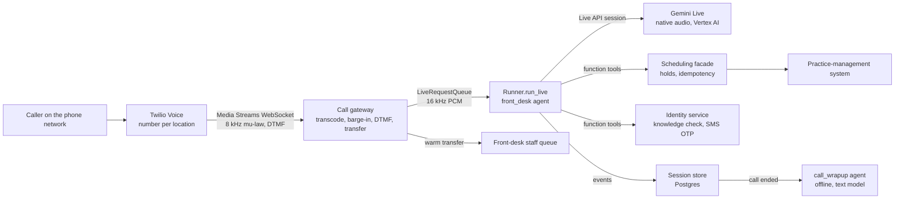
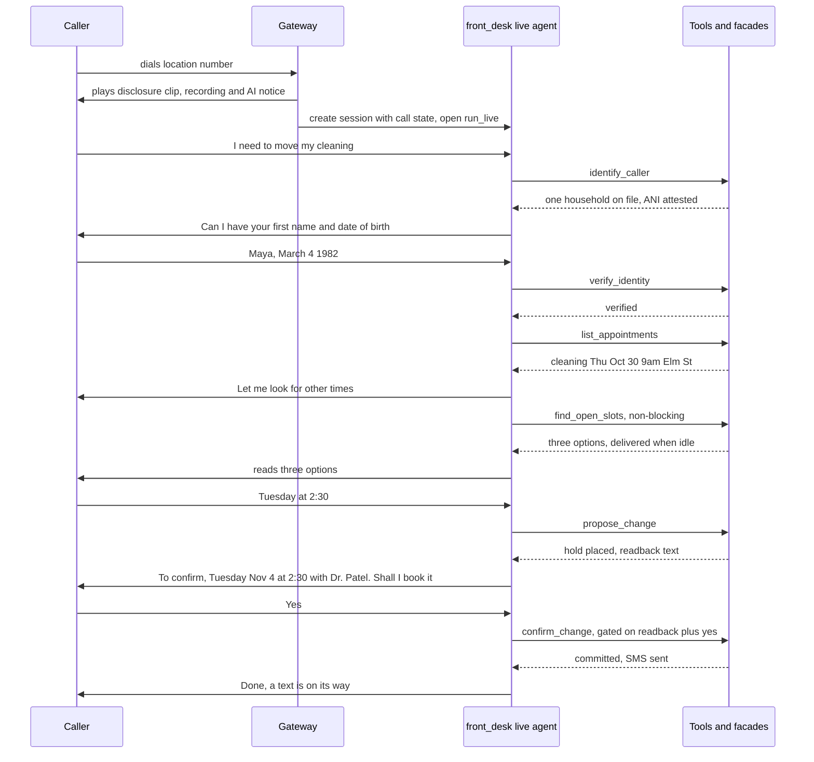

# Front Desk — a real-time voice agent for a dental group's phone line

A voice agent answers the phone for **Brightline Dental** (a fictional 60-location dental and orthodontics group). It talks with callers in real time, verifies who they are, and changes their appointments: it reschedules, cancels, and tells them when their next visit is. Anything else goes to a person at the front desk through a warm transfer, or becomes a callback ticket.

The system has **one live agent** on the call and **one offline agent** after the call. Everything else is deterministic harness code: a telephony gateway, a scheduling facade over the practice-management system (PMS), an identity service, and a set of ADK plugins. The companion [harness architecture](harness-architecture.md) covers the harness around these agents, module by module.

## Contents

- [Problem as given, and the assumptions I made](#problem-as-given-and-the-assumptions-i-made)
- [Overview](#overview)
- [Architecture at a glance](#architecture-at-a-glance)
- [The central decision: speech-to-speech or a cascade](#the-central-decision-speech-to-speech-or-a-cascade)
  - [What ADK 2.13 actually offers](#what-adk-213-actually-offers)
  - [The comparison](#the-comparison)
  - [The decision](#the-decision)
- [How a call flows](#how-a-call-flows)
- [Agents](#agents)
  - [Front desk (live agent)](#front-desk-live-agent)
  - [Call wrap-up (offline agent)](#call-wrap-up-offline-agent)
- [Cross-agent workflows](#cross-agent-workflows)
- [Why one live agent](#why-one-live-agent)
- [Tools: built-ins, long-running, toolsets and MCP](#tools-built-ins-long-running-toolsets-and-mcp)
- [Does a VFS-style flat orchestrator fit?](#does-a-vfs-style-flat-orchestrator-fit)
- [A2A](#a2a)
- [Identity, auth and OAuth](#identity-auth-and-oauth)
- [Skills](#skills)
- [Other ADK machinery](#other-adk-machinery)
- [Session state](#session-state)
  - [How state works in a live call](#how-state-works-in-a-live-call)
  - [Who sees the conversation history](#who-sees-the-conversation-history)
  - [All state variables at a glance](#all-state-variables-at-a-glance)
  - [Kept outside state on purpose](#kept-outside-state-on-purpose)
  - [State considered and rejected](#state-considered-and-rejected)
  - [Tensions to resolve](#tensions-to-resolve)
- [Closed decisions](#closed-decisions)
- [Open decisions](#open-decisions)
- [Appendix](#appendix)

---

## Problem as given, and the assumptions I made

> Design a real-time voice agent that answers a company's phone line, talks with callers, and takes actions such as rescheduling an appointment.

Nobody will answer questions, so every number below is an assumption I chose, written down so it can be challenged.

| Dimension | Assumption |
|---|---|
| **Company** | One company: a dental group with 60 locations in 9 US states, each with its own phone number. All numbers route into one system. |
| **Volume** | About 150 inbound calls per location per day, so **9,000 calls a day**. The busy hour carries 15% of the day (1,350 calls). At a 3.5-minute average that is about 80 calls at once. **The design target is 200 concurrent calls.** |
| **Call mix** | Reschedule or cancel 35%. "When is my appointment?" 20%. New-patient or new-booking requests 15%. Billing or insurance 15%. Hours, address and parking 10%. Clinical questions or emergencies 5%. |
| **v1 scope** | The agent changes **existing** appointments (reschedule, cancel), looks them up, and answers practice-info questions. New bookings, billing, insurance and clinical questions are handed off (transfer or callback ticket). |
| **Containment target** | 55% of calls finish without a human. An agent that contains more by refusing to transfer is a failure. |
| **Latency SLO** | Voice-to-voice (the caller stops speaking → the first agent audio reaches the caller): **p50 ≤ 1.0 s, p95 ≤ 1.6 s**. Barge-in (the caller starts speaking → agent audio stops): **p95 ≤ 300 ms**. Turns that call a tool: spoken acknowledgement ≤ 1.2 s p95, and the result spoken ≤ 3.5 s p95. |
| **Correctness SLO** | **Zero wrong-patient changes.** Each one is a Sev-1 incident. Wrong-slot changes (right patient, slot the caller didn't agree to) below 0.1% of changes. |
| **Languages** | English and Spanish. |
| **Hours** | 24/7. Outside office hours, transfers become callback tickets. |
| **Systems of record** | The PMS (an Open-Dental-class system with a REST API) holds patients and appointments. Twilio holds the phone numbers. |
| **Regulation** | Calls carry PHI, so every vendor in the audio and transcript path is under a BAA (Business Associate Agreement). About a dozen states the group operates in require all-party consent to recording. |
| **Cost ceiling** | ≤ $0.12 per call-minute all-in (model, telephony, recording), against roughly $4–6 for a human-handled call. |

---

## Overview

- **Goal:** answer every call within one ring, settle the common appointment requests end to end, and hand everything else to a person with a brief already written.
- **Shape:** one **live agent** (`front_desk`) runs on a native-audio model through ADK's bidirectional streaming (`Runner.run_live` + `LiveRequestQueue`). One **offline agent** (`call_wrapup`) turns the finished call into a structured record. Both are flat `LlmAgent`s with no sub-agents.
- **The rule that shapes everything:** **the model talks; code decides.** The model handles turn-taking, understanding, and phrasing. Identity, authorization, which patient's data can be touched, whether a change was confirmed, and idempotency all live in tools and in harness code. None of it relies on the model following prose.
- **Live-mode facts that bend the design**, all verified in ADK source:
  - The instruction is assembled once, when the live connection opens, and stays fixed until a reconnect. Mid-call context reaches the model through **tool results**, not `{state}` templating ([Session state](#how-state-works-in-a-live-call)).
  - Tool confirmation (`require_confirmation`) **does not work in live mode**. A gated tool can only be refused, never resumed. Writes therefore use a two-phase **propose → confirm** pair with a harness gate ([`confirm_change`](#tool-confirm_change)).
  - Agent transfer in live mode closes the connection, waits 1 s, and opens a new session. This is why the call has one agent ([Why one live agent](#why-one-live-agent)).
- **Tool conventions** (adapted from the ops-desk design to voice):
  - Arguments are flat and typed. Fixed sets are enums, with each value's meaning in the docstring.
  - **The model never passes a patient id.** Every tool that touches patient data reads `patient_id` from [`caller_identity`](#state-caller_identity), which only the verification tools write.
  - A missing fact (a date of birth, a choice) is optional in the signature and comes back as `needs_input`, in the ops-desk shape: `status`, `missing`, `collected`, `message`. An ambiguous reference comes back as `needs_clarification` with at most 3 candidates.
  - **Spoken output rules:** at most 3 options per turn (people can't hold more by ear). Ids are never spoken. Dates are spoken as weekday, month and day. Every tool returns a `say` field: a short, deterministic sentence the model may read as written. This keeps facts (dates, times, provider names) out of the model's own paraphrasing.
  - List tools return one page (3 by voice) and report the total.
  - Every write is two-phase, idempotent, and confirmed by SMS to the number on file.

---

## Architecture at a glance



| Component | Kind | Owns | Model? |
|---|---|---|---|
| `front_desk` | live `LlmAgent` under `run_live` | the conversation, intent, phrasing, when to call which tool | Gemini Live native audio (Vertex AI, pinned version) |
| `call_wrapup` | offline `LlmAgent`, single turn, `output_schema` | the structured call record, the staff note | text model via `LiteLlm` (course default stack) |
| Call gateway | harness service (FastAPI + WebSockets) | audio transcoding, barge-in `clear`, DTMF capture, recording consent clip, transfer execution, kill switch | none |
| Scheduling facade | harness service | slot search, holds with TTL, idempotent commits, SMS confirmation, the reschedule saga against the PMS | none |
| Identity service | harness service | knowledge-factor checks, OTP issue and verify, lockouts | none |
| ADK plugins | harness code in the runner | confirmation-evidence gate, tool budgets, transcript ring buffer, emergency backstop, output screen, telemetry | none |

---

## The central decision: speech-to-speech or a cascade

### What ADK 2.13 actually offers

Both architectures exist in ADK 2.13 as **a different `model` on the same `LlmAgent`**, with the same tools, instruction and `run_live` loop:

- **Native speech-to-speech:** set `model` to a Gemini Live native-audio model. `Gemini.connect()` opens a Live API session, and audio goes in and out of one model. **Code:** `ADK/models/google_llm.py:580-618`. The default live model is `gemini-live-2.5-flash-native-audio`. **Code:** `ADK/agents/llm_agent.py:292`.
- **Cascade:** set `model=CascadeLive(model=<text LLM>, stt=<LiveIngress>, tts=<LiveEgress>)`. `CascadeLiveConnection` runs STT → text LLM → TTS, with barge-in handling and transcripts. **Code:** `ADK/live/_cascade_live.py`, `ADK/live/_cascade_live_connection.py`. The built-in transforms are `GeminiSTT` (`gemini-3.5-transcribe-live`) and `GeminiTTS` (`gemini-3.8-flash-lite-tts`). **Code:** `ADK/live/_gemini_stt.py:48`, `ADK/live/_gemini_tts.py:48`. It is `@experimental(FeatureName.CASCADE_LIVE)`, on by default. **Code:** `ADK/features/_feature_registry.py:148`.
- **What does not exist:** `LiteLlm` has no live `connect()`, so `BaseLlm.connect` raises `NotImplementedError`. **Code:** `ADK/models/base_llm.py:281-294`, with no override in `ADK/models/lite_llm.py`. In this framework, native speech-to-speech means Gemini. A non-Gemini reasoner (GPT-4.1 or Claude through LiteLLM) is only possible inside `CascadeLive`, which accepts any `BaseLlm` instance. **Code:** `ADK/live/_cascade_live.py:72-80`.

What I verified about the cascade, because it decides the comparison:

- **Function calls wait for speech to end.** The connection holds the model's function call until the turn's audio would have finished playing, and only then emits it. A spoken "let me check" therefore *delays the tool* by the length of the sentence, instead of overlapping with it. **Code:** `ADK/live/_cascade_live_connection.py:446-470`.
- **A known history-corruption bug on the phone's most common overlap.** When the caller speaks while a tool call is waiting for its response, the user turn lands between the call and its response, "which breaks this and later requests". It is an open TODO. **Code:** `ADK/live/_cascade_live_connection.py:352-355`. On a phone line, "hello? are you there?" during a slow lookup is routine.
- **Transcript fidelity is excellent.** History keeps only what the caller *heard*. On barge-in, the agent's turn is cut to the words whose audio had played. **Code:** `ADK/live/_cascade_live_connection.py:516-587`.
- **STT reconnects per user turn** (open TODO), which costs latency on every turn. **Code:** `ADK/live/_cascade_live_connection.py:207-209`.

### The comparison

| Criterion | Native speech-to-speech (Gemini Live) | Cascade (`CascadeLive`) |
|---|---|---|
| **Voice-to-voice latency** | One model hop. Server VAD end-of-speech (~400 ms silence, configurable) + time to first audio. My estimate: 0.8–1.2 s p50 over PSTN (**Unverified**, to be measured). | STT endpointing (500 ms default silence, **Code:** `ADK/live/_gemini_stt.py:52`) + LLM time to first token + TTS first audio + a per-turn STT reconnect. My estimate: 1.2–1.8 s p50 (**Unverified**). This misses the p95 SLO. |
| **Barge-in** | Server-side: the model emits `interrupted`, the gateway sends Twilio `clear`. | Handled in the connection with a heard-prefix cut (good). |
| **Tool calling mid-speech** | The model can speak and call in the same turn. `NON_BLOCKING` tools run in the background, and their results arrive with `WHEN_IDLE` scheduling. **Code:** `ADK/tools/base_tool.py:99-123`, `ADK/flows/llm_flows/tools/_live_caller.py:385-391,413-465`. | The call is held until the preamble finishes playing, which serializes filler and tool. The open TODO corrupts history when the caller talks during a pending call. |
| **Tool-calling quality** | Audio-native models are reported to be weaker at multi-step tool use than frontier text models (**Unverified**, widely reported). Mitigation: a 12-tool surface, flat args, policy enforced in code. | Text-model quality, any provider through LiteLLM. Its strongest advantage. |
| **Voice quality** | Natural prosody. Affective dialog is available (`enable_affective_dialog`, **Code:** `ADK/agents/run_config.py`). | Good TTS voices, but prosody doesn't follow the caller. |
| **Observability** | Input and output transcription are a side channel (`input_audio_transcription`, `output_audio_transcription` on `RunConfig`, on by default; **Code:** `ADK/agents/run_config.py`). The model reasons over audio, so the transcript is evidence, not the exact model input. | The transcript *is* the model's input and the heard output. Best audit story. |
| **Guardrails on output** | Only after the fact: the after-model callback sees accumulated output transcription and can force a session restart. **Code:** `ADK/live/_live_llm_flow.py:277-300`. | A custom `LiveEgress` can filter text *before* it is synthesized ("handle optional filtering", **Code:** `ADK/live/_transforms.py`). A real pre-speech gate. |
| **PII scrubbing before the model** | Impossible: the model hears raw audio. | Possible on STT text (the agentfarm scrubber pattern), at +50–200 ms per turn. |
| **Cost per minute** | Audio tokens: ~$3/M in, ~$12/M out, roughly $0.005 + $0.018 per minute before context growth (**Unverified**, third-party price reports). | STT + text LLM + TTS per minute. Similar order of magnitude (**Unverified**). Not a decider. |
| **Maturity in ADK 2.13** | `run_live` is experimental (**Code:** `ADK/runners.py:1788-1790`), but it handles session resumption, GoAway reconnect and restart. **Code:** `ADK/live/_live_llm_flow.py:540-809`. | Experimental, with open TODOs on the exact overlap pattern phone calls produce. |
| **Provider lock-in** | Gemini only. A departure from the course's LiteLLM/no-Gemini default. | Any reasoner. Default STT/TTS are Gemini; Deepgram or ElevenLabs need custom transforms. |

### The decision

**Ship native speech-to-speech (Gemini Live native audio on Vertex AI, model version pinned) for the live call. Keep `CascadeLive` as a per-location switch on the same agent definition, re-evaluated at every ADK minor release.** Full record: [ADR-001](#adr-001-native-speech-to-speech-on-gemini-live-with-cascadelive-as-a-switchable-track).

Why native wins today:

1. **Latency is the product.** A 1.8 s p50 sounds broken on a phone, and callers talk over it, which causes more barge-ins and more misheard turns.
2. **The cascade's open bug sits on the critical path.** "Caller speaks during a pending tool call" happens on every slow PMS lookup, and it corrupts history in today's ADK.
3. **The native path's weaknesses can be fixed in the harness.** Weak tool calling is countered by a tiny, flat, policy-enforcing tool surface. Transcript fidelity is countered by dual-channel recording as the record of truth. Weak output guardrails matter less because the dangerous outputs are *actions*, and actions are gated in tools, not in speech.

The cascade's strengths are real, and they are why it stays a switch rather than being deleted: the same agent, tools and instruction run under `CascadeLive(model=LiteLlm(...), stt=..., tts=...)`, and the eval suite runs both. **The trigger to switch:** the TODO at `_cascade_live_connection.py:352` is closed, and the cascade meets the p95 voice-to-voice SLO in the telephony-in-the-loop eval.

---

## How a call flows



---

## Agents

### Front desk (live agent)

- **Purpose**
  - Hold a natural phone conversation in English or Spanish: greet, understand, ask, confirm, close.
  - Verify the caller to the level the request needs, then look up, reschedule or cancel their appointments.
  - Answer the enumerated practice-info questions (hours, address, parking, accepted insurers by name, cancellation policy, what to bring).
  - Hand off everything else, early and gracefully: warm transfer during office hours, a callback ticket outside them.
- **Model and run configuration**
  - `model`: a pinned Gemini Live native-audio version on Vertex AI (the ADK default name is `gemini-live-2.5-flash-native-audio`; production pins an exact dated version).
  - `RunConfig(streaming_mode=StreamingMode.BIDI, response_modalities=[AUDIO], speech_config=<one voice per language>, input_audio_transcription=..., output_audio_transcription=..., realtime_input_config=<server VAD, silence_duration_ms=400>, session_resumption=SessionResumptionConfig(transparent=True), context_window_compression=<sliding window>)`. Every field exists. **Code:** `ADK/agents/run_config.py`. `transparent=True` is set only on Vertex AI, because the Gemini API rejects it. **Code:** `ADK/live/_live_llm_flow.py:557-567`.
  - `tool_thread_pool_config` stays unset: every tool is `async` over `httpx`, so nothing blocks the event loop (the reason the option exists in live mode). **Code:** `ADK/agents/run_config.py` (the `tool_thread_pool_config` docstring).
- **Its loop, internally:** there is no plan-act-observe loop the harness drives. The Live session is one long invocation. The server decides turn-taking; each model turn is speech, a function call, or both. A function call goes through ADK's tool pipeline (callbacks included). Its response is sent back on the queue and the model continues. **Code:** `ADK/live/_live_llm_flow.py:614-650`.
- **Stop conditions** (none of them up to the model's judgement):
  - `end_call` → the gateway hangs up after the final audio mark plays.
  - `transfer_to_staff` → the gateway bridges the caller to staff and closes the live session.
  - The caller hangs up → Twilio `stop` → the gateway calls `LiveRequestQueue.close()`.
  - Harness budgets: 20 minutes of call time or 25 tool calls → forced warm transfer ([harness M13](harness-architecture.md#m13--reliability-engineering-for-agents)).
  - Verification lockout (3 failed attempts) → forced transfer.
- **Instruction:** assembled once at connect time ([why](#how-state-works-in-a-live-call)). It holds: identity and disclosure rules, the verification ladder in plain words, the per-tool "use when / say first" lines, the escalation table, the spoken-style rules, and a **14-day date table** ("Mon Oct 27, Tue Oct 28 … Sun Nov 9") built from the location's time zone. The model resolves "next Tuesday" by reading the table instead of computing it, and every readback repeats the full date, so a wrong resolution is caught by the caller. `static_instruction` is **not** used: "Live API has its own cache mechanism, thus this field doesn't work with Live API." **Code:** `ADK/agents/llm_agent.py:346-354`.
- **Tools** (12, all native `FunctionTool`s; [why not MCP](#tools-built-ins-long-running-toolsets-and-mcp)):

  - <a id="tool-identify_caller"></a>`identify_caller()` — takes no arguments. Reads the caller ID (ANI) and its STIR/SHAKEN attestation from [`call`](#state-call), and asks the identity service how many patients and households have that number on file. It returns **counts and a hint, never names**: `{status: "ok", on_file: "single"|"household"|"none", attestation: "A"|"B"|"C"|"none", say: "..."}`.
    - **Use when:** the caller asks about *their* appointments. Never for practice-info questions.
    - **State:** reads [`call`](#state-call). Writes [`caller_identity`](#state-caller_identity) at `level: "ani_hint"`. A hint is not verification.
    - <a id="state-call"></a>**State variable `call`** (config-time: written by the gateway when the session is created; the model never writes it)
      - **What it is for:** the facts of this phone call that only the telephony layer knows: `{call_sid, ani, stir_attestation, dialed_number, location_id, language_hint, started_at}`.
      - **Written by:** the gateway, through `session_service.create_session(state={...})` before `run_live` starts. This route is required: the runner's auto-create path sets no state ([ops-desk note](../../code/my_multi_agent/README.md#setting-values-at-config-time)). **Read by:** `identify_caller`, `transfer_to_staff`, `take_message`, the instruction provider at connect time (location name, time zone), and `call_wrapup`.
      - **Chat example:**
        ```text
        (caller dials the Elm Street number from +1 312 555 0147)
        Agent:  Thanks for calling Brightline Dental, Elm Street. How can I help?
                                             (location name from call.location_id)
        Caller: When's my next appointment?
        Agent:  I can check. What's your first name and date of birth?
                                             (identify_caller found one household for that number)
        ```
      - **Why state:** the tools must not accept the caller's number as an argument. If they did, the model could be talked into "look me up under 312 555 0199". The number comes from Twilio, through the gateway, into state, and a tool reads it.
      - **Risk:** caller ID is spoofable. `ani` is a *hint* that picks the household to check knowledge factors against. It never verifies anyone by itself ([Identity](#identity-auth-and-oauth)).

  - <a id="tool-verify_identity"></a>`verify_identity(first_name=None, date_of_birth=None)` — a knowledge-factor check against the patients reached through the ANI hint, or against a name-plus-DOB search when the ANI matched nobody. `date_of_birth` is ISO `YYYY-MM-DD`; the model converts the spoken date.
    - Missing either value → `needs_input` naming what is missing, with "ask the caller; do not guess".
    - Match → `{status: "verified", level: "knowledge", say: "Thanks, Maya. I've got your file."}`, plus a one-line list of dependents the caller is the guardian of ("you can also manage appointments for Leo").
      - If this verified patient dropped a call mid-task in the last 15 minutes, the result also carries `continuation` and a `say` such as "We got cut off while moving Leo's checkup to Tuesday at 2:30. Want me to check that time again?"
      - It is consumed once and seeds no state ([ADR-011](#adr-011-no-cross-call-memory-beyond-a-15-minute-continuation-record-the-pms-is-the-source-of-truth)). `check_verification_code` does the same on success. Mismatch → `{status: "not_matched", attempts_left: n}`. The tool never says which field was wrong, so it can't be used as an oracle.
    - It decides whether the request needs a **step-up** to a one-time code (ANI didn't match, attestation below A, or caller ID withheld) and says so: `{status: "step_up_required", say: "For your security I'll text a code to the mobile number we have on file."}`.
    - **State:** writes [`caller_identity`](#state-caller_identity) and [`verification`](#state-verification).
    - <a id="state-caller_identity"></a>**State variable `caller_identity`** (written by tools while the call runs)
      - **What it is for:** who the caller has been proven to be, and how strongly: `{level: "none"|"ani_hint"|"knowledge"|"otp", patient_id, display_first_name, dependents: [{patient_id, first_name}], verified_at}`.
      - **Written by:** `identify_caller` (only `ani_hint`), `verify_identity` and `check_verification_code`. **Nothing else can write it**, and a plugin rejects any state delta touching it from any other tool ([harness M14](harness-architecture.md#m14--security--injection-defense)). **Read by:** every tool that touches patient data (`list_appointments`, `find_open_slots`, `propose_change`, `confirm_change`), the confirmation gate, the transfer brief, and `call_wrapup`.
      - **Chat example:**
        ```text
        Caller: I'm calling to move my son Leo's checkup.
        Agent:  Sure. First, your first name and date of birth?
        Caller: Maya, March 4th 1982.
        Agent:  Thanks, Maya. I see Leo's checkup on Thursday, October 30th at 4 PM.
                                (caller_identity.dependents includes Leo; list_appointments
                                 returns appointments for the patient and their dependents)
        Caller: Actually, can you look up my sister Dana's too?
        Agent:  I can only help with appointments for you and the people on your account.
                Dana can call us, or I can have the front desk call her back.
                                (Dana is not in caller_identity; the tool would refuse anyway)
        ```
      - **Why state:** it is the authorization boundary for the whole call. Tools take `patient_id` from here, never from an argument, so no phrasing, injected instruction or mishearing can point a tool at another patient.
      - **Risk:** it is a single point of trust. If a bug lets the wrong tool write it, every downstream check is void. The plugin guard and a unit test that walks every tool's state writes exist for this reason. It also goes stale if the caller hands the phone to someone else; the instruction says to re-verify when the speaker changes, but that rule is soft.
    - <a id="state-verification"></a>**State variable `verification`** (written by tools while the call runs)
      - **What it is for:** attempts and lockout for this call: `{knowledge_attempts, otp_attempts, otp_sent_at, otp_expires_at, locked: bool}`.
      - **Written by:** `verify_identity`, `send_verification_code`, `check_verification_code`. **Read by:** the same three, and the transfer brief ("verification failed 3 times").
      - **Chat example:**
        ```text
        Caller: Maya, March 14th 1982.
        Agent:  I couldn't match that. Could you say your date of birth again?
        Caller: March 14th.
        Agent:  That still doesn't match what we have. Let me connect you with the front
                desk; they can help.        (3rd failure: locked = true, transfer forced)
        ```
      - **Why state:** the attempt limit must hold even if the model "forgets" or the caller rephrases. Kept in code, it can't be talked around.
      - **Risk:** a per-call counter does nothing against an attacker who simply calls again. The identity service also keeps a per-patient lockout across calls (5 failures in 24 h); this state variable only drives the in-call conversation.

  - <a id="tool-send_verification_code"></a>`send_verification_code()` — no arguments. Sends a 6-digit code by SMS to the mobile number **on file** (never a number the caller says), valid for 5 minutes. Returns `{status: "sent", say: "I've texted a 6-digit code to the mobile ending in 47. You can type it on your keypad."}`.
    - **State:** writes [`verification`](#state-verification).
  - <a id="tool-check_verification_code"></a>`check_verification_code(spoken_code=None)` — first checks the **keypad digits the gateway captured** from Twilio `dtmf` messages. Those digits never pass through the model. If the caller read the code aloud instead, the model passes it as `spoken_code`. That is acceptable: the code is single-use and expires in 5 minutes.
    - **State:** writes [`caller_identity`](#state-caller_identity) (`level: "otp"`) and [`verification`](#state-verification).

  - <a id="tool-list_appointments"></a>`list_appointments()` — upcoming appointments for the verified patient and their dependents. It returns at most 3, the soonest first, with the total: `{status, total, items: [{appointment_id, who, what, when_spoken, location_name, provider}], say}`.
    - Refuses with `{status: "not_verified"}` below `level: "knowledge"`.
    - **State:** reads [`caller_identity`](#state-caller_identity). Writes [`listed_appointments`](#state-listed_appointments).
    - <a id="state-listed_appointments"></a>**State variable `listed_appointments`** (written by tools while the call runs)
      - **What it is for:** the appointment ids in the order they were spoken, `{shown_ids, total}`, so "the second one" or "Leo's" means what the caller heard.
      - **Written by:** `list_appointments`. **Read by:** `find_open_slots` and `propose_change`, which reject any `appointment_id` not in `shown_ids`. The model can only act on appointments the caller has heard read back.
      - **Chat example:**
        ```text
        Agent:  You have two: a cleaning Thursday October 30th at 9 AM, and Leo's
                checkup the same day at 4 PM.
        Caller: Move the second one.
        Agent:  Leo's checkup. Any day or time that works better?
                                       (appointment id taken from shown_ids[1])
        ```
      - **Why state:** the order the caller heard is fixed. A fresh query could reorder the list, and the model would then be guessing which item "the second one" was.
      - **Risk:** an appointment can change in the PMS between listing and acting (staff moved it). `propose_change` re-reads the appointment and returns `stale` if it changed.

  - <a id="tool-find_open_slots"></a>`find_open_slots(appointment_id, earliest_date=None, latest_date=None, part_of_day=None, same_provider=True)` — open slots that fit the appointment's type and duration, at its location unless the caller asks otherwise.
    - `part_of_day` is one of `morning` (before 12:00), `afternoon` (12:00–17:00), `evening` (after 17:00), or none for any time.
    - Returns at most 3 slots, the soonest first, with `{slot_id, when_spoken, provider, location_name}` and a `say` line. With no slots it widens the search once (same provider → any provider, then +7 days) and says what it widened.
    - **Non-blocking:** `behavior = types.Behavior.NON_BLOCKING`, `response_scheduling = types.FunctionResponseScheduling.WHEN_IDLE`. The model can say "let me look" and keep talking. The result is delivered when the model is idle, not mid-sentence. **Code:** `ADK/tools/base_tool.py:99-123`; ADK marks the declaration `NON_BLOCKING` on the Live request, `ADK/flows/llm_flows/tools/_agent_tools.py:130-151`. PMS slot search takes 1–3 s, which is why this tool is the one made non-blocking.
    - **State:** reads [`caller_identity`](#state-caller_identity), [`listed_appointments`](#state-listed_appointments). Writes [`offered_slots`](#state-offered_slots).
    - <a id="state-offered_slots"></a>**State variable `offered_slots`** (written by tools while the call runs)
      - **What it is for:** the last slot search and its results in spoken order: `{appointment_id, slot_ids, earliest_date, latest_date, part_of_day, same_provider}`. "The second one", "the Tuesday one" and "anything later that day?" all depend on it.
      - **Written by:** `find_open_slots`. **Read by:** `propose_change` (the slot must be among `slot_ids`) and `find_open_slots` itself (a follow-up search reuses the stored parameters with one field changed).
      - **Chat example:**
        ```text
        Agent:  I have Monday November 3rd at 10, Tuesday the 4th at 2:30, or
                Wednesday the 5th at 8 AM.
        Caller: Tuesday works.
        Agent:  Tuesday November 4th at 2:30 with Dr. Patel at Elm Street. Shall I book it?
                                        (slot id = offered_slots.slot_ids[1])
        Caller: Hmm, anything later on Tuesday?
                                        (same search, earliest = Nov 4 14:30, part_of_day = afternoon)
        ```
      - **Why state:** slot ids are long opaque strings the model must not invent or misremember. Storing the ordered list turns "Tuesday" into an exact id. The `propose_change` check also stops the model from booking a slot it never offered.
      - **Risk:** slots disappear (another caller took it). `propose_change` places a hold and returns `slot_taken` if it fails; the model offers the next one.

  - <a id="tool-propose_change"></a>`propose_change(kind, appointment_id, slot_id=None)` — phase one of every write.
    - `kind` is `reschedule` (needs `slot_id`) or `cancel` (no `slot_id`; the tool applies the cancellation policy and returns any late-cancellation fee **as policy text**, never as an amount the model computes).
    - It validates everything against the verified identity and the stored lists, then places a **5-minute hold** on the target slot in the scheduling facade. It returns `{status: "proposed", change_id, readback, say}`. `readback` is a deterministic sentence ("Leo's checkup moves from Thursday October 30th at 4 PM to Tuesday November 4th at 2:30 PM with Dr. Patel at Elm Street").
    - **Nothing is changed in the PMS yet.**
    - **State:** reads [`caller_identity`](#state-caller_identity), [`listed_appointments`](#state-listed_appointments), [`offered_slots`](#state-offered_slots). Writes [`pending_change`](#state-pending_change).
    - <a id="state-pending_change"></a>**State variable `pending_change`** (written by tools while the call runs)
      - **What it is for:** the one write awaiting the caller's "yes", frozen: `{change_id, kind, patient_id, appointment_id, from_slot, to_slot, hold_id, hold_expires_at, readback, idempotency_key, proposed_at}`. There is at most one at a time; a new proposal releases the previous hold.
      - **Written by:** `propose_change` (creates it), `confirm_change` (clears it on success). **Read by:** `confirm_change` and the **confirmation-evidence gate** (a `before_tool_callback` in a plugin). The gate checks that the readback was spoken after `proposed_at` and that the caller's next finished utterance is an unambiguous yes ([harness M8](harness-architecture.md#m8--tool-interfaces)).
      - **Chat example:**
        ```text
        Agent:  To confirm: Leo's checkup moves to Tuesday November 4th at 2:30 with
                Dr. Patel. Shall I book it?
        Caller: Wait, is that the Elm Street office?
        Agent:  Yes, Elm Street.
        Caller: OK, yes.
        Agent:  Done. You'll get a text confirming it.
                    (the gate saw the readback, then "OK, yes" as the latest caller turn)

        Agent:  To confirm: Tuesday November 4th at 2:30. Shall I —
        Caller: [interrupts] Actually no, make it Monday.
                    (barge-in: no yes ever arrived; a confirm_change call would be refused;
                     a new propose_change releases the Tuesday hold)
        ```
      - **Why state:** this is the ops desk's deferred `pending_action`, made necessary. `require_confirmation` cannot pause and resume a tool in live mode (**Code:** `ADK/flows/llm_flows/tools/_live_caller.py:517-519`, "a confirmation-gated tool can only ever be refused, never resumed"; also `ADK/live/_live_llm_flow.py:169-173,461-464`). The frozen proposal means the yes applies exactly to what was read back, not to whatever the model reconstructs from memory.
      - **Risk:** the yes is spoken, so its evidence is a transcription of audio, and transcription can mishear "no, yes the Monday" as "yes". The gate rejects mixed or negated utterances and asks again. The SMS confirmation to the number on file is the after-the-fact backstop.

  - <a id="tool-confirm_change"></a>`confirm_change(change_id)` — phase two. It commits the frozen `pending_change` through the scheduling facade with its `idempotency_key`, which is derived from `(patient_id, appointment_id, to_slot)`, **not** from the call. A caller whose call dropped and who calls back produces the same key, and the facade answers `already_applied` instead of double-booking ([ADR-009](#adr-009-idempotency-by-patient-appointment-and-slot-plus-holds-and-sms-confirmation)).
    - **Blocking** (the default): the model must not claim success before the result. The instruction says to speak one short line ("booking that now") first.
    - Returns `committed`, `already_applied`, `hold_expired` (re-propose), `slot_taken` (offer alternatives), or `failed` with `retryable`. On `committed`, the facade sends an SMS to the number on file.
    - **State:** reads [`pending_change`](#state-pending_change), [`caller_identity`](#state-caller_identity). Writes [`completed_changes`](#state-completed_changes), clears `pending_change`.
    - <a id="state-completed_changes"></a>**State variable `completed_changes`** (written by tools while the call runs)
      - **What it is for:** the writes that actually happened on this call: `[{change_id, kind, appointment_id, to_slot, result, sms_sent}]`.
      - **Written by:** `confirm_change`. **Read by:** `call_wrapup` (the record and staff note), the transfer brief, and the instruction-independent rule in `end_call` that a call with a `committed` change always ends by restating it.
      - **Chat example:**
        ```text
        (connection drops after "Done" but before the caller hears it; caller redials)
        Agent:  Thanks for calling Brightline Dental. How can I help?
        Caller: I was just moving my son's appointment and it cut out.
        Agent:  Let me check. First name and date of birth?  ...
        Agent:  Leo's checkup is already moved to Tuesday November 4th at 2:30;
                you should have a text.
                (new call, new session: the PMS shows the change; a repeat confirm would
                 return already_applied)
        ```
      - **Why state:** it is the call's own audit of side effects, read by code that runs after the conversation (the wrap-up). The PMS stays the source of truth.
      - **Risk:** low. It duplicates the facade's own log; it exists so the wrap-up does not have to query the PMS.

  - <a id="tool-get_practice_info"></a>`get_practice_info(topic, location_id=None)` — `topic` is one of `hours`, `address`, `parking`, `insurers_accepted`, `cancellation_policy`, `what_to_bring`, `new_patient_process`. It returns the location's approved snippet, written by the practice in the admin console, plus `as_of`. Unverified callers can use it. No retrieval, no free text ([ADR-013](#adr-013-practice-info-as-an-enumerated-lookup-not-rag)).
  - <a id="tool-transfer_to_staff"></a>`transfer_to_staff(reason, note=None)` — warm transfer.
    - `reason` is one of `caller_asked`, `new_booking`, `billing_insurance`, `clinical_question`, `urgent_dental`, `emergency`, `verification_failed`, `complaint`, `out_of_scope`, `agent_trouble`.
    - `note` is at most 120 characters of the caller's request in the model's words.
    - Returns the queue's estimated wait. Above 3 minutes, the model offers a callback (`take_message`) instead.
    - On accept, it writes [`handoff`](#state-handoff). The gateway sees it through the event stream and runs the transfer ([Cross-agent workflows](#cross-agent-workflows)).
    - <a id="state-handoff"></a>**State variable `handoff`** (written by tools while the call runs)
      - **What it is for:** the transfer or callback request: `{mode: "warm_transfer"|"callback", reason, note, queue, requested_at}`.
      - **Written by:** `transfer_to_staff`, `take_message`, and harness budgets (forced transfer). **Read by:** the gateway (to act), the deterministic brief builder (what the staff member hears before the bridge), and `call_wrapup`.
      - **Chat example:**
        ```text
        Caller: Does my insurance cover the crown?
        Agent:  That's one for our billing team. I can connect you now; the wait is
                about a minute. Or they can call you back this afternoon.
        Caller: Connect me.
        Agent:  Connecting you now.
        (staff hears: "Verified patient Maya R., asking about crown coverage, Delta plan
         on file. No changes made on this call.")
        ```
      - **Why state:** the gateway and the wrap-up are not the model. They need the request as data, and the brief is built from state, not from an LLM summary, so it is instant and never invents ([ADR-010](#adr-010-warm-transfer-through-telephony-with-a-deterministic-brief-not-agent-transfer)).
      - **Risk:** `note` is model-written text read to a staff member, so it is a small injection and hallucination surface. It is length-capped and labelled "caller request (automated)".
  - <a id="tool-take_message"></a>`take_message(reason, callback_window=None)` — creates a callback ticket in the front-desk queue. `callback_window` is `today`, `tomorrow_morning`, `tomorrow_afternoon`, or none for "next available". Writes [`handoff`](#state-handoff). This is prospective memory: the ticket lives in the queue system with a due time and a done flag, never in session state (M7).
  - <a id="tool-end_call"></a>`end_call(reason)` — `reason` is `resolved`, `caller_done`, `no_response` (two prompts with 8 s of silence each), or `wrong_number`. The gateway hangs up after the last audio mark is played back.
- **Does not**
  - Accept a patient id, phone number, or slot it didn't offer from the model's own arguments.
  - Give clinical advice, quote prices or coverage amounts, or book new patients (v1).
  - Change contact details, insurance, or anything outside appointments.
  - Read back anything about a patient before verification, including whether a patient exists.
- **Rules** (declared in the instruction, enforced in code where marked)
  - Disclosure first: the gateway plays a fixed clip ("You've reached Brightline Dental's automated assistant. This call is recorded…") before the agent speaks. *Enforced:* the clip is played by the gateway, not by the model.
  - Verify before any patient data. *Enforced:* every patient tool refuses below `knowledge`.
  - Writes need a read-back and a fresh yes. *Enforced:* the confirmation-evidence gate.
  - Emergencies (trouble breathing or swallowing, swelling spreading to the eye or neck, uncontrolled bleeding, facial trauma): tell the caller to call 911 or go to an emergency room, then transfer with `emergency`. *Backstop:* the harness emergency detector forces the transfer if the model hasn't called it within two caller turns ([harness M15](harness-architecture.md#m15--guardrails-safety--governance)).
  - Before any tool that takes more than about a second, say one short line first. Never go silent for more than 2 seconds.
- **State:** all of the above; summarized in [Session state](#session-state).

### Call wrap-up (offline agent)

- **Purpose:** once the call ends, turn it into a structured record: what the caller wanted, what happened, what changed, why it was handed off, and a 2-line note for the staff member who handles any follow-up.
- **Shape:** `LlmAgent(name="call_wrapup", model=LiteLlm("azure/gpt-4.1-mini"), mode="single_turn", output_schema=CallRecord, include_contents="none")`. A worker runs it with `Runner.run_async` when the gateway publishes `call.ended`.
  - Its input is assembled by harness code from the session: finished transcriptions, tool calls and results, `completed_changes`, `handoff`.
  - This is the one place the course's LiteLLM default applies unchanged: it is a text task with no latency pressure.
- **Its loop:** one model call, no tools. `CallRecord` fields: `intent` (enum, mirrors the call mix), `outcome` (`contained`, `transferred`, `callback`, `abandoned`, `failed`), `changes` (copied from state by code, never generated), `handoff_reason`, `follow_up_needed` (bool), `staff_note` (≤ 300 chars), `quality_flags` (enum list: `long_silence`, `repeated_question`, `verification_struggle`, `caller_frustration`, `possible_misunderstanding`).
- **Stop condition:** one response. A schema-validation failure gets one retry; a second failure files the record with `outcome` from code and `staff_note: null`.
- **Does not:** write to the PMS, send messages, or decide anything with side effects. Code persists its output, and `changes` comes from state, so a hallucinated change can't enter the record.
- **State:** none. It reads the finished session through the session service (read-only) and writes nothing back to it.

---

## Cross-agent workflows

The two agents never talk to each other. They are joined by the session store and a queue message.

- **A contained reschedule:** `front_desk` runs `identify_caller` → `verify_identity` → `list_appointments` → `find_open_slots` → `propose_change` → `confirm_change` → `end_call`. The gateway hangs up. `call.ended` reaches the worker, `call_wrapup` produces the record, and code writes a PMS note.
- **Warm transfer:**
  1. `front_desk` calls `transfer_to_staff`.
  2. An `on_event_callback` plugin sees the `handoff` state delta and notifies the gateway.
  3. The gateway moves the caller into a Twilio Conference with hold audio, and builds the brief from state.
  4. It dials the staff queue and whispers the brief to the agent who answers.
  5. It bridges the caller and closes the `LiveRequestQueue`. The AI leaves the call.
  6. No answer in 90 s → the caller hears "press 1 to leave a message, or stay on the line", handled by Twilio, not the AI.
- **A call that drops mid-action:**
  - Before `confirm_change`:
    - The hold expires after 5 minutes and nothing changed.
    - The gateway's end-of-call handler writes a 15-minute continuation for the verified patient.
    - A redial that re-verifies within 15 minutes is told what was in progress. Otherwise a callback ticket is filed at minute 15.
    - The wrap-up records `abandoned` with the pending proposal.
  - After the commit: the SMS went out, and a re-call sees the change in the PMS. A retried commit returns `already_applied`.
  - Full mechanics: [harness M7, prospective memory](harness-architecture.md#prospective-memory-holds-confirmations-callbacks-wrap-up).

---

## Why one live agent

The ops desk split into agents by vocabulary and policy. Here the honest test from M11 ("would one well-harnessed agent do this better?") comes out clearly for one agent, and live mode makes splitting expensive:

- **What transfer costs in live mode** (**Code:** `ADK/live/_live_llm_flow.py:671-704`, `ADK/live/_flow_utils.py:36`):
  1. Stop background tools.
  2. `asyncio.sleep(DEFAULT_TRANSFER_AGENT_DELAY)`, which is **1.0 s**.
  3. Close the Live connection.
  4. Start the child agent's `run_live` with **a new Live session** (the resumption handle is deliberately cleared) and the history re-sent.

  That is 1–2 s of dead air per hop, a possible voice change, and the server-side audio context is lost. ADK also warns that transfer needs transcription enabled. **Code:** `ADK/live/_runner_utils.py:52-62`.
- **`AgentTool`, or a `task` / `single_turn` sub-agent as a tool:** a task or single-turn sub-agent is wrapped as a tool (**Code:** `ADK/agents/llm_agent.py:1347-1373`). Calling it from a live agent runs a *text* agent invocation inside a tool call, which takes seconds of blocking work, and the caller hears nothing unless it is non-blocking. Nothing in this domain needs that.
- **Workflow agents (Sequential, Parallel, Loop):** a phone call isn't linear. Callers change their mind, ask two things, and go back. A `SequentialAgent` of "verify → schedule" would fight the conversation. The ordering that matters (verify before data, propose before confirm) is enforced in tools, which is stricter than a workflow and needs no extra agents.
- **What the split would have bought:** context isolation (the whole context is small: one caller, ~10 tool results), specialization (12 tools, one vocabulary), parallelism (none needed), independent verification (done by deterministic gates, not a second model).
- **Where a second agent does earn its place:** after the call, where latency is free and the task (summarize, classify) suits a text model.

---

## Tools: built-ins, long-running, toolsets and MCP

- **Custom function tools:** all 12 live tools are native `async` `FunctionTool`s calling the internal facades over HTTP with a 2.5 s timeout. Native, because each one embeds policy: identity scoping, list membership, holds, idempotency. That is M9's rule: native for what you control.
- **ADK built-ins considered:**
  - `google_search`: rejected. The agent must never improvise practice facts from the web.
  - `load_memory` / `preload_memory`: rejected (no cross-call memory, [ADR-011](#adr-011-no-cross-call-memory-beyond-a-15-minute-continuation-record-the-pms-is-the-source-of-truth)).
  - `transfer_to_agent`: unused (one agent).
  - `exit_loop`: not applicable.
  - The **`stop_streaming`** built-in path for streaming tools exists (**Code:** `ADK/flows/llm_flows/tools/_live_caller.py:166-215`), but no tool here streams.
- **`LongRunningFunctionTool`: not used.** In ADK it returns no immediate response and expects the result to be injected later by function-call id (**Code:** `ADK/tools/long_running_tool.py`, `ADK/flows/llm_flows/tools/_caller.py:628-638`). In a live call, a `NON_BLOCKING` tool with `WHEN_IDLE` scheduling gets the same "work in the background, answer when ready" behaviour inside the same session, with less plumbing. Long-running work that outlives the call (a callback, an SMS reply) belongs to the queue system, not to a tool call. **Where it would fit:** a future "hold while I check with the office" flow, where a human approves something mid-call over minutes. Even then, a transfer is the better experience.
- **Streaming tools (async generators):** not used. A generator that yields progress ("still looking…") would make the model speak progress updates. The instruction's single filler line is cheaper and more predictable.
- **Toolsets:** one `BaseToolset` subclass, `FrontDeskToolset`. `get_tools(readonly_context)` hides the four patient-data tools until `caller_identity.level` is at least `knowledge` (M8's "the tool list is a permission boundary"). The catch: in live mode the tool list is resolved at connect time (**Unverified** whether ADK re-resolves toolsets mid-session). So this is defence in depth only. The authoritative check is inside each tool.
- **Existing MCP servers, and why none sits in the live path:**

  | Server | Status (verified by search, 2026-10) | Fit |
  |---|---|---|
  | [Google Calendar MCP](https://developers.google.com/workspace/calendar/api/guides/configure-mcp-server) (`https://calendarmcp.googleapis.com/mcp/v1`, OAuth 2.0, Streamable HTTP; tools `list_events`, `create_event`, `update_event`, `delete_event`, `suggest_time`, …) | Official, **Developer Preview** | A general calendar, not a clinic schedule (no appointment types, operatories, provider templates). Not our system of record. |
  | [Cal.com MCP](https://mcpservers.org/servers/calcom-mcp) (hosted `mcp.cal.com`, OAuth 2.1, or `@calcom/cal-mcp` with an API key; includes `reschedule_booking`, `cancel_booking`) | Listed as official by a third-party directory; repo not confirmed | The right fit **if** a tenant ran on Cal.com. Brightline doesn't. |
  | [Calendly MCP](https://www.developersdigest.tech/mcp-servers/calendly) | Vendor-hosted, per a directory | Same: wrong system of record. |
  | Dental PMS (Open Dental, Dentrix, Eaglesoft) | No official MCP server found | We build the facade over the PMS REST API. |

  - **Why MCP stays out of the call even where a server exists:**
    1. Every hop on the turn costs latency.
    2. MCP connections are stateful sessions to manage per call.
    3. A generic `reschedule_booking` has none of our identity scoping, holds or idempotency. Wrapping it would put all the policy in our wrapper anyway (M9: "MCP standardizes the socket; you still own the policy").
  - **How one would plug in if needed** (an offline staff-assist agent over Cal.com, say): `McpToolset(connection_params=StreamableHTTPConnectionParams(url="https://mcp.cal.com/...", headers=...), tool_filter=["get_bookings", "get_availability"], tool_name_prefix="calcom_", auth_scheme=..., auth_credential=...)`, read-only by filter. All parameters exist. **Code:** `ADK/tools/mcp_tool/mcp_toolset.py:150-180`, `ADK/tools/mcp_tool/mcp_session_manager.py:504-530`. Writes would still go through our facade.

---

## Does a VFS-style flat orchestrator fit?

The VFS design (agentfarm V10–V12) replaced several retrieval sub-agents with one flat orchestrator and `ws_ls`/`ws_cat`/`ws_search`/`ws_grep` over a virtual filesystem of workspace entities. Two ideas are mixed in it, and they come out differently here:

- **"One flat orchestrator, no sub-agents" fits completely.** That is exactly `front_desk`, for the same reason V11 adopted it: sub-agents were costing handoff boundaries for no isolation payoff. In live mode the cost is even higher (1–2 s of dead air per hop).
- **"Navigate a filesystem of entities" does not fit the live call.**
  - VFS pays off when the domain is large and exploratory (thousands of resources, SLXs, issues, runs) and the model must *find* things over several calls.
  - Here the domain a caller can touch is tiny (their own ~1–5 appointments), the access path is fixed (verify → list → search slots → propose → confirm), and every extra call is about a second of audible latency.
  - Nobody should `ls /patients/` on a phone line. Path-shaped access is also exactly what identity scoping forbids: the model must not be able to address another patient's directory.
- **Where VFS could fit later:** an internal, text-based **call-review assistant** for practice managers ("show me yesterday's failed verifications at Elm Street", "open call CA9f… and its tool trace"). That domain is large, exploratory and read-only, the VFS shape: `/locations/elm-st/calls/2026-10-25/<call_sid>/{transcript, tools, record}`. **Not yet:** no one has asked for it, and the observability dashboards ([harness M16](harness-architecture.md#m16--observability--llmops)) cover the v1 need.

---

## A2A

- **ADK's A2A surface:** `RemoteA2aAgent` to consume a remote agent, and an A2A executor to expose one (**Code:** `ADK/a2a/agent/_remote_a2a_agent.py`, `ADK/a2a/executor/a2a_agent_executor.py`).
- **Relevance now: none.** Both agents are in-process. The only boundary we cross mid-call is to a human (telephony) and to deterministic services (HTTP).
- **When it would start to matter:**
  - **(a)** The group's billing department deploys its own billing agent, owned by another team, and we want `front_desk` to ask it a question ("what's this patient's balance?"). Even then, it would be a `NON_BLOCKING` tool call to a `RemoteA2aAgent`, with an answer within 2 s or a transfer. It is never a hand-over of the audio session: live audio isn't an A2A artifact, and a voice handoff is a telephony transfer.
  - **(b)** The call-review assistant (above) is built by another team and wants `call_wrapup`'s records. That is a data feed, not A2A.

---

## Identity, auth and OAuth

Two separate questions, often confused: **who the caller is** (patient identity on a phone line) and **what identity the system uses to reach the PMS** (service auth).

- **Caller identity: a verification ladder, not OAuth.** A caller has no browser to finish an OAuth redirect, so ADK's interactive credential flow (`request_credential` / `get_auth_response`, **Code:** `ADK/agents/context.py:634-680`) has no role for the caller.

  | Level | How it is reached | What it unlocks |
  |---|---|---|
  | `none` | start of call | practice info, take a message, transfer |
  | `ani_hint` | caller ID matches a number on file | nothing by itself; it picks which records to check knowledge against |
  | `knowledge` | first name + DOB match a patient reached through the ANI hint, **and** STIR/SHAKEN attestation is A (Twilio passes the attestation on the inbound webhook; **Unverified** exact parameter name) | list, reschedule and cancel the patient's own and dependents' appointments |
  | `otp` | 6-digit SMS code to the mobile on file, typed on the keypad (DTMF) or spoken | the same, when the ANI didn't match, attestation was below A, or caller ID was withheld |

  - **Why this ladder:**
    - Caller ID is spoofable, so it is never a factor by itself.
    - A DOB is a weak secret (it shows up in breaches), so on its own it unlocks only when the call also comes from the number on file with A attestation.
    - The OTP proves possession of the phone on file.
    - The harm being protected against is moderate: someone moving or cancelling another person's dental visit. So no harder factor is demanded, and the **SMS confirmation after every change** means the real patient finds out within seconds.
  - **What never enters the model's context:** keypad digits (they go from gateway to identity service), the full DOB on file (only match/no-match), other household members' details beyond first names after verification, and any credential.

- **Service identity: the practice, not the caller, is the principal for the PMS.**
  - The scheduling facade authenticates to the PMS as the practice (an API key or OAuth client issued to Brightline's integration). It is stored in Secret Manager and rotated quarterly.
  - The live agent's tools call the facade with a **per-call capability token** that the gateway mints at session creation: a JWT with `call_sid` and `location_id`, a 30-minute TTL, and scope `appointments:read,write`. The facade **re-derives the patient scope** from the verification record held by the identity service (keyed by `call_sid`), not from anything the tool sends. So even a compromised tool process can't reach patients the caller didn't verify as.
  - On-behalf-of in this system means "on behalf of a verified caller, as checked by the identity service". It is not OAuth delegation.
- **Where ADK's auth machinery would be used:** if a location ran on Google Calendar or Cal.com, the practice admin consents once in our admin console (an OAuth 2.0 authorization-code flow, scopes such as `calendar.events`). The refresh token is stored in Secret Manager, and the facade refreshes it. Inside ADK, an `AuthenticatedFunctionTool` with `auth_scheme` / `auth_credential` and the OAuth2 refresher (`ADK/auth/refresher/oauth2_credential_refresher.py`) could do this per tool. I keep it in the facade instead, so that tokens never exist in the agent process and therefore can't reach session state, logs or the model.

---

## Skills

- **What ADK 2.13 offers:** `google.adk.skills` (load `SKILL.md`-style folders from a directory or GCS, `SkillRegistry`) and `SkillToolset`, with lazy discovery by default (**Code:** `ADK/skills/__init__.py`, `ADK/tools/skill_toolset.py:2112-2152`). The model discovers a skill and then loads it through tool calls.
- **At runtime in the live call: no.** Each lazy skill load is an extra model round trip, roughly a second of audible silence, and the call's whole procedural knowledge is small enough to sit in the instruction (~2.5k tokens).
- **As an authoring format: yes.** The instruction is compiled at build time from Agent-Skills-style folders in the repo, one per call type. Each has a `SKILL.md` with the procedure, phrasing rules, 3–5 example exchanges, and the eval cases that test it:
  - `skills/verify-caller/`: the ladder, how to ask for a DOB, how to handle "why do you need that?", lockout wording.
  - `skills/reschedule-or-cancel/`: offering 3 options, widening rules, readback wording, cancellation-policy wording.
  - `skills/handoff/`: the reason table, wait-time thresholds, callback wording, after-hours behaviour.
  - `skills/emergency/`: the symptom list, the exact 911 wording, never diagnose.
  - `skills/spoken-style/`: no ids, dates as weekday-month-day, ≤ 2 sentences per turn, one filler line before slow tools, Spanish register.

  A build step concatenates the selected skills per location (some locations have no orthodontics) into the instruction provider's static part. The same skill folder holds the eval cases, so a procedure change and its test change in one PR (M6).

---

## Other ADK machinery

| Machinery | Used? | How, or why not |
|---|---|---|
| `Runner.run_live`, `LiveRequestQueue` | **Yes, the core.** | The gateway calls `send_realtime(Blob(mime_type="audio/pcm;rate=16000"))` per 20–40 ms frame and `close()` on hang-up. It sends `LiveRequest(state_delta=...)` for harness facts mid-call (rare). A `state_delta` is always applied, even with no content. **Code:** `ADK/live/live_request_queue.py:28-80`, `ADK/live/_live_llm_flow.py:122-143`. |
| `App` + plugins | **Yes.** | `App(name="front_desk", root_agent=front_desk, plugins=[...])` (**Code:** `ADK/apps/app.py`). The plugins are the confirmation-evidence gate, tool budget, state-write guard, transcript ring buffer, emergency backstop, output screen and telemetry; details in the [harness doc](harness-architecture.md). Plugin `on_event_callback` runs for every event the runner processes, before it is appended. **Code:** `ADK/runners.py:1536-1560`. |
| Callbacks in live mode | **Yes, with care.** | Three live screening sites: typed content, accumulated output transcription, finished input transcription (**Code:** `ADK/live/_live_llm_flow.py:192-207,277-300,325-352`). A block at the second or third site forces a **RESTART** reconnect (**Code:** `ADK/live/_live_llm_flow.py:299,351,732-743`), which costs about a second, so blocks are reserved for severe cases. Tool callbacks run normally, because live calls go through the shared tool pipeline. **Code:** `ADK/flows/llm_flows/tools/_live_caller.py:353-375`. |
| `require_confirmation` | **No.** | It doesn't resume in live mode (above). Replaced by two-phase tools plus a gate. |
| Session service | **Yes:** `DatabaseSessionService` on Postgres. | Non-partial transcriptions, function calls and responses are saved; raw audio blobs are not. **Code:** `ADK/runners.py:1759-1772`. |
| Session resumption, GoAway | **Yes.** | `RunConfig.session_resumption`. ADK stores the handle, reconnects on GoAway and on drops with codes 1000/1006/1011, up to 5 attempts. **Code:** `ADK/live/_live_llm_flow.py:248-261,745-801`, `ADK/live/_flow_utils.py:44`. |
| Context window compression | **Yes.** | `ContextWindowCompressionConfig(trigger_tokens=20_000, sliding_window=SlidingWindow(target_tokens=10_000))`. It fires on about 2% of calls, around minute 14. It truncates the oldest turns, so action-relevant facts live in state ([harness M7](harness-architecture.md#working-memory-the-live-call)). |
| `save_live_blob` / artifacts | **No.** | Twilio dual-channel recording is the record of truth. A second PHI audio copy in the artifact store doubles the retention and deletion work for no gain ([harness ADR-005](harness-architecture.md#adr-005-twilio-dual-channel-recording-is-the-record-of-truth-not-adk-save_live_blob)). |
| Memory service | **No.** | [ADR-011](#adr-011-no-cross-call-memory-beyond-a-15-minute-continuation-record-the-pms-is-the-source-of-truth). |
| Planners, thinking | **No** on the live agent (latency). | `call_wrapup` doesn't need it either. |
| Code executors | **No.** | Nothing to compute that a tool can't. |
| `GlobalInstructionPlugin` | **No.** | It edits the request in `before_model_callback`. In live mode the system instruction is sent once at connect, and the live callback sites run on screened content copies, so it would not reach the session (**Code:** `ADK/plugins/global_instruction_plugin.py:86-116` read with `ADK/live/_live_llm_flow.py:62-88`). One agent needs no global instruction anyway. |
| Context caching, `static_instruction` | **No.** | Doesn't apply to Live API (**Code:** `ADK/agents/llm_agent.py:346-354`). |
| ADK live eval, audio user simulator | **Yes** (harness M12). | `EvalConfig.live_model_config`, `_LlmAudioUserSimulator`. **Code:** `ADK/evaluation/eval_config.py:81-95,198-204`, `ADK/evaluation/simulation/_llm_audio_user_simulator.py`. |

---

## Session state

Where `session.state` earns its place in this design, as specified above.

- **Count:** 9 variables. One is set by the gateway when the session is created; 8 are written by tools while the call runs.
- **Where each is defined:** in full, with an example, at its first mention in the [front desk tools](#front-desk-live-agent).
- **Evidence tags:** **Code** = read in the `google-adk 2.13.0` source. **Docs** = [ADK state docs](https://adk.dev/sessions/state/). **Unverified** = plausible, not checked.
- **Nothing here is implemented.** This is a design inventory.

### How state works in a live call

The ADK mechanics are the same as in the ops desk: prefixes, writes through `ToolContext.state` captured as `state_delta`, no direct mutation of a fetched session (**Docs**; the user's [ADK conventions](../../../../ADK-conventions/README.md)). Live mode changes **who can read state, and when**:

- **The instruction is frozen at connect time.**
  - `run_live_flow` runs request preprocessing (including instruction templating) once, then opens the connection. **Code:** `ADK/live/_live_llm_flow.py:479-487,595`.
  - `Gemini.connect()` copies the system instruction into the Live connect config. **Code:** `ADK/models/google_llm.py:608-618`.
  - A `{caller_identity}` placeholder would therefore show the value from the start of the call for the rest of the call. Only a reconnect without a resumption handle (a RESTART) rebuilds it.
  - So: **connect-time values** (location name, time zone, date table, language) are read through the instruction provider. **Conversation-time values are read by tools, callbacks, the gateway and the wrap-up, never by the instruction.** The model learns them from tool results (`say`, `status`). This inverts the ops-desk pattern, where instruction templating was the main reader.
- **Writing mid-call from outside the model:** the gateway can send `LiveRequest(state_delta=...)`. It is applied as a `user`-authored event even with no content (**Code:** `ADK/live/_live_llm_flow.py:122-143`). It is used only for harness facts, such as `call.transfer_failed`.
- **Config-time values:** the gateway calls `create_session(state={"call": {...}})` before `run_live`, because auto-create sets no state.
- **Scopes used:** session scope only. A call is the session; `user_id` is the `call_sid`. `user:` and `app:` are rejected ([below](#state-considered-and-rejected)). `temp:` is not used: the one value that should not persist (keypad digits) is kept outside ADK entirely.

### Who sees the conversation history

- **`front_desk`:** the whole call, held **server-side** in the Live session.
  - On a resumption reconnect, the server keeps the context and ADK does not re-send history. **Code:** `ADK/live/_live_llm_flow.py:599-612`.
  - On a RESTART, ADK re-sends the session's contents as history. **Code:** `ADK/live/_live_llm_flow.py:569-612`. The contents builder turns accumulated input and output transcription events into `user` and `model` text parts. **Code:** `ADK/flows/llm_flows/context/_contents.py:569-600`. The audio itself is not replayed.
- **`call_wrapup`:** no history in the ADK sense (`include_contents="none"`). Its whole input is the call digest that harness code assembles from session events.
- **Tools:** no history. They read state. That is why the lists the caller heard (`listed_appointments`, `offered_slots`) and the frozen proposal (`pending_change`) are state, not "something the model remembers".

### All state variables at a glance

| # | Variable | Kind | Holds | Written by | Read by |
|---|---|---|---|---|---|
| 1 | [`call`](#state-call) | config-time | call sid, ANI, attestation, location, language hint | gateway at `create_session` | `identify_caller`, transfer and message tools, instruction provider at connect, wrap-up |
| 2 | [`caller_identity`](#state-caller_identity) | conversation | verification level, patient id, dependents | `identify_caller`, `verify_identity`, `check_verification_code` only | every patient tool, confirmation gate, brief, wrap-up |
| 3 | [`verification`](#state-verification) | conversation | attempts, OTP timing, lockout | the three verification tools | the same, the brief |
| 4 | [`listed_appointments`](#state-listed_appointments) | conversation | appointment ids in spoken order | `list_appointments` | `find_open_slots`, `propose_change` |
| 5 | [`offered_slots`](#state-offered_slots) | conversation | last slot search and slot ids in spoken order | `find_open_slots` | `propose_change`, `find_open_slots` |
| 6 | [`pending_change`](#state-pending_change) | conversation | the one frozen write awaiting a yes | `propose_change`, `confirm_change` | `confirm_change`, confirmation gate |
| 7 | [`completed_changes`](#state-completed_changes) | conversation | writes committed on this call | `confirm_change` | wrap-up, brief, `end_call` |
| 8 | [`handoff`](#state-handoff) | conversation | transfer or callback request | `transfer_to_staff`, `take_message`, harness budgets | gateway, brief builder, wrap-up |
| 9 | `tool_budget` | conversation (harness-owned) | `{calls, by_tool, started_at}` | the budget plugin's `before_tool_callback` | the same plugin |

`tool_budget` is written by harness code, so nothing the model can call may write it, the same rule as the ops desk's `write_chunk_size`.

### Kept outside state on purpose

- **Keypad digits (DTMF):** held in the gateway's per-call buffer (Redis, keyed by `call_sid`, 5-minute TTL) and read by `check_verification_code` through the identity service. They never reach session events, so they never reach the session database, traces or the wrap-up model.
- **The dropped-call continuation:** a facade table keyed by the re-verified patient id, with a 15-minute TTL. It reaches the model only through the verification tools' results ([ADR-011](#adr-011-no-cross-call-memory-beyond-a-15-minute-continuation-record-the-pms-is-the-source-of-truth)).
- **The recent-transcription ring buffer** that the confirmation gate reads: plugin memory, per session id, the last 8 finished utterances with their timestamps. It is a derived view of events that are already persisted. Writing it to state would double-write every utterance.
- **Credentials and the per-call capability token:** held in the tool process's request context, set by the gateway. Never in state.

### State considered and rejected

- **`user:` keyed on the caller's number**, for "welcome back, Maya":
  - Rejected. ANI is spoofable, so a `user:` scope keyed on it would leak one patient's facts to anyone spoofing their number.
  - Recognition must follow verification, and after verification the PMS is the source of truth.
- **`app:` for location config:** rejected. Config differs per location and is read at connect time from the config service. An `app:` key would be one value for all 60 locations.
- **`temp:` for keypad digits:** considered.
  - ADK applies `temp:` values to the in-memory session for the invocation, and trims them from the event before persisting. **Code:** `ADK/sessions/base_session_service.py:173-215`.
  - Still rejected: the digits would pass through the event pipeline (`on_event_callback`s, tracing) before the trim, and the identity service, not the agent, has to verify them anyway.
- **`last_caller_utterance` in state** for the confirmation gate: rejected (double-writes every utterance). The ring buffer serves the same purpose.
- **A conversation summary in state** (`output_key`): rejected. Live mode has no final response (`output_schema` is ignored in live, **Code:** `ADK/live/_live_llm_flow.py:491-504`), and the wrap-up builds the summary after the call.
- **Facts of record** (appointment times, the patient's DOB, slot availability): the PMS is the source of truth. State holds ids and pointers only, and every tool re-validates.
- **The current date:** rejected as state. It goes in the instruction's date table at connect (calls last minutes), and the facade always uses its own clock.

### Tensions to resolve

- **State cannot steer the model mid-call.** Because the instruction is frozen, a mid-call policy change (the caller just verified, so a different tone or rules) has to arrive through tool results. That makes `say` and `status` strings part of the policy surface, and they need the same review as the instruction (M6).
- **The confirmation evidence is a transcript of audio.** The gate checks text that a separate recognizer produced from what the caller said, while the model reasoned over the audio itself. When the two disagree (the model heard "no", the transcript says "yes"), code trusts the transcript. That is wrong in rare cases, and the SMS backstop exists for them.
- **One pending change at a time:** "move both appointments to Tuesday" becomes two sequential propose/confirm rounds. That is slower but keeps each yes tied to one readback. Revisit if the call-mix data shows multi-appointment requests above 5%.
- **The session DB write is on the hot path.** Every non-partial event is appended (**Code:** `ADK/runners.py:1550-1560`). Postgres append latency (~5–15 ms, **Unverified** under load) is inside the turn's budget, but it has to be measured at 200 concurrent calls.

---

## Closed decisions

- **Native speech-to-speech for the call; `CascadeLive` kept as a switch:** [ADR-001](#adr-001-native-speech-to-speech-on-gemini-live-with-cascadelive-as-a-switchable-track).
- **One live agent, no sub-agents, no transfer, no `AgentTool` in the call:** [ADR-002](#adr-002-one-flat-live-agent-no-sub-agents-transfer-or-agenttool-during-the-call).
- **A separate offline wrap-up agent on the LiteLLM stack:** [ADR-003](#adr-003-a-separate-offline-wrap-up-agent-on-a-text-model).
- **Two-phase writes with a confirmation-evidence gate:** [ADR-004](#adr-004-two-phase-propose-and-confirm-writes-with-a-harness-gate-instead-of-require_confirmation).
- **The verification ladder; `patient_id` only from state:** [ADR-005](#adr-005-a-verification-ladder-ani-as-a-hint-knowledge-factors-sms-otp-by-keypad).
- **Mid-call context through tool results:** [ADR-006](#adr-006-mid-call-context-reaches-the-model-through-tool-results-not-instruction-templating).
- **Non-blocking reads, blocking writes, no `LongRunningFunctionTool`:** [ADR-007](#adr-007-non-blocking-reads-with-when_idle-blocking-writes-no-longrunningfunctiontool).
- **Native tools over our facade, no MCP in the call:** [ADR-008](#adr-008-native-function-tools-over-our-own-scheduling-facade-no-mcp-in-the-call-path).
- **Idempotency, holds, SMS:** [ADR-009](#adr-009-idempotency-by-patient-appointment-and-slot-plus-holds-and-sms-confirmation).
- **Warm transfer through telephony:** [ADR-010](#adr-010-warm-transfer-through-telephony-with-a-deterministic-brief-not-agent-transfer).
- **No cross-call memory beyond a 15-minute verified continuation:** [ADR-011](#adr-011-no-cross-call-memory-beyond-a-15-minute-continuation-record-the-pms-is-the-source-of-truth).
- **Skills compiled at build time, not loaded at runtime:** [ADR-012](#adr-012-skills-as-a-build-time-authoring-format-not-a-runtime-skilltoolset).
- **Practice info as an enumerated lookup:** [ADR-013](#adr-013-practice-info-as-an-enumerated-lookup-not-rag).
- **A2A not used:** [ADR-014](#adr-014-no-a2a-in-v1).

## Open decisions

- **New bookings for existing patients in v2:** the same propose/confirm shape works, but appointment-type selection ("I need a crown looked at") is a clinical triage question. It needs the practice's rules first.
- **Spanish voice:** one voice for both languages, or a voice per language, which would change voice mid-call if the caller switches language. Leaning towards one bilingual voice; to be tested with callers.
- **Guardian verification for adult dependents** (an elderly parent's appointments managed by an adult child): the PMS "responsible party" field may not mean consent. This is a legal question to put to the practice.
- **Whether the toolset hides patient tools before verification works in live mode:** depends on whether toolsets are re-resolved mid-session (**Unverified**). If they aren't, keep the in-tool checks only and drop the toolset filter, so nobody mistakes it for a control.
- **The cascade switch trigger:** re-evaluate at each ADK minor release against the two named blockers.

---

## Appendix

### ADRs

#### ADR-001: Native speech-to-speech on Gemini Live, with CascadeLive as a switchable track

##### Status
Accepted (2026-10-26)

##### Context
The central architecture choice for a phone agent. The latency SLO is a voice-to-voice p95 of 1.6 s. The agent must call tools mid-conversation while the caller keeps talking. ADK 2.13 offers native audio through `Gemini.connect()` and an experimental cascade (`CascadeLive`) with any `BaseLlm` reasoner. `LiteLlm` has no live connection. The cascade holds function calls until the preamble finishes playing, reconnects STT on every turn, and has an open TODO: a user turn during a pending tool call corrupts history (`ADK/live/_cascade_live_connection.py:207-209,352-355,446-470`).

##### Considered Options
1. Native speech-to-speech: Gemini Live native audio through `run_live`.
2. Cascade through `CascadeLive`: GeminiSTT, a text LLM through LiteLLM, GeminiTTS.
3. Cascade outside ADK (Pipecat or LiveKit Agents pipeline), with ADK only for tools.
4. Native for most turns, and switching to a cascade turn for writes.

##### Decision
Option 1 for production calls, with option 2 kept as a per-location configuration switch on the identical agent definition, and run in the eval suite.

###### Rejected Alternatives
- **Cascade as primary:** an estimated 1.2–1.8 s p50 voice-to-voice, plus an open history-corruption bug on the most common phone overlap. Its strengths (text-model tool calling, exact transcripts, pre-speech filtering) don't outweigh audible latency and a correctness bug.
- **An external pipeline framework:** it duplicates ADK's loop, callbacks, session and eval, and splits the harness across two frameworks, so seams would cross processes.
- **Switching models per turn:** changes voice mid-call and needs a reconnect (about 1 s) per switch.

##### Consequences
- Positive: the lowest latency, natural barge-in and prosody, and ADK-handled resumption and reconnect.
- Negative: Gemini lock-in for the live path, a departure from the course's LiteLLM default (recorded again in [harness ADR-002](harness-architecture.md#adr-002-gemini-live-on-vertex-ai-pinned-and-region-locked-a-departure-from-the-litellm-default)). Weaker tool calling has to be compensated by tool design. Transcripts are evidence, not the exact model input. Output can't be filtered before it is spoken.
- Revisit when the cascade TODO is closed and the cascade meets p95 ≤ 1.6 s in telephony-in-the-loop evals.

#### ADR-002: One flat live agent; no sub-agents, transfer or AgentTool during the call

##### Status
Accepted (2026-10-26)

##### Context
Agent transfer in live mode stops background tools, sleeps 1.0 s, closes the connection and starts a new Live session for the child, with the resumption handle cleared (`ADK/live/_live_llm_flow.py:671-704`, `ADK/live/_flow_utils.py:36`). Task and single-turn sub-agents become tools that run a text invocation (`ADK/agents/llm_agent.py:1347-1373`). The domain is small: 12 tools, one vocabulary.

##### Considered Options
1. One flat agent.
2. A router plus specialists (verification agent, scheduling agent, info agent) with transfer.
3. A root with task-mode sub-agents as tools.
4. `SequentialAgent` of verify → act.

##### Decision
One flat `LlmAgent` on the call.

###### Rejected Alternatives
- **Router + specialists:** 1–2 s of dead air and a fresh session per hop, a possible voice change, and no isolation payoff.
- **Task sub-agents as tools:** seconds of blocking text-model work inside a tool call. Nothing needs a second model.
- **Sequential workflow:** calls are non-linear. The ordering constraints are enforced more strictly in tools.

##### Consequences
- Positive: no handoff latency or context loss, one place to test, and the smallest context.
- Negative: one instruction carries all call types, so instruction-drift risk is concentrated. Mitigated by keeping it short and skill-structured, and by enforcing the rules that matter in code.

#### ADR-003: A separate offline wrap-up agent on a text model

##### Status
Accepted (2026-10-26)

##### Context
Each call needs a structured record (intent, outcome, changes, handoff reason) and a staff note. Doing this in the live agent would cost the caller latency and needs `output_schema`, which live mode ignores (`ADK/live/_live_llm_flow.py:491-504`).

##### Considered Options
1. An offline `call_wrapup` agent triggered by `call.ended`.
2. The live agent writes the record through a tool before hanging up.
3. Deterministic code only, without an LLM.

##### Decision
Option 1, with `changes` and `outcome` copied by code from state and only the interpretive fields generated.

###### Rejected Alternatives
- **Live agent writes it:** it adds a tool round trip at the end of every call, and the model would be summarizing while the caller waits.
- **Code only:** intent classification and the staff note genuinely need language understanding; regex on transcripts is brittle.

##### Consequences
- Positive: no live latency, text-model quality, and the course stack (LiteLLM) applies.
- Negative: a second agent to evaluate, and records arrive ~5–20 s after hang-up. Acceptable: nobody reads them sooner.

#### ADR-004: Two-phase propose and confirm writes, with a harness gate instead of require_confirmation

##### Status
Accepted (2026-10-26)

##### Context
Writes to the PMS must be confirmed by the caller after a read-back. ADK's `require_confirmation` doesn't work in live mode: no confirmation reaches the live tool path, so "a confirmation-gated tool can only ever be refused, never resumed" (`ADK/flows/llm_flows/tools/_live_caller.py:517-519`; also `ADK/live/_live_llm_flow.py:169-173,461-464`). The confirmer is the caller's voice, not a UI button.

##### Considered Options
1. `require_confirmation=True` on a single `reschedule` tool.
2. A single write tool, trusting the instruction to read back and ask first.
3. Two tools (`propose_change` places a hold and returns a deterministic readback; `confirm_change` commits), plus a `before_tool_callback` gate that requires (a) the readback in the output transcription after `proposed_at` and (b) an unambiguous yes as the latest finished caller utterance.
4. DTMF confirmation ("press 1 to confirm").

##### Decision
Option 3, with DTMF ("press 1") offered as a fallback when the gate rejects twice (noisy line).

###### Rejected Alternatives
- **`require_confirmation`:** it doesn't resume in live mode.
- **Instruction only:** the readback-and-yes rule would be a wish; one sycophantic or drifted turn commits a change.
- **DTMF always:** clunky, and callers on headsets or in cars often can't press keys. Kept as the fallback.

##### Consequences
- Positive: the yes is bound to a frozen proposal, enforced in code, and testable.
- Negative: one extra tool round trip per write, and the gate depends on transcription quality. False rejections cost a re-ask; false accepts are caught by the SMS backstop.

#### ADR-005: A verification ladder: ANI as a hint, knowledge factors, SMS OTP by keypad

##### Status
Accepted (2026-10-26)

##### Context
There's no OAuth on a phone line. Caller ID is spoofable. DOBs are weak secrets. The harm is a moderate one (another person's appointment moved). The model must never be able to choose which patient a tool acts on.

##### Considered Options
1. ANI match alone.
2. Knowledge factors (first name + DOB) alone.
3. A ladder: ANI as a hint, knowledge for A-attested on-file numbers, SMS OTP otherwise; `patient_id` held only in state written by verification tools.
4. OTP for every caller.
5. Voice biometrics.

##### Decision
Option 3, plus SMS confirmation after every change and a per-patient lockout across calls.

###### Rejected Alternatives
- **ANI alone:** spoofable.
- **Knowledge alone:** DOBs leak, and family members know them.
- **OTP always:** about 30 s added to every call, and it fails for landline-only patients (who get a transfer under option 3).
- **Voice biometrics:** enrolment burden, deepfake exposure, a consent regime, and a biometric privacy-law surface. Not justified by the harm.

##### Consequences
- Positive: proportionate friction. Keypad digits never reach the model. The authorization boundary is code.
- Negative: a household member who knows the DOB and calls from the family phone can pass. Accepted, and mitigated by the SMS to the patient's mobile.

#### ADR-006: Mid-call context reaches the model through tool results, not instruction templating

##### Status
Accepted (2026-10-26)

##### Context
In live mode the instruction is templated once, before connect, and sent with the connect config (`ADK/live/_live_llm_flow.py:479-487,595`, `ADK/models/google_llm.py:608-618`). State written mid-call doesn't reach the system instruction until a RESTART reconnect.

##### Considered Options
1. `{state}` placeholders in the instruction, as in the ops desk.
2. Tool results carry status and a deterministic `say` line.
3. Force a RESTART after state changes, to refresh the instruction.
4. Send harness-authored text turns into the session ("[system] caller verified").

##### Decision
Option 2. Connect-time values (location, time zone, date table, language) stay in the instruction provider.

###### Rejected Alternatives
- **Templating:** silently stale for the whole call.
- **Forced restart:** about 1 s of dead air per state change.
- **Injected text turns:** they arrive in the user channel, which blurs instruction and data (M14), and the model may read them aloud.

##### Consequences
- Positive: the model learns facts at the moment they matter, in a fixed wording.
- Negative: `say` and `status` strings become part of the policy surface and need review and tests like the instruction.

#### ADR-007: Non-blocking reads with WHEN_IDLE, blocking writes, no LongRunningFunctionTool

##### Status
Accepted (2026-10-26)

##### Context
Slot search takes 1–3 s, and silence of more than 2 s sounds like a dropped call. ADK live supports `behavior=NON_BLOCKING` and `response_scheduling` (`SILENT`, `WHEN_IDLE`, `INTERRUPT`) per tool (`ADK/tools/base_tool.py:99-123`), and marks the declarations for the Live API (`ADK/flows/llm_flows/tools/_agent_tools.py:130-151`). `LongRunningFunctionTool` defers the response to a later injection.

##### Considered Options
1. Everything blocking, with an instructed filler line.
2. Non-blocking + `WHEN_IDLE` for slow reads; blocking for writes and verification.
3. Everything non-blocking.
4. `LongRunningFunctionTool` for slot search.

##### Decision
Option 2: only `find_open_slots` is non-blocking.

###### Rejected Alternatives
- **All blocking:** dead air on the slowest, most frequent call.
- **All non-blocking:** the model might say "you're all set" before `confirm_change` returns, or carry on talking before verification is known.
- **Long-running:** extra injection plumbing for what non-blocking does natively inside the session.

##### Consequences
- Positive: no dead air on searches, and writes are never pre-announced.
- Negative: `WHEN_IDLE` timing depends on the model's notion of idle (**Unverified** behaviour under constant caller chatter). The eval must include a talkative-caller case.

#### ADR-008: Native function tools over our own scheduling facade; no MCP in the call path

##### Status
Accepted (2026-10-26)

##### Context
The system of record is a dental PMS with no MCP server. Official calendar MCPs exist (Google Calendar MCP in Developer Preview; Cal.com, Calendly) for general calendars. Writes need holds, identity scoping and idempotency. Each extra hop costs latency on every turn.

##### Considered Options
1. Native tools → our HTTP facade → the PMS REST API.
2. Our own MCP server in front of the facade, consumed through `McpToolset`.
3. A vendor calendar MCP with `tool_filter`.

##### Decision
Option 1.

###### Rejected Alternatives
- **Our own MCP server:** reuse across agents isn't needed (one agent), and it adds a stateful hop and a per-call session.
- **Vendor MCP:** wrong system of record, and none of the needed write semantics.

##### Consequences
- Positive: the fewest hops, and policy lives with the tool.
- Negative: no ecosystem reuse. If a second consumer appears (a staff-assist agent), wrap the facade in MCP then.

#### ADR-009: Idempotency by patient, appointment and slot, plus holds and SMS confirmation

##### Status
Accepted (2026-10-26)

##### Context
Calls drop, at a rate I assume to be 1–2%. A caller who loses the line during "booking that now" calls back and asks again. The PMS may not support an atomic move.

##### Considered Options
1. An idempotency key per tool call (`call_sid` + `change_id`).
2. A key from `(patient_id, appointment_id, to_slot)`, valid for 24 h, plus a 5-minute slot hold at proposal and SMS confirmation on commit.
3. No idempotency; rely on the PMS rejecting a double-book.

##### Decision
Option 2. The facade runs the reschedule as a saga (create the new appointment → cancel the old one; if the cancel fails, flag it for staff and keep both, never lose one).

###### Rejected Alternatives
- **Per-call keys:** a re-call is a new call, so the move would be applied twice.
- **Relying on the PMS:** it may allow double-booking a patient; the failure is silent.

##### Consequences
- Positive: re-calls are safe, and the patient is told by SMS whatever happened.
- Negative: a genuine identical request within 24 h returns `already_applied`. That is the correct answer anyway.

#### ADR-010: Warm transfer through telephony with a deterministic brief, not agent transfer

##### Status
Accepted (2026-10-26)

##### Context
Escalation goes to humans. Staff want to know who is calling and why before they say hello. An LLM summary would cost ~1–2 s and can invent details.

##### Considered Options
1. Twilio Conference: the caller on hold audio, staff dialled, the brief whispered, then bridged, and the AI leg closed.
2. A cold transfer (`<Dial>`) with no brief.
3. An LLM-generated summary as the brief.

##### Decision
Option 1, with the brief rendered from state by a template ("Verified patient {first name, last initial}; {reason}; {note}; changes this call: {…}").

###### Rejected Alternatives
- **Cold transfer:** callers repeat everything, the most-hated pattern in call centres.
- **LLM brief:** latency, and hallucinated facts read to staff as true.

##### Consequences
- Positive: an instant, faithful brief. The AI leaves the call cleanly.
- Negative: the brief is terse. `call_wrapup`'s richer note arrives later in the ticket.

#### ADR-011: No cross-call memory beyond a 15-minute continuation record; the PMS is the source of truth

##### Status
Accepted (2026-10-26). Refined the same day by the M7 rewrite: option 4 replaces the flat "no memory".

##### Context
"Welcome back" personalization and resuming dropped calls are tempting. But caller identity at the start of a call is a spoofable number, transcripts are PHI, and appointment facts change in the PMS without the agent knowing. About 1–2% of calls drop (assumed), mostly mid-task. A caller who drops right after the read-back doesn't know whether anything changed, and calls back anxious.

##### Considered Options
1. `user:` state keyed on ANI.
2. A `MemoryService` (Memory Bank) over past calls.
3. No memory; re-verify, then read the PMS.
4. Option 3, plus a 15-minute, consume-once continuation record (intent, appointment id, first name of whom it concerned, spoken target slot, change ids). It is keyed by the patient id produced by a **fresh verification on the new call**, written only when a verified caller dropped mid-task, and informational only (it seeds no state).
5. Reuse the prior call's Gemini resumption handle on the redial.

##### Decision
Option 4. Build details are in [harness M7, episodic memory](harness-architecture.md#episodic-memory-call-records-and-dropped-call-continuity).

###### Rejected Alternatives
- **`user:` on ANI:** leaks one patient's facts to anyone who spoofs their number.
- **Memory Bank:** a stale second copy of PMS facts, plus a PHI retention and deletion obligation, to save 20 seconds.
- **Flat "no" (option 3):** every drop costs a full re-explanation, and drives "did it go through?" re-calls.
- **Resumption-handle reuse:** restores the whole prior context, PHI included, before the new caller is verified.

##### Consequences
- Positive: no leakage path through caller ID, and no staleness (the agent still re-lists and re-searches). Dropped callers pick up where they were.
- Negative: no personalization. A small cross-call table to govern, with a 15-minute TTL, rows deleted at 24 h, and a follow-up callback if the caller never redials.

#### ADR-012: Skills as a build-time authoring format, not a runtime SkillToolset

##### Status
Accepted (2026-10-26)

##### Context
ADK 2.13's `SkillToolset` loads skills lazily through tool calls (`ADK/tools/skill_toolset.py:2112-2152`). Each load is a model round trip, about a second of audible silence. The total procedural knowledge is about 2.5k tokens.

##### Considered Options
1. `SkillToolset` at runtime.
2. `SKILL.md` folders compiled into the instruction at build time, per location.
3. One hand-written monolithic instruction.

##### Decision
Option 2.

###### Rejected Alternatives
- **Runtime skills:** latency for knowledge that fits in the instruction.
- **Monolith:** no per-call-type ownership, and tests drift from the prose they test.

##### Consequences
- Positive: skill-sized review units with co-located eval cases, and no runtime cost.
- Negative: a build step. A skill change needs a redeploy (versioned instructions want that anyway, M6).

#### ADR-013: Practice info as an enumerated lookup, not RAG

##### Status
Accepted (2026-10-26)

##### Context
Callers ask about hours, address, parking, insurers and policies. The corpus is about 30 snippets per location, written by staff. A wrong answer (wrong hours, "yes we take your insurance") has real cost.

##### Considered Options
1. RAG over a practice knowledge base.
2. `get_practice_info(topic)` with an enum of 7 topics returning approved snippets.
3. Put all snippets in the instruction.

##### Decision
Option 2. Questions outside the topics go to a transfer or a callback.

###### Rejected Alternatives
- **RAG:** retrieval failure modes (M5) for a corpus small enough to enumerate, plus retrieval latency.
- **All in the instruction:** 60 locations × 7 topics bloats it, and a mid-week hours change needs a redeploy.

##### Consequences
- Positive: answers are exact and attributable (`as_of`), with no retrieval latency.
- Negative: any question off the list is unanswerable by design; staff must keep snippets current, with a freshness check (harness M5).

#### ADR-014: No A2A in v1

##### Status
Accepted (2026-10-26)

##### Context
Both agents are in-process. Escalation is to humans over telephony. No other team's agent needs to be called.

##### Considered Options
1. No A2A.
2. Expose `call_wrapup` or `front_desk` over A2A for future consumers.

##### Decision
Option 1. Revisit when another team's agent (for example billing) must answer a mid-call question, as a non-blocking `RemoteA2aAgent` tool call with a 2 s budget.

###### Rejected Alternatives
- **Exposing over A2A now:** a protocol surface, auth and versioning for consumers who don't exist.

##### Consequences
- Positive: a smaller surface.
- Negative: none now. Adding it later is additive.
