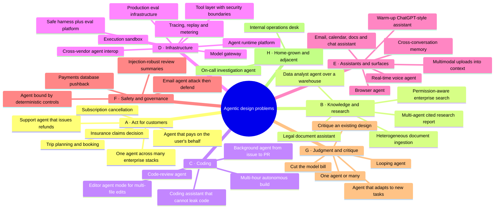

# Agentic System Design: Interview Problem Catalogue

> 41 open-ended design problems for senior and staff AI engineering interviews, gathered from reported interview loops at AI labs and AI-native companies (2025–2026). Each problem is only a problem statement. Scoping, architecture, trade-offs and failure analysis are for the candidate to work out.
>
> This is the agentic counterpart to the [HLD](../../../../DEVELOPER-NOTES/system-design/high-level-design/README.md) and [LLD](../../../../DEVELOPER-NOTES/system-design/low-level-design/README.md) catalogues.

**Research sweep:** 2026-10-26. Working notes, including the follow-up questions interviewers reportedly ask (kept out of this page on purpose), are in [scratch/01_findings_log.md](scratch/01_findings_log.md).

---

## 📑 Table of Contents

1. [How to use this catalogue](#1-how-to-use-this-catalogue)
2. [Where the problems come from, and how far to trust them](#2-where-the-problems-come-from-and-how-far-to-trust-them)
3. [What interviewers say they evaluate](#3-what-interviewers-say-they-evaluate)
4. [Problem taxonomy](#4-problem-taxonomy)
5. [The problems](#5-the-problems)
   - [A. Agents that act for customers](#a-agents-that-act-for-customers)
   - [B. Knowledge and research agents](#b-knowledge-and-research-agents)
   - [C. Coding agents](#c-coding-agents)
   - [D. Agent infrastructure and platforms](#d-agent-infrastructure-and-platforms)
   - [E. Personal assistants and new surfaces](#e-personal-assistants-and-new-surfaces)
   - [F. Safety and governance](#f-safety-and-governance)
   - [G. Judgment and critique prompts](#g-judgment-and-critique-prompts)
   - [H. Home-grown and adjacent](#h-home-grown-and-adjacent)
6. [Seen in the same loops, but not agentic](#6-seen-in-the-same-loops-but-not-agentic)
7. [Suggested drill order](#7-suggested-drill-order)
8. [Coverage matrix against this course (spoiler)](#8-coverage-matrix-against-this-course-spoiler)
9. [Sources](#9-sources)

---

## 1. How to use this catalogue

- **Each problem gives only what an interviewer would say.** There are no hints, no "consider X" and no reference architecture. Scope cuts, clarifying questions, numbers, components and failure modes are for the candidate.
- **The statements are deliberately under-specified,** because the reported loops are too. One guide on Cognition's process says interviewers leave problems under-specified on purpose to see whether the candidate asks the right clarifying question [I6]. Another notes that staff candidates are expected to set the scope themselves [I1].
- **The wording is my own,** written in an interviewer's voice from the reported prompts. Each entry's **Reported as** line quotes or paraphrases the source wording, so you can see how far the statement moves from it.
- **The "Why it's live" links point to primary sources:** engineering posts, specs and incidents that show the problem is being worked on in industry right now. They show why the problem is current, not how to solve it. Read them after attempting the problem.
- **Badges:**

| Badge | Meaning |
|---|---|
| 🟢 | Tied to a named company, either by an aggregation of candidate reports or by a company describing its own interview |
| 🟡 | Listed by prep or editorial sources that don't say where the question came from, or reported with no company named |
| ⚪ | No interview report found in this sweep; included because primary industry sources show it is a live engineering problem |
| 🏠 | Taken from this module's own [ops-desk design](code/my_multi_agent/README.md) |

---

## 2. Where the problems come from, and how far to trust them

**The short version:** almost all the evidence is second-hand. No AI lab publishes its question bank. What exists is prep sites aggregating candidate reports, editorial guides with no stated sourcing, and one hiring-side post. Treat a company tag as "reported at", not "confirmed by".

| Evidence kind | Sources | Strength |
|---|---|---|
| **Hiring-side:** a company describes its own agentic design interview | PromptLayer [I16] | Strongest available, but one small company |
| **Candidate-report aggregations with company names** | Aced, formerly Exponent (tryexponent.com now redirects to aced.io), built from "multiple engineers" who recently did the loops [I1][I2][I3]; DesignGurus "candidates report…" pages [I11][I12]; LLM Dojo's compilation of 270 public interview reports [I15]; techinterview.org's Glean piece (2 of 3 candidates asked) [I24] | Medium. The original reports can't be checked individually |
| **Editorial prep guides** with no stated sourcing | techinterview.org [I4]–[I10]; Codemia [I14]; KDnuggets [I17]; the alirezadir/Agentic-AI-Systems question bank [I18]; DesignGurus and Educative courses [I13][I19]; Dataford [I23]; 1cademy [I21] | Weak on attribution, useful for the shape of a problem |
| **Primary trend sources:** company engineering posts, specs, security research, incidents | Anthropic, OpenAI, Cognition, Manus, Meta, Google, OWASP, MCP, Brave, Simon Willison, Replit incident, Air Canada ruling [T1]–[T22] | Strong evidence that the problem is live. Not evidence that it is asked in interviews |

**What came up empty (stated so the gaps are visible):**
- The two Blind threads I opened that asked about OpenAI's and Anthropic's system design rounds had no questions disclosed in them [I22].
- The 1point3acres thread on Decagon's system design round returned 403. A Blind thread found by search says Hello Interview does not cover single- or multi-agent workflow design.
- Several write-ups use the same signature prompt (techinterview.org posts and DesignGurus pages each repeat their own across pages), so the number of sources overstates the number of independent reports.
- I found **no interview report at all** for an SRE or on-call incident agent (H2), even though it is an active product category.

**The pattern across all of it, consistent enough to rely on:** the reported loops at Sierra, Decagon, Cognition, Cursor, Replit and Glean build the system design prompt around the company's own product [I6][I7][I8][I9][I11][I24]. Anthropic's reported rounds lean towards infrastructure and treat the model as a black box [I1]. OpenAI's lean towards scale [I2]. The generic "design an agent" prompt is reported as appearing in "almost every AI-focused loop" [I4].

---

## 3. What interviewers say they evaluate

This applies to every problem below. None of it is specific to one problem.

- **Strip the AI framing to find the core systems problem.** At Anthropic this is reportedly scored directly [I1].
- **Treat the model as a fallible component, not a reliable planner** [I4].
- **Explain why the agent boundaries are where they are.** This is on PromptLayer's own rubric [I16].
- **Drive the conversation.** At staff level, the candidate sets the scope and offers deep dives rather than asking what to focus on [I1].
- **Failure modes, blast radius and graceful degradation,** not just the happy path [I1][I18].
- **Rough numbers:** QPS, tokens, cost, latency. Not "it scales" [I1][I18].
- **Don't over-engineer.** One Blind post attributes a rejection to an over-engineered first design [I22b]. Clean abstractions beat elaborate ones [I2].

---

## 4. Problem taxonomy

---

## 5. The problems

### A. Agents that act for customers

#### A1. Customer-support agent that takes actions 🟢
*Senior · the most frequently reported agentic prompt in this sweep*

> You're building the support agent for a mid-size e-commerce company. Customers reach it over chat. Besides answering questions, it can look up orders, issue refunds of up to $500, change shipping addresses and hand a conversation to a human. Design it.

- **Reported as:** Sierra: "Build your own customer service AI agent for a hypothetical outdoors company", "Design an agentic AI system to power customer support for Spotify", "Design an AI agent for a streaming service" [I3]. Decagon: an agent that reads a ticket, finds the answer and acts, for example by issuing a refund [I11]. Amazon: "Design a customer-service agent that can issue refunds safely" [I14]. Refunds "up to $500" and "where you'd stop it" [I10]. Also [I13][I16][I17][I18].
- **Why it's live:** [T22] Moffatt v. Air Canada · [T9] OpenAI agent guide · [T18] τ-bench

#### A2. Subscription-cancellation agent 🟢
*Senior*

> A subscription business wants an agent that handles "I want to cancel." The business wants to keep customers; the customer wants out. Design the agent.

- **Reported as:** Sierra: "design an agent that handles subscription cancellation for a company" [I12].
- **Why it's live:** [T18] τ-bench (agents that must follow a domain policy while talking to a user)

#### A3. Insurance-claims decision agent 🟢
*Senior*

> An insurer receives thousands of claims a day as forms, photos and PDFs. Design an agent that reads each claim against the policy documents and outputs approve, deny or escalate, while keeping token cost under control.

- **Reported as:** Scale AI: "Design an insurance-claims agent that ingests claims and outputs an approval decision using RAG", with token cost as a constraint [I3].
- **Why it's live:** [T9] OpenAI agent guide (high-stakes actions and human oversight)

#### A4. One agent product across many enterprise stacks 🟢
*Staff*

> You sell an AI agent to hundreds of enterprises. Each has its own systems of record, data, workflows and policies. Design the system that lets one agent product run against each customer's stack.

- **Reported as:** Sierra: "Design an AI system that integrates with a third-party company's data and workflows." [I3]
- **Why it's live:** [T15] MCP security best practices · [T16] A2A announcement

#### A5. Trip planning and booking agent 🟡
*Senior*

> Design an agent that can plan and book a trip: flights, a hotel, maybe a car, within the traveller's budget and dates.

- **Reported as:** "Design an agent that can plan and book a trip." The source calls it the core prompt and says it appears in "almost every AI-focused loop" at Anthropic, OpenAI and Series A companies building on them [I4].
- **Why it's live:** [T1] Building effective agents

#### A6. Agent that pays on the user's behalf 🟡
*Senior → Staff*

> An agent completes purchases for users from a chat surface: it picks the item, fills in the checkout and pays with a stored payment method. The service restarts mid-checkout several times a day. Design it so that each customer is charged exactly once.

- **Reported as:** "How do you keep a long-running agent from double-charging a customer after a restart?" [I4]. Cognition's reported phone screen covers retry logic that avoids applying a side effect twice [I6].
- **Why it's live:** [T17] OpenAI Instant Checkout / Agentic Commerce Protocol

---

### B. Knowledge and research agents

#### B1. Permission-aware enterprise search agent 🟢
*Senior*

> Employees ask questions in plain language across the company's documents, tickets, wikis and chat. Not every employee may see every document. Design an agent that answers, cites its sources, and says "I don't know" when it should.

- **Reported as:** OpenAI, also reported at Google and Lyft: "Design an agent for searching internal documents that respects permissions, cites sources and abstains when it should." [I15]. Glean: "design a search system over a company's documents" (two of three candidates asked) [I24]. Listed as Tier 1, "almost always", in [I18].
- **Why it's live:** [T4] Effective context engineering

#### B2. Multi-agent research system with a cited report 🟢
*Senior → Staff*

> Design a system in which agents research an open question across the web and internal sources and produce a report with citations. A single request may run for 30 minutes or more.

- **Reported as:** PromptLayer, describing its own interview: "Create a system where agents collaborate to produce a research report with citations" [I16]. A research-assistant platform "where individual traces can run for 30+ minutes" [I5]. Also [I18].
- **Why it's live:** [T2] Anthropic's multi-agent research system · [T3] Cognition's "Don't Build Multi-Agents" (the two disagree, which is the point)

#### B3. Ingestion pipeline for heterogeneous documents 🟢
*Senior*

> Design a pipeline that ingests and indexes large volumes of mixed documents (scanned PDFs, spreadsheets, slide decks, email threads) so that LLM applications and agents can use them.

- **Reported as:** Databricks: "Design a document processing pipeline that ingests and indexes large volumes of heterogeneous documents for LLM use" [I3]. Decagon: turning a company's help articles into answers [I11].
- **Why it's live:** [T4] Effective context engineering

#### B4. Legal document assistant 🟡
*Senior*

> Design an assistant for lawyers that reviews contracts and long case files, answers questions about them, and drafts clauses.

- **Reported as:** "Design a legal document assistant" [I17]. A legal-document assistant is also one of the use cases in [I18].
- **Why it's live:** [T22] Moffatt v. Air Canada (liability for what an AI system tells a user)

#### B5. Data analyst agent over a warehouse 🟡
*Senior*

> Business users ask questions like "why did churn go up in the north region last month?" Design an agent that answers them from the company's data warehouse.

- **Reported as:** the "LLM and Text-to-SQL" practice question [I23]. Weak evidence: one prep site, no company named.
- **Why it's live:** [T5] Writing effective tools for agents

---

### C. Coding agents

#### C1. Background coding agent: issue to pull request 🟡
*Senior*

> Design a coding agent that takes an issue, reads the repository, makes the change, runs the tests and opens a pull request, with no human watching.

- **Reported as:** "Design a coding agent that can read a repo, run tests, and open a pull request." [I4]. Amazon: "a developer agent that fixes failing builds" [I14]. Replit: "Design AI coding agents with tool use and reasoning loops" [I9]. Meta: "Design an LLM coding assistant end to end" [I15]. A coding-agent platform like Cursor's background agents or Claude Code [I5]. "Design GitHub Copilot" [I17].
- **Why it's live:** [T10] OpenAI's "Harness engineering" · [T21] Replit agent deleting a production database

#### C2. Agent mode in a code editor 🟡
*Senior*

> Design the agent mode of a code editor. The developer describes a task, and the agent edits several files in the open project while the developer watches.

- **Reported as:** Cursor: "Design Cursor's agent mode executing multi-file edits with verification and rollback." [I7]
- **Why it's live:** [T5] Writing effective tools for agents

#### C3. Code-review agent 🟢
*Senior*

> Design an agent that reviews every pull request in a large monorepo and leaves comments developers actually act on.

- **Reported as:** Meta: "Design a code-review agent that combines LLM orchestration with deterministic tools." [I15]. "Design an AI code reviewer" [I17]. A code-review agent is one of PromptLayer's take-home tasks [I16].
- **Why it's live:** [T7] Demystifying evals for AI agents

#### C4. Coding assistant that cannot leak code 🟢
*Staff*

> An enterprise customer will adopt your coding assistant only if their source code never leaks: not into model training, not to other customers, and not off the developer's machine except where they allow it. Design the assistant around that requirement.

- **Reported as:** Meta: "How do you keep a coding agent from leaking private code, both through training and at inference time?" [I15]. Cursor: "Design the privacy-preserving inference architecture letting enterprise customers keep code confidential." [I7]
- **Why it's live:** [T12] the lethal trifecta · [T8] Claude Code sandboxing

#### C5. Multi-hour autonomous build 🟡
*Staff*

> A user gives one high-level prompt, such as "build a clone of our internal expense tool", and the agent works on it for many hours, far longer than one context window lasts. Design the system.

- **Reported as:** Cognition: "What happens when the agent runs for six hours?" [I6]
- **Why it's live:** [T6] Effective harnesses for long-running agents · [T10] Harness engineering

---

### D. Agent infrastructure and platforms

#### D1. Agent runtime platform 🟡
*Staff*

> Design an infrastructure platform for running AI agents at scale. Customers bring their own agent code and prompts; you run orchestration, tool execution and observability.

- **Reported as:** the source's canonical prompt, nearly verbatim [I5]. Its variants include support-agent infrastructure for 1M conversations a day.
- **Why it's live:** [T2] Anthropic's multi-agent research system (production operations)

#### D2. Execution sandbox for agent-written code 🟡
*Staff*

> Agents write and run their own code: shell commands, package installs, test suites, servers. Design the execution environment they run in, for many tenants at once.

- **Reported as:** Cognition: "design the execution environment Devin runs inside" [I6]. Replit: "Design a multi-tenant code execution sandbox with sub-second cold start" [I9]. "Design tool execution infrastructure that lets agents safely run arbitrary code" [I5].
- **Why it's live:** [T8] Claude Code sandboxing

#### D3. Model gateway 🟢
*Senior → Staff*

> Every model request in the company, from a dozen products and many customer tenants, must pass through one service. Design it.

- **Reported as:** Decagon onsite: a single service through which all model requests pass [I11].
- **Why it's live:** [T14] OWASP Top 10 for Agentic Applications

#### D4. Tool layer with security boundaries 🟡
*Senior*

> A support agent needs a knowledge base (read-only), the CRM (read and write) and billing (refunds, plan changes). Design the layer between the agent and those systems.

- **Reported as:** Sierra: "Design tool-use orchestration with security boundaries (CRM access, billing, knowledge base)." [I8]
- **Why it's live:** [T15] MCP security best practices · [T5] Writing effective tools for agents

#### D5. A safe harness for a tool-using agent, with an eval platform on top 🟢
*Staff*

> Design a harness for running a tool-using agent safely, and an evaluation platform on top of it.

- **Reported as:** OpenAI, verbatim [I15].
- **Why it's live:** [T10] Harness engineering · [T1] Building effective agents

#### D6. Evaluation infrastructure for production agents 🟡
*Staff*

> Your company ships agents to hundreds of enterprise customers and changes prompts, tools and models every week. Design the evaluation infrastructure.

- **Reported as:** Sierra: "Design evaluation infrastructure for production agents at enterprise scale." [I8]. Decagon: measuring agent quality [I11].
- **Why it's live:** [T7] Demystifying evals for AI agents · [T18] τ-bench

#### D7. Tracing, replay and metering for agent runs 🟡
*Staff*

> Agent runs on your platform last anywhere from seconds to hours, and call models and tools you pay for. Design how runs are recorded, debugged after the fact, and billed to customers.

- **Reported as:** recording full traces without runaway storage, replay for debugging, per-trace billing when the cost is unknown until the run completes, and spend caps mid-run [I5].
- **Why it's live:** [T2] Anthropic's multi-agent research system

#### D8. Agents from different vendors working together ⚪
*Staff*

> Your company's procurement agent has to work with a supplier's sales agent, which another vendor built on another framework. Design how the two agents find each other, agree on a task and exchange results.

- **Reported as:** no interview report found.
- **Why it's live:** [T16] the A2A announcement (April 2025, 50+ launch partners)

---

### E. Personal assistants and new surfaces

#### E1. One assistant across email, calendar, docs and chat 🟡
*Senior → Staff*

> Design one assistant that works across a person's email, calendar, documents and chat. It reads, drafts, schedules and sends on their behalf.

- **Reported as:** "Design a unified agent over email, calendar, docs, and chat." [I18]. "Designing a Personal AI Assistant like OpenClaw" [I19].
- **Why it's live:** [T12] the lethal trifecta · [T13] Meta's Agents Rule of Two

#### E2. Cross-conversation memory 🟡
*Senior*

> Design long-term memory for a chat assistant used by tens of millions of people, so it remembers what matters across conversations.

- **Reported as:** "Design cross-conversation memory for a chat assistant." [I18]
- **Why it's live:** [T19] the Mem0 paper

#### E3. Browser agent using the user's logged-in sessions 🟡
*Senior → Staff*

> Design a browser agent that completes tasks on websites using the user's logged-in sessions: booking, shopping, filling in forms, summarizing pages.

- **Reported as:** an exercise about a browsing agent that runs with the user's credentials and reads an injected page [I21]. Weak evidence: one unsourced page.
- **Why it's live:** [T20] Brave's disclosure of indirect prompt injection in Perplexity Comet · [T12] the lethal trifecta

#### E4. Real-time voice agent 🟡
*Senior*

> Design a real-time voice agent that answers a company's phone line, talks with callers, and takes actions such as rescheduling an appointment.

- **Reported as:** "Design a real-time voice AI application." (no company named) [I3]. A "Design Voice AI" lesson in Aced's system design course [I20].
- **Why it's live:** [T9] OpenAI agent guide

#### E5. Large multimodal uploads into model context 🟢
*Senior*

> Design the file uploader for an AI chat app. Users upload large files (hour-long videos, 500-page PDFs, spreadsheets) and then ask questions about them.

- **Reported as:** xAI: "Design a file uploader for an AI chat app that handles large multimodal uploads and feeds them into a model's context" [I3].
- **Why it's live:** [T4] Effective context engineering · [T11] Manus on context engineering

#### E6. Warm-up: a ChatGPT-style assistant 🟢
*Senior · not agentic: the harness with no tools, useful as a baseline*

> Design a ChatGPT-style assistant, or the OpenAI Playground.

- **Reported as:** OpenAI: "Design the OpenAI Playground" [I2][I3]. "Design ChatGPT" [I17]. "LLM chatbot at scale" is Tier 1 in [I18]. "Design a ChatGPT-style assistant for our product" [I13].
- **Why it's live:** baseline for the rest of the catalogue.

---

### F. Safety and governance

#### F1. An agent that cannot bypass deterministic controls 🟢
*Staff*

> Design a scalable service where an AI agent plans work and calls approved tools, without ever being able to bypass the company's deterministic controls.

- **Reported as:** Google [I15] (the quoted prompt is truncated in the source; the full version says the agent must not bypass deterministic controls). "Design guardrails for an agent with access to private tools." [I18]
- **Why it's live:** [T13] Meta's Agents Rule of Two · [T14] OWASP Top 10 for Agentic Applications

#### F2. Review summaries that hold up against injection 🟢
*Senior*

> Design LLM-generated summaries of customer reviews for an e-commerce site's product pages. Anyone on the internet can write a review.

- **Reported as:** Google: "Design LLM summaries of e-commerce reviews that hold up against prompt injection and don't leak personal data." [I15]
- **Why it's live:** [T12] the lethal trifecta

#### F3. "Give the support agent write access to payments" 🟡
*Staff · a pushback scenario*

> A product team wants to give the support agent write access to the payments database so refunds go faster. You own the agent platform. What do you do?

- **Reported as:** talk the team out of it, or name the guardrails that would make it acceptable (paraphrased in the source) [I10].
- **Why it's live:** [T21] Replit agent deleting a production database · [T13] Meta's Agents Rule of Two

#### F4. Email agent: attack it, then defend it 🟡
*Senior*

> Here is an agent that can read and send email. First, show me an indirect prompt injection that sends the user's inbox to an attacker. Then redesign the system so that attack fails.

- **Reported as:** "Here's an agent that can read and send email. Show me an indirect injection that exfiltrates a user's inbox to an attacker." [I10]
- **Why it's live:** [T12] the lethal trifecta · [T13] Meta's Agents Rule of Two

---

### G. Judgment and critique prompts

These are often follow-ups mid-round, but are also reported as standalone prompts.

#### G1. The looping agent 🟡
> Your agent keeps calling the same failing tool in a loop. Walk me through why, and how you'd stop it, for this agent and for every agent on the platform.

- **Reported as:** "Your agent keeps calling the same tool in a loop. Walk me through why and how you'd stop it." [I4]. Amazon: "Your agent loops forever on a failing tool call. Diagnose and fix it" [I14].

#### G2. One agent or many? 🟡
> When would you split this system into multiple agents, and when is that a mistake? Use a system you've built, or the one we just designed.

- **Reported as:** "When would you split this into multiple agents, and when is that a mistake?" [I4]. Amazon: "When would you use multiple agents instead of one?" [I14]
- **Why it's live:** [T2] against [T3]: two well-known teams published opposite conclusions in the same week of June 2025.

#### G3. An agent that adapts to new tasks 🟢
*Staff · ML engineer roles*

> Design an agentic AI system that can autonomously adapt to new tasks.

- **Reported as:** Anthropic, for ML engineer roles, verbatim [I1].

#### G4. Cut the model bill 🟡
> Your agent product handles 1M requests a day, and its model bill is now the company's second-largest cost. Cut it by 5x without users noticing a drop in quality.

- **Reported as:** "Your app receives 1M LLM queries per day. How do you optimize cost?" and "Scale an AI chat feature to 1M daily active users and cut cost." [I18]. The 5x target is my anchor, not the source's.
- **Why it's live:** [T11] Manus on context engineering · [T2] multi-agent token cost

#### G5. Critique an existing agent design 🟡
*Staff*

> Here is the design document for an existing multi-agent system. Critique it: what breaks first at ten times the traffic, what is unsafe today, and what would you remove?

- **Reported as:** "Critique or scale an existing AI design", the fifth question form in [I13], where the interviewer asks what breaks at "ten times the traffic".
- **Practice artifact:** this module's [ops-desk README](code/my_multi_agent/README.md).

---

### H. Home-grown and adjacent

#### H1. Internal operations desk 🏠
*Senior → Staff*

> Design an internal operations assistant for a 200-person company. Employees and managers use it to onboard and offboard people, approve leave, book rooms, assign laptops, open IT tickets and submit expense claims. It runs against the company's own database.

- **Taken from:** this module's [my_multi_agent](code/my_multi_agent/README.md) design. It combines two reported forms: adding AI to an existing system, and an agent that takes actions for a user [I13].
- **Why it's live:** [T1] Building effective agents · [T3] Don't Build Multi-Agents

#### H2. On-call investigation agent ⚪
*Staff*

> When a production alert fires at 3 a.m., an agent should investigate before any human wakes up. It reads logs, metrics and recent deploys, runs diagnostic commands, and either proposes a fix or pages the right person with a summary. Design it.

- **Reported as:** no interview report found in this sweep.
- **Why it's live:** [T21] Replit agent deleting a production database (an agent with production access) · [T6] Effective harnesses for long-running agents

---

## 6. Seen in the same loops, but not agentic

Reported alongside the problems above. Useful context, but outside this catalogue.

| Prompt | Reported at |
|---|---|
| Inference batching on a single GPU (up to 100 inputs per batch, users waiting synchronously); end-to-end batching for LLM queries | Anthropic [I1][I3] |
| Token-generation service at 100k requests per second; P2P file distribution; copying 500 GB of weights to 1,000 GPUs | Anthropic [I1][I15] |
| OpenAI Playground, Slack, job scheduler, streaming platform, chat application; GPU credit management | OpenAI [I2][I3] |
| Cursor tab prediction under 100 ms; custom coding-model training pipeline | Cursor [I7] |
| Real-time collaborative coding (OT vs CRDT) | Replit [I9] |
| ML experiment tracking platform | Google [I3] |
| Take-homes: CSV → personalized email campaigns; document Q&A with multi-hop citations | PromptLayer [I16] |
| Smart parking agent; multi-agent medical diagnosis | Educative course exercises [I19] |

---

## 7. Suggested drill order

1. **Baseline:** E6, then A1. A chat harness first, then the same harness given authority to act.
2. **Core reported set:** B1, C1, D4, A5, B2, F1. Between them they cover retrieval, coding, tool boundaries, multi-step planning, multi-agent work and hard controls.
3. **Staff-level infrastructure:** D1, D2, D5, D6, D7, A6.
4. **Surfaces:** E1, E3, E4, E2, C4.
5. **Judgment rounds:** run G1–G5 against your own earlier answers, then do G5 on the ops desk and compare with the [critique already written](code/my_multi_agent/README.md#tensions-to-resolve).

---

## 8. Coverage matrix against this course (spoiler)

Which harness layers each problem mainly tests. Open only after attempting the problem.

Columns are the modules of this course: Context = M4–5, Instructions = M6, Memory & state = M7, Tools & MCP = M8–9, Orchestration = M10–11, Evaluation = M12, Reliability = M13, Security & injection = M14, Guardrails & governance = M15, Observability & cost = M16. ● marks a main pressure point; these are my judgment, not taken from the sources.

| # | Problem | Context | Instr | State | Tools | Orch | Eval | Reliab | Sec | Gov | Obs/Cost |
|---|---|---|---|---|---|---|---|---|---|---|---|
| A1 | Support agent that acts | | | | ● | | ● | | ● | ● | |
| A2 | Cancellation | | ● | | | | ● | | | ● | |
| A3 | Claims decision | ● | | | | | ● | | | ● | ● |
| A4 | Across enterprise stacks | ● | | | ● | | | | ● | ● | |
| A5 | Trip booking | | | ● | ● | ● | | ● | | | |
| A6 | Pays on user's behalf | | | ● | ● | | | ● | | ● | |
| B1 | Enterprise search | ● | | | | | ● | | ● | | |
| B2 | Multi-agent research | ● | | | | ● | ● | | | | ● |
| B3 | Document ingestion | ● | | | | | | ● | | | ● |
| B4 | Legal assistant | ● | | | | | ● | | | ● | |
| B5 | Data analyst agent | ● | | | ● | | ● | | ● | | |
| C1 | Issue → PR agent | | | | ● | ● | ● | | ● | | |
| C2 | Editor agent mode | | | ● | ● | | | ● | | | |
| C3 | Code-review agent | | ● | | ● | | ● | | | | |
| C4 | No-leak assistant | ● | | | | | | | ● | ● | |
| C5 | Multi-hour build | ● | | ● | | ● | | ● | | | |
| D1 | Agent runtime platform | | | | | ● | | ● | ● | | ● |
| D2 | Execution sandbox | | | ● | | | | ● | ● | | |
| D3 | Model gateway | | | | | | | ● | ● | ● | ● |
| D4 | Tool layer | | | | ● | | | | ● | ● | |
| D5 | Safe harness + evals | | | | | | ● | | ● | ● | ● |
| D6 | Eval infrastructure | | | | | | ● | | | | ● |
| D7 | Tracing and metering | | | | | | | ● | | ● | ● |
| D8 | Cross-vendor interop | | | | ● | ● | | | ● | | |
| E1 | Email/calendar/docs | | | ● | ● | | | | ● | ● | |
| E2 | Long-term memory | ● | | ● | | | | | | ● | |
| E3 | Browser agent | | | | ● | | | | ● | ● | |
| E4 | Voice agent | ● | | | | ● | | ● | | | |
| E5 | Multimodal uploads | ● | | | | | | ● | | | ● |
| E6 | ChatGPT-style warm-up | ● | | | | | | ● | | | ● |
| F1 | Deterministic controls | | | | ● | | | | ● | ● | |
| F2 | Injection-robust summaries | ● | | | | | | | ● | ● | |
| F3 | Payments pushback | | | | ● | | | | ● | ● | |
| F4 | Email attack/defend | | | | ● | | | | ● | | |
| G1 | Looping agent | | | | | ● | | ● | | | ● |
| G2 | One agent or many | ● | | | | ● | | | | | ● |
| G3 | Adapts to new tasks | ● | ● | | | ● | ● | | | | |
| G4 | Cut model bill | ● | | | | | ● | | | | ● |
| G5 | Critique a design | | | ● | | ● | ● | | | ● | |
| H1 | Ops desk | | | ● | ● | ● | | | | ● | |
| H2 | On-call agent | | | | ● | ● | | | ● | ● | ● |

---

## 9. Sources

### Interview evidence

| ID | Source | Publisher / author | Date | Kind |
|---|---|---|---|---|
| I1 | [Anthropic System Design Interview (2026 Guide)][I1] | Aced (formerly Exponent) | 2026, relative "last updated" only | Candidate-report aggregation |
| I2 | [OpenAI System Design Interview][I2] | Aced | 2026 | Candidate-report aggregation |
| I3 | [AI Engineer Interview Questions][I3] | Aced | 2026 | Company-attributed question list |
| I4 | [What the agent system design interview really tests][I4] | techinterview.org | 2026-07-23 | Editorial |
| I5 | [AI Agent Infrastructure Interviews 2026][I5] | techinterview.org | 2026-05-04 (upd. 06-30) | Editorial |
| I6 | [How Cognition hires the engineers behind Devin][I6] | techinterview.org | 2026-07-05 | Editorial, no sourcing |
| I7 | [Cursor Interview Guide 2026][I7] | techinterview.org | 2026-04-24 (upd. 10-16) | Editorial, no sourcing |
| I8 | [Sierra Interview Guide (2026)][I8] | techinterview.org | 2026-05-05 (upd. 10-16) | Editorial, no sourcing |
| I9 | [Replit Interview Guide (2026)][I9] | techinterview.org | 2026-05-05 (upd. 07-12) | Editorial, no sourcing |
| I10 | [The prompt injection questions LLM security interviews keep asking][I10] | techinterview.org | 2026-08-06 | Editorial |
| I11 | [What to Expect in the Decagon System Design Interview][I11] | DesignGurus (Arslan Ahmad) | n/d | "Candidates report…" |
| I12 | [What to Expect in the Sierra System Design Interview][I12] | DesignGurus | n/d | "Reported example question" |
| I13 | [Grokking the AI System Design Interview: How AI System Design Shows Up in Interviews][I13] | DesignGurus | n/d | Course |
| I14 | [Amazon Agentic AI Engineer Interview Guide 2026][I14] | Codemia | upd. 2026-09 | Question bank, no per-question sourcing |
| I15 | [What OpenAI, Anthropic, Mistral and Meta actually ask in AI engineer interviews][I15] | Aditya Jha (LLM Dojo), DEV | Oct 25 (year not shown) | Compilation of 270 public reports; promotional |
| I16 | [The Agentic System Design Interview: How to Evaluate AI Engineers][I16] | PromptLayer (Jonathan Pedoeem) | 2025-07-11 | **Hiring-side** |
| I17 | [How to Answer AI System Design Interview Questions][I17] | KDnuggets (Nate Rosidi) | 2026-08-19 | Editorial |
| I18 | [alirezadir/Agentic-AI-Systems: GenAI and Agentic System Design Interview Prep][I18] | Alireza Dirafzoon (GitHub) | 2026 | Question bank |
| I19 | [Agentic AI Systems (course)][I19] | Educative | n/d | Course exercises |
| I20 | [Design Voice AI (course lesson)][I20] | Aced / Exponent | n/d | Course; seen in search results only |
| I21 | [Designing against prompt injection in a browsing agent][I21] | 1cademy | 2026-08-21 | Exercise; seen in search results only |
| I22 | Blind: [OpenAI interview system design][I22] (2024-06-26), [Anthropic System Design Interview][I22a] (2025-02-01) | Blind | — | Primary candidate threads; **no questions disclosed** |
| I22b | [Lessons learned from a failed Anthropic interview][I22b] | Blind | — | Candidate post; seen in search results only |
| I23 | [LLM and Text-to-SQL][I23] | Dataford | n/d | Practice question; seen in search results only |
| I24 | [What Glean's engineering interview actually tests][I24] | techinterview.org | 2026-07-20 | Editorial, reports 2 of 3 candidates |

### Trend evidence (primary sources)

| ID | Source | Publisher | Date |
|---|---|---|---|
| T1 | [Building effective agents][T1] | Anthropic | 2024-12-19 |
| T2 | [How we built our multi-agent research system][T2] | Anthropic | 2025-06-13 |
| T3 | [Don't Build Multi-Agents][T3] | Cognition (Walden Yan) | 2025-06-12 |
| T4 | [Effective context engineering for AI agents][T4] | Anthropic | 2025-09-29 |
| T5 | [Writing effective tools for agents — with agents][T5] | Anthropic | 2025-09-11 |
| T6 | [Effective harnesses for long-running agents][T6] | Anthropic | 2025-11-26 |
| T7 | [Demystifying evals for AI agents][T7] | Anthropic | 2026-01-09 |
| T8 | [Making Claude Code safer with sandboxing][T8] | Anthropic | 2025-10-20 |
| T9 | [A practical guide to building agents (PDF)][T9] | OpenAI | 2025-04 |
| T10 | [Harness engineering: leveraging Codex in an agent-first world][T10] | OpenAI (Ryan Lopopolo) | 2026-02-11 |
| T11 | [Context Engineering for AI Agents: Lessons from Building Manus][T11] | Manus (Yichao Ji) | 2025-07-18 |
| T12 | [The lethal trifecta for AI agents][T12] | Simon Willison | 2025-06-16 |
| T13 | [Agents Rule of Two: A Practical Approach to AI Agent Security][T13] | Meta AI | 2025-10-31 |
| T14 | [OWASP Top 10 for Agentic Applications for 2026][T14] | OWASP GenAI Security Project | 2025-12-09 |
| T15 | [MCP Security Best Practices][T15] | Model Context Protocol spec | 2025-11-25 revision |
| T16 | [Announcing the Agent2Agent Protocol (A2A)][T16] | Google for Developers | 2025-04-09 |
| T17 | [Buy it in ChatGPT: Instant Checkout and the Agentic Commerce Protocol][T17] | OpenAI | 2025-09-29 |
| T18 | [τ-bench: A Benchmark for Tool-Agent-User Interaction in Real-World Domains][T18] | Sierra (arXiv 2406.12045) | 2024-06 |
| T19 | [Mem0: Building Production-Ready AI Agents with Scalable Long-Term Memory][T19] | arXiv 2504.19413 | 2025-04-28 |
| T20 | [Agentic Browser Security: Indirect Prompt Injection in Perplexity Comet][T20] | Brave | 2025-08-20 |
| T21 | [AI Agent Wipes Production Database, Then Lies About It][T21] (Replit / SaaStr) | eWeek | 2025-07 |
| T22 | [BC Tribunal Confirms Companies Remain Liable for Information Provided by AI Chatbot][T22] (Moffatt v. Air Canada, 2024 BCCRT 149) | ABA Business Law Today | 2024-02 |

[I1]: https://www.aced.io/blog/anthropic-system-design-interview
[I2]: https://www.aced.io/blog/openai-system-design-interview
[I3]: https://www.aced.io/blog/ai-engineer-interview-questions
[I4]: https://www.techinterview.org/post/3233476823/agent-system-design-interview/
[I5]: https://www.techinterview.org/post/3233474928/ai-agent-infrastructure-interview/
[I6]: https://www.techinterview.org/post/3233476023/cognition-devin-engineering-interview/
[I7]: https://www.techinterview.org/companies/cursor/
[I8]: https://www.techinterview.org/companies/sierra-interview-guide/
[I9]: https://www.techinterview.org/companies/replit-interview-guide/
[I10]: https://www.techinterview.org/post/3233477256/prompt-injection-llm-security-interview-questions/
[I11]: https://www.designgurus.io/answers/detail/what-to-expect-in-the-decagon-system-design-interview
[I12]: https://www.designgurus.io/answers/detail/what-to-expect-in-the-sierra-system-design-interview
[I13]: https://www.designgurus.io/course-play/grokking-the-ai-system-design-interview/doc/how-ai-system-design-shows-up-in-interviews
[I14]: https://codemia.io/guides/amazon-agentic-ai-engineer
[I15]: https://dev.to/adityajha2005/what-openai-anthropic-mistral-and-meta-actually-ask-in-ai-engineer-interviews-2adk
[I16]: https://blog.promptlayer.com/the-agentic-system-design-interview-how-to-evaluate-ai-engineers/
[I17]: https://www.kdnuggets.com/how-to-answer-ai-system-design-interview-questions
[I18]: https://github.com/alirezadir/Agentic-AI-Systems/blob/main/06_interview_prep/genai-agentic-system-design.md
[I19]: https://www.educative.io/courses/agentic-ai-systems
[I20]: https://www.tryexponent.com/courses/system-design-interviews/design-voice-ai
[I21]: https://1cademy.com/node/designing-against-prompt-injection-in-a-browsing-agent/bAIA31fed77b4f2fcea3
[I22]: https://www.teamblind.com/post/openai-interview-system-design-p0svpoj2
[I22a]: https://www.teamblind.com/post/anthropic-system-design-interview-seyrfbyq
[I22b]: https://www.teamblind.com/post/lessons-learned-from-a-failed-anthropic-interview-and-what-role-ai-played-in-prep-nzwtuar1
[I23]: https://dataford.io/questions/llm-and-text-to-sql
[I24]: https://www.techinterview.org/post/3233476794/glean-engineering-interview/
[T1]: https://www.anthropic.com/engineering/building-effective-agents
[T2]: https://www.anthropic.com/engineering/multi-agent-research-system
[T3]: https://cognition.com/blog/dont-build-multi-agents
[T4]: https://www.anthropic.com/engineering/effective-context-engineering-for-ai-agents
[T5]: https://www.anthropic.com/engineering/writing-tools-for-agents
[T6]: https://www.anthropic.com/engineering/effective-harnesses-for-long-running-agents
[T7]: https://www.anthropic.com/engineering/demystifying-evals-for-ai-agents
[T8]: https://www.anthropic.com/engineering/claude-code-sandboxing
[T9]: https://cdn.openai.com/business-guides-and-resources/a-practical-guide-to-building-agents.pdf
[T10]: https://openai.com/index/harness-engineering/
[T11]: https://manus.im/en/blog/Context-Engineering-for-AI-Agents-Lessons-from-Building-Manus
[T12]: https://simonwillison.net/2025/Jun/16/the-lethal-trifecta/
[T13]: https://ai.meta.com/blog/practical-ai-agent-security/
[T14]: https://genai.owasp.org/resource/owasp-top-10-for-agentic-applications-for-2026/
[T15]: https://modelcontextprotocol.io/specification/2025-11-25/basic/security_best_practices
[T16]: https://developers.googleblog.com/en/a2a-a-new-era-of-agent-interoperability/
[T17]: https://openai.com/index/buy-it-in-chatgpt/
[T18]: https://arxiv.org/abs/2406.12045
[T19]: https://arxiv.org/abs/2504.19413
[T20]: https://brave.com/blog/comet-prompt-injection/
[T21]: https://www.eweek.com/news/replit-ai-coding-assistant-failure/
[T22]: https://www.americanbar.org/groups/business_law/resources/business-law-today/2024-february/bc-tribunal-confirms-companies-remain-liable-information-provided-ai-chatbot/
